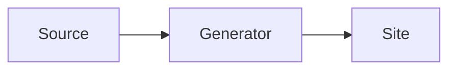

# Writing for the site

The site at <https://finos.github.io/morphir-moonbit/> is built from this repository on every push to `main`.

## Where content goes

| Content | Location |
|---|---|
| Documentation, designs, specifications, decision records | `docs/` (`docs/design/`, `docs/specs/`, `docs/adr/`) |
| Blog posts | `site/blog/YYYY-MM-DD-slug.md` or `.html` |
| Landing page | `site/pages/index.html` |
| Package pages | the package `README.md`, listed in `site/site.json` |

A blog file name starts with a real date. The slug after it uses only `a`-`z`, `0`-`9` and single `-` characters,
for example `2026-10-13-first-release.md`. The slug is the post's URL: `/blog/first-release/`.

Agent specs, plans and ledgers live in beads. Never put them in `docs/`: the build rejects `docs/superpowers/`.

## Front matter

Front matter is optional in docs and required in blog posts.

```markdown
---
title: A clear title
date: 2026-10-13
authors: [Your Name]
summary: One sentence for the feed and search.
---
```

In an HTML file, put the same block in a comment: `<!-- ---` on the first line and `--- -->` after the last key.

| Key | Docs | Blog |
|---|---|---|
| `title` | optional; the first `#` heading is used | required |
| `date` | not used | required; must match the file name |
| `authors` | not used | required |
| `summary` | optional | optional |
| `order` | optional; sidebar position, lower first | not used |
| `draft` | `true` skips the page locally and fails CI | same |

A blog post does not repeat its title as a `#` heading: the site prints the title.

## Sidebar

The `nav` key in `site/site.json` puts the top-level docs entries into labelled groups:

```json
"nav": [
  { "group": "Get started", "items": ["QUICK_START.md", "ARCHITECTURE.md"] },
  { "group": "Packages", "items": ["packages/"] }
]
```

- An item is a page directly in `docs/` (`NAME.md` or `NAME.html`) or a directory (`NAME/`). `packages/` holds the
  package pages.
- An item can be a glob: `*` matches any characters and `?` matches one character, but neither matches `/`. For
  example, `*.md` matches every top-level page and `*/` every directory.
- Exact items take their entry first. Then globs take the entries that are left, in `nav` order. Thus a catch-all
  group such as `{ "group": "More", "items": ["*.md"] }` gets only the pages that no other item lists.
- A directory with a `README.md` shows as a link with its pages below it. A directory without one puts its pages
  directly in the group.
- **When you add a top-level page or directory, add it to `nav`.** The build fails for an entry that no item
  matches, and for an exact item that matches no page. Pages inside a listed directory need no change.

Inside a directory, and on a site without `nav`, the sidebar sorts entries by `order`, then by title. A directory
gets its position from the `order` in its `README.md`. An entry without `order` comes after all entries that have
one. Leave gaps between the values, so that you can put a new page between two entries.

On a wide screen, a docs page with two or more `##` or `###` headings also gets an "On this page" list of them.

## Links

Link to other Markdown files with relative paths, as on GitHub: `[Architecture](ARCHITECTURE.md#overview)`. The build
turns them into site links, and turns links to other repository files into GitHub links. A broken link or a missing
heading anchor fails the build. In HTML pages, `/docs/` and other paths that start with `/` are site routes.

Put images next to the page that uses them and link them relatively, as in ``. The build copies
linked images to the site.

## Diagrams and code

A ` ```mermaid ` block becomes an SVG diagram. A fenced block with a language (`moonbit`, `elm`, `scheme`, `json`,
`shell`, `toml`, `yaml`) is highlighted. This block:



renders as a diagram on the site.

## Preview

    mise run setup:site
    mise run dev:site
