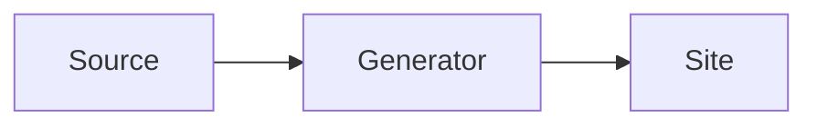

# Writing for the site

The site at <https://finos.github.io/morphir-moonbit/> is built from this repository on every push to `main`.

## Where content goes

| Content | Location |
|---|---|
| Documentation, designs, specifications, decision records | `docs/` (`docs/design/`, `docs/specs/`, `docs/adr/`) |
| Blog posts | `site/blog/YYYY-MM-DD-slug.md` or `.html` |
| Landing page | `site/pages/index.html` |
| Package pages | the package `README.md` or `README.mbt.md`, listed in `site/site.json`; each sub-package README is a page below it |

A blog file name starts with a real date. The slug after it uses only `a`-`z`, `0`-`9` and single `-` characters,
for example `2026-10-13-first-release.md`. The slug is the post's URL: `/blog/first-release/`.

Agent specs, plans and ledgers live in beads. Never put them in `docs/`: the build rejects `docs/superpowers/`.

## Front matter

Front matter is optional in docs and required in blog posts.

```markdown
---
title: A clear title
date: 2026-10-13
authors: [Your Name]
summary: One sentence for the feed and search.
---
```

In an HTML file, put the same block in a comment: `<!-- ---` on the first line and `--- -->` after the last key.

| Key | Docs | Blog |
|---|---|---|
| `title` | optional; the first `#` heading is used | required |
| `date` | not used | required; must match the file name |
| `authors` | not used | required |
| `summary` | optional | optional |
| `order` | optional; sidebar position, lower first | not used |
| `draft` | `true` skips the page locally and fails CI | same |

A blog post does not repeat its title as a `#` heading: the site prints the title.

## Sidebar

The `nav` key in `site/site.json` puts the top-level docs entries into labelled groups:

```json
"nav": [
  { "group": "Get started", "items": ["QUICK_START.md", "ARCHITECTURE.md"] },
  { "group": "Packages", "items": ["packages/"] }
]
```

- An item is a page directly in `docs/` (`NAME.md` or `NAME.html`) or a directory (`NAME/`). `packages/` holds the
  package pages.
- An item can be a glob: `*` matches any characters and `?` matches one character, but neither matches `/`. For
  example, `*.md` matches every top-level page and `*/` every directory.
- Exact items take their entry first. Then globs take the entries that are left, in `nav` order. Thus a catch-all
  group such as `{ "group": "More", "items": ["*.md"] }` gets only the pages that no other item lists.
- A directory with a `README.md` shows as a link with its pages below it. A directory without one puts its pages
  directly in the group.
- **When you add a top-level page or directory, add it to `nav`.** The build fails for an entry that no item
  matches, and for an exact item that matches no page. Pages inside a listed directory need no change.

Inside a directory, and on a site without `nav`, the sidebar sorts entries by `order`, then by title. A directory
gets its position from the `order` in its `README.md`. An entry without `order` sorts as order 1000, so it comes
after the entries with a lower `order`. Leave gaps between the values, so that you can put a new page between two
entries.

On a wide screen, a docs page with two or more `##` or `###` headings also gets an "On this page" list of them.

## Links

Link to other Markdown files with relative paths, as on GitHub: `[Architecture](ARCHITECTURE.md#overview)`. The build
turns them into site links, and turns links to other repository files into GitHub links. A broken link or a missing
heading anchor fails the build. In HTML pages, `/docs/` and other paths that start with `/` are site routes.

Put images next to the page that uses them and link them relatively, as in ``. The build copies
linked images to the site.

## Diagrams and code

A ` ```mermaid ` block becomes an SVG diagram. A fenced block with a language (`moonbit`, `elm`, `scheme`, `json`,
`shell`, `toml`, `yaml`) is highlighted. This block:



renders as a diagram on the site.

## Package chapters

A package listed in `site/site.json` can be written as chapters. The package README is the first page. Each
README below the package directory is a page below it: the README in `pkgs/<name>/<sub-path>/` becomes the page
`/docs/packages/<name>/<sub-path>/`. For example, `pkgs/morphir-scheme/frontend/README.mbt.md` becomes the page
`/docs/packages/morphir-scheme/frontend/`.

- A directory holds one README: either `README.md` or `README.mbt.md`. The build fails with "`<dir>` has both
  README.md and README.mbt.md" when it finds both.
- The build skips READMEs in directories named `fixtures`, `_build`, `.mooncakes`, `node_modules` and `target`.
- `chapters` in `site/site.json` orders a package's chapters in the sidebar. It maps a package name to its
  sub-package paths in order, for example `"chapters": { "morphir-scheme": ["frontend", "backend", "pipeline",
  "spec"] }`. A listed chapter takes its position as its order: 1, 2 and so on. A chapter that is not listed takes
  the `order` in its front matter, or 1000 without one. Chapters with the same order sort by title.
- The build fails for a listed path without a README, and for a package in `chapters` that is not in `packages`.
- Do not put front matter in a package README. Mooncakes and GitHub show the README as it is, so front matter shows
  as text. Without `order`, a package page sorts as order 1000 among the other packages, then by title.

### Checked Scheme examples

Every `README.mbt.md` under `pkgs/morphir-scheme` is a chapter, and the test suite runs its Scheme examples. Every
` ```scheme ` fence in a chapter is an example. The chapter's package needs a `docs_run_test.mbt` that defines
`run_example`, which runs a block the way the chapter describes. `mise run scheme-docs:generate` and
`scheme-docs:check` fail, naming the chapter, when it is missing.

| Annotation | Meaning |
|---|---|
| none | The block must run without an error. |
| `;; => text` | The last non-empty line of the block, starting with exactly `;; => `. The printed result must be `text`. |
| `;; error: text` | The last non-empty line of the block, starting with exactly `;; error: `. The block must fail with an error message that starts with `text`. |
| `;; file: path` | The first line of the block. The block is a file at `path` in an in-memory project. Consecutive `file:` blocks form one project, and only the last block may state an expectation. |
| `scheme notest` | The fence is written ` ```scheme notest `. The block is shown but not run. Use it rarely, and name the bead that explains why. |

Only the Writing models chapter checks `;; file:` projects. Its harness compiles every file as the module its path
names, loads them into one runtime in order, and runs the last file's `main`, so a file can call an earlier file's
definitions by their qualified names. The harnesses of the other chapters refuse a `;; file:` project.

The extractor refuses a block that could escape testing, and names its line:

- an indented or tab-indented `scheme` fence, a case variant such as `Scheme`, and any word after `scheme` other
  than `notest`;
- a `scheme` fence of tildes, such as `~~~scheme`, or of more than three backticks, such as ` ````scheme `;
- a last non-empty line that starts with `;` and contains `=>` or `error:` but does not start with exactly `;; => `
  or `;; error: `, such as `;=> 3`, `; => 3` or `;; =>3`.

Fences follow CommonMark. A block closes at a fence of the same character, with at least as many markers and no
other text, indented by up to three spaces. A ` ```scheme ` example quoted inside a longer fence, such as
` ````markdown `, or inside a tilde fence is literal text and is not run. The extractor reads CRLF and LF alike.

Run `mise run scheme-docs:generate` after you change a chapter. It writes `docs_examples_test.mbt` next to the
chapter, and `docs_procedures_generated_wbtest.mbt` next to any chapter with a `## Built-in procedures` table. It
removes a generated file that no chapter writes any more. Do not edit these files. CI runs
`mise run scheme-docs:check`, which fails when a generated file differs from its chapter or no chapter writes it.

## Preview

    mise run setup:site
    mise run dev:site
