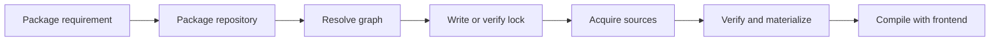
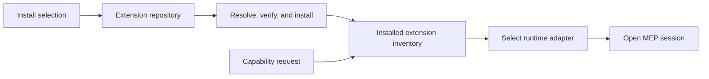
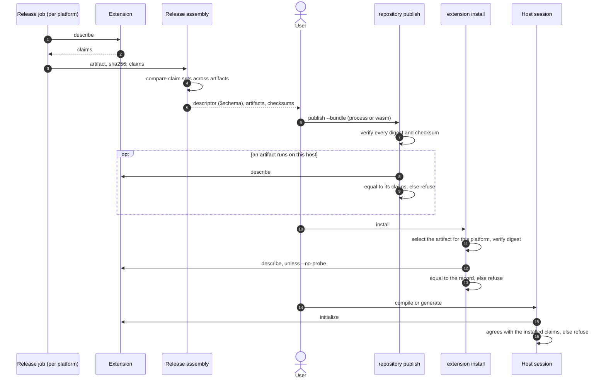

# Extension distribution and package acquisition

Morphir needs two related distribution systems. Morphir packages distribute reusable logic and types for frontends to compile. Extension distributions deliver capability providers that a Morphir host can load, start, or contact. They should share identity, resolution, integrity, acquisition, caching, and locking machinery without sharing one manifest or lifecycle.

The [Morphir Extension Protocol](./protocol.md) begins after the host has selected an installed extension. This design covers the work that happens before that point and the local state that remains afterward.

The accepted [WASM runtime and Avro backend proposal](../../proposals/wasm-extension-runtime-and-avro-backend.md)
specializes this draft for portable WASM extensions. That feature is not
released. The accepted proposal controls if the two documents differ.

## Boundaries

| Concern | Morphir package | Extension distribution |
|---|---|---|
| Purpose | Supply reusable model logic and types | Supply frontend, backend, validator, or transform capabilities |
| Primary content | Source modules and native project metadata | WASM module, executable, JVM artifact, or daemon connection metadata |
| Materialized result | Verified source tree | Verified runnable artifact or connection description |
| Consumer | Frontend and build pipeline | Extension host |
| Runtime lifecycle | Compiled as build input | Initialized, called, cancelled, and stopped through MEP |
| Platform selection | Usually none for source packages | Often required for native and JVM artifacts |

An extension may consume Morphir packages while compiling a project. That dependency does not turn the package into an extension or make the extension host responsible for package semantics.

## Direction from Morphir Scala and MoonBit

The morphir-scala knowledge base contains two inputs to this design:

- [Package URL-centered package management](https://github.com/finos/morphir-scala/blob/2f697f4e4155926eb3107c8f83b009fe2d0b3f40/kb/bundles/morphir/morphir-scala/design/package-url-package-management.md) proposes Package URL as the canonical package identity, Package VERS for ranges, typed source descriptors, immutable resolution, content digests, and locks that retain the complete graph and provenance.
- [MoonBit registry, resolution, and source materialization](https://github.com/finos/morphir-scala/blob/2f697f4e4155926eb3107c8f83b009fe2d0b3f40/kb/bundles/morphir/morphir-scala/design/moonbit-package-management.md) documents a Git-distributed registry index with one line-delimited history per package, a small resolver-facing record, separate archive storage, checksum verification, staged extraction, and immutable materialized trees.

MoonBit provides architectural evidence, not a format to copy. Its implementation is AGPL-3.0, its version-selection rules belong to its ecosystem, and its observed registry has case-colliding paths that fail on common case-insensitive filesystems. Morphir must define its own schema, namespace rules, and resolution policy.

The useful lessons are:

1. Keep logical identity independent from content location.
2. Keep the resolver record small while allowing publication metadata to grow.
3. Resolve the complete graph before acquiring content.
4. Verify cached and downloaded bytes before materialization.
5. Validate the materialized manifest against the selected identity.
6. Pin the repository-metadata revision as well as package versions and digests.
7. Treat local workspace replacements as policy over a stable identity, not as publishable dependencies.

## Shared distribution kernel

A common distribution kernel should provide pure value types and effects for:

- canonical identity and version requirements;
- version discovery and dependency metadata;
- exact resolution and lock generation;
- typed source descriptors and provenance;
- content and normalized-tree digests;
- authenticated acquisition;
- staged verification and materialization;
- content-addressed storage under `MorphirHome`;
- offline and mirror-aware lookup.

Interpreters provide network, Git, filesystem, credential, archive, and cache behavior. Buildkit, frontends, and the extension host consume resolved or materialized values and do not depend on repository endpoints, cache layouts, or credentials.

Package and extension policy remains above this shared kernel:

- the Morphir package resolver understands package dependencies, source roots, module enumeration, and source-package locks;
- the extension resolver understands capabilities, MEP versions, permissions, runtime kinds, operating systems, architectures, launch arguments, and daemon endpoints;
- each family validates its own manifest after materialization.

## Repository architecture

The first distributed repository backend should be service-free and mirrorable. A Git-backed repository is a good launch option when paired with a local-directory backend for development, tests, and air-gapped use.

Repository metadata should partition histories by a canonical, filesystem-portable encoding of package identity. Each version record should contain only what resolution needs:

- exact identity and version;
- dependency requirements when the package family supports dependencies;
- source descriptor or an input from which the source can be derived;
- content digest and digest algorithm;
- manifest kind and schema version;
- optional yanked or revoked status.

Presentation fields such as descriptions, licenses, documentation, maintainers, and search keywords may extend the record without becoming inputs to dependency resolution.

The client pins the Git commit or metadata revision used for resolution. A future registry may expose the same logical operations over HTTP, but reproducibility must not depend on a mutable `latest` response. Multiple endpoints may provide the same repository identity and digest.

### Repository and catalog topology

Morphir packages and extension distributions use separate logical repositories. Each repository has its own metadata schema, validation rules, version history, and resolution policy. A model-package repository cannot contain extension records, and an extension repository cannot contain model-package records.

Both repository kinds implement the same client capability for version discovery, exact-record lookup, provenance, and mirroring. That shared capability does not erase the different record types.

A repository is a logical collection, not a directory, Git checkout, or service. Those are repository endpoints. One Git repository may host package and extension repository metadata under separate roots, for example `model-packages/` and `extensions/`. Deployments may also place them at separate endpoints or expose them through different registries. Endpoint layout is a backend and operational choice. It does not change the logical repository boundary.

The catalog is a searchable view over enabled repositories. It may merge results, but every result retains its repository identity and endpoint provenance. The catalog is neither the publication authority nor the installed-state record.

When one endpoint contains both repository kinds, a lock records the repository kind, logical repository identity, endpoint, root path, and pinned metadata revision. This prevents the shared endpoint from making a repository reference ambiguous.

### Release channels

Each repository supports release channels as mutable version-selection policy. The first channel model includes:

- `stable` for versions intended for general use;
- `preview` for pre-release testing, also exposed as `insiders` by products that already use that name;
- optional segmented preview channels such as `preview/<segment>` for a bounded prototype, compatibility test, or staged rollout.

A segmented preview channel remains part of the same logical repository. It does not create a new package identity, extension identity, or repository. Repository policy defines valid segment names, who may publish to them, and whether they inherit candidates from the general preview channel.

A channel request resolves to an exact version before acquisition. The lock records the requested channel, exact selected identity and version, repository identity, metadata revision, source, and digest. Reusing the lock never follows a moving channel. Refreshing or changing channels is an explicit resolution operation.

Stable resolution excludes preview versions unless the request or workspace policy opts into them. Promotion changes channel eligibility. It does not let a repository replace locked bytes for an existing exact identity and digest.

## Morphir package flow



A Morphir package is a source distribution first. A materialized package may come from a registry archive, immutable Git commit, vendored tree, or workspace snapshot. All sources must declare the same logical identity and produce the locked normalized digest. Compiler caches and generated IR remain derived data unless a later package format explicitly includes them.

Compilation receives a prepared source view and runs without package-network access. Credentials remain confined to acquisition and are resolved through the protected secret mechanism.

## Extension flow



### Author a native process bundle

After a language repository builds its MEP executable, `morphir extension bundle`
creates a release bundle from explicit inputs. For example, on a native
`aarch64-apple-darwin` CLI:

```sh
morphir extension bundle \
  --executable ./dist/my-extension \
  --extension-id my-extension \
  --short-id example \
  --version 1.2.3 \
  --platform aarch64-apple-darwin \
  --output ./dist/my-extension-bundle
```

The executable must implement `morphir.extension.describe`. The command snapshots
its bytes, runs a private copy through the host's bounded describe probe, and
checks the reported identity and exact version. The declared platform must match
the CLI's own build target. A legacy session fallback is insufficient to author
the guest's complete claim set.

The new output directory contains `release.json`, the executable with its input
filename, and `<filename>.sha256`. The descriptor uses the extension state family
`$schema` URL at `0.1.0-preview.3`, retains optional claim members and records
runtime `process`. Current authoring belongs to morphir-dotnet, including publication
for extensions owned by other repositories, as decided in Decision 13. No Cargo manifest, source layout, current Git revision
or package-version inference is required. Build provenance remains the producer's
responsibility.

The output parent must exist. Existing destinations, including empty directories
and symlinks, are refused. A sibling staging directory is moved into place
atomically without replacement. The guest runs in a separate temporary workspace,
so files it creates there are not included in the bundle. Probe or validation
failure leaves no release bundle.

Bundle authoring does not publish or install the extension. Configure a local
extension repository, publish the bundle with `morphir extension repository
publish`, and install it through `morphir extension install`. Those steps perform
their own probes; the bundle keeps `claimCheck` as `unchecked` rather than claiming
that a later installation has been checked. This command currently authors one
host-native executable. Portable WASM packaging and multi-platform assembly remain
separate workflows.

### Installed inventory and activation

The installed extension inventory is local state, not a repository or catalog.
It records the extension ID, name, version, runtime, platform, arguments,
artifact digest, content-addressed store path, capabilities, MEP versions,
repository provenance, frontend metadata, backend metadata, and executable
mode. The matching lock also records the requested selection and artifact
source; the inventory does not. Both records persist matching frontend or
backend metadata whenever that capability is declared. The host uses the
inventory and lock together to select an artifact and runtime without contacting
a registry during normal execution.

An extension manifest needs:

- extension identity and version;
- supported MEP versions;
- a capability claim set for each artifact, captured from the extension itself (see [Capability claims in distribution](#capability-claims-in-distribution));
- requested permissions;
- one or more artifacts;
- each artifact's runtime kind, source, digest, and platform constraints;
- launch commands and arguments for managed processes;
- endpoint and authentication requirements for connected daemons.

The runtime kind is independent from the acquisition source. A GitHub Release may contain a portable WASM module, a native process, or a JVM process. A daemon entry may require no artifact at all when policy permits connecting to an existing endpoint.

The installed catalog and lock carry the exact schema URLs and members in
[Shared extension state contract](#shared-extension-state-contract). There is no
per-file version or conversion. Runtime rules are:

| Runtime | Platform | Arguments and executable bit | Rights |
| --- | --- | --- | --- |
| `wasm` | Absent, portable artifact | Empty arguments and `executable: false` | No ambient filesystem or network access |
| `process` | Required, matched to the host | Locked arguments and executable mode | Ambient rights of the user |

`wasm` is the public runtime name. Extism is the current engine behind that
adapter and does not appear as a runtime value. A future WASM engine can replace
it without changing an extension record or the MEP methods.

Installation verifies the selected artifact's SHA-256 before publishing it to
the content-addressed store. It then records the exact artifact in both the
inventory and lock. Frontend records lock language IDs, file extensions,
supported Morphir IR versions, and compile support. Backend records lock target
IDs, supported Morphir IR versions, and generate support. Normal activation is
offline. It loads one inventory and lock snapshot, checks that they agree,
canonicalizes the stored artifact under Morphir home and checks its runtime-specific
mode before starting a session. A single file is rehashed. A package uses VERIFY-B:
manifest digest, exact file names, sizes and modes at activation, with every file
digest verified at install and on an explicit verification request.

The MEP handshake is a second check, not a replacement for the lock:

| Stage | Compared values | Result on mismatch |
|---|---|---|
| Inventory against lock | Extension ID, name, version, runtime, platform, arguments, digest, capabilities, MEP versions, repository provenance, complete frontend and backend metadata, and executable mode | Activation stops before guest code runs. |
| Installed record against initialization | Extension ID, name, version, capability kinds, complete frontend metadata including languages, file extensions, IR versions, and `compile`, and complete backend metadata including targets, IR versions, and `generate` | The host rejects initialization and does not call the provider. |
| Requested operation against negotiated capability | Frontend language, requested IR version, and `compile`, or backend target, input IR version, and `generate` | The host does not send `morphir.frontend.compile` or `morphir.backend.generate`. |

This comparison prevents a verified file from silently advertising a different
frontend or backend after installation. Artifact integrity proves which bytes
the host loaded. The handshake proves what those bytes claim in the current
session.

The host supports these activation modes behind one session contract:

- load a portable WASM module through the current Extism engine;
- spawn a process and use `Content-Length` framed MEP over standard input and output;
- connect to an existing daemon through a specified MEP socket or HTTP transport;
- start a managed daemon, wait for its endpoint, and then use the daemon transport;
- call a built-in provider through the same logical operation contract where practical.

## Capability claims in distribution

The [protocol](./protocol.md#capability-claims) defines the capability
claim set and the `morphir.extension.describe` method that returns it. This
section defines how the claim set travels from a release to an installed
record. The working specification is
[finos/morphir#921](https://github.com/finos/morphir/discussions/921).

### The gap this closes

Until claim sets exist, capabilities are declared by hand in a release
manifest (`.github/extensions.toml` in morphir-rust, `extension.json` in
morphir-elm) and turned into capability kinds by key: `languages` becomes
`frontend`, `targets` becomes `backend`, `workspaceDiscovery` becomes
`workspace`. Every parser of these documents rejects unknown fields, so each new
capability needs a manifest key, a writer in every packaging tool, a host parser
change and a host release. `extension repository publish` also accepts only a
single-artifact WASM bundle, so a multi-platform process extension such as the
Elm MEP extension has no supported path to an installed record.

### Release descriptor

A release has one descriptor with one entry per artifact. Each entry carries the
claim set that the artifact returned from `describe` on its own platform:

This 0.3.0 example retains the JavaScript extension's historical identity and
filename. From 0.5.0, it is `morphir-elm-classic`, short id `elm-classic`, with
`morphir-elm-classic-extension-*` files on `extension/elm-classic/v*` releases.
The new `morphir-elm` is a MoonBit Wasm extension.

```json
{
  "$schema": "https://morphir.finos.org/schemas/extensions/0.1.0-preview.3/release.schema.json",
  "extensionId": "morphir-elm",
  "shortId": "elm",
  "version": "0.3.0",
  "platformDifferences": "none",
  "artifacts": [
    {
      "runtime": "process",
      "filename": "morphir-elm-extension-0.3.0-x86_64-unknown-linux-gnu.zip",
      "sha256": "e7843fe0cb40b99db07130143467fa7a36c00bfef5d680ed0b42cf0e2d1fd042",
      "package": {
        "format": "zip",
        "root": "bundle",
        "entryPoint": "run",
        "executables": [
          "tools/helper"
        ],
        "treeSha256": "b4b57fdb392b9a799f373d1cba33a6ccd8facdbf17e6a48afad9949bb352bf98"
      },
      "claims": {
        "protocolVersions": [
          "0.2.0-draft.1"
        ],
        "extension": {
          "id": "morphir-elm",
          "name": "Morphir Elm frontend",
          "version": "0.3.0",
          "types": [
            "frontend"
          ]
        },
        "capabilities": {
          "frontend": {
            "languages": [
              {
                "id": "elm",
                "fileExtensions": [
                  ".elm"
                ]
              }
            ],
            "irVersions": [
              "4"
            ],
            "compile": true
          }
        }
      },
      "platform": "x86_64-unknown-linux-gnu"
    }
  ],
  "critical": [
    "artifacts.package"
  ]
}
```

A WASM release is the case with one artifact and no `platform`. A bundle
directory contains the descriptor, every artifact it lists and one checksum per
artifact, and nothing else.

### Publication and installation



**Figure 1:** A claim set comes from the extension at packaging time and is
checked against the extension three more times. Notice that installation is the
first place where the artifact that will run is on the machine that runs it:
publication can check only the artifacts that run on the publishing host.

The repository index record and the installed record keep each artifact's
claim set unchanged, in the member `claims`. The installed record keeps only
the claim set of the installed artifact. The host's provider registry reads
that claim set, so a
member such as `frontend.multiDocument` or the `workspace` kind is known before
a session starts.

A session is compared with the installed claim set by the
[agreement rule](./protocol.md#when-a-session-agrees-with-a-claim-set), not by
equality: the session carries one negotiated protocol version and may offer less
than the claim set. When publication or installation probes a process artifact
through `describe`, the two complete claim sets must be equal as parsed values.
Object key order and whitespace do not matter; array order does. No additional
numeric normalization or canonical byte encoding is defined.

As recorded on 2026-10-21 in the [beta.10 claims decision](https://github.com/finos/morphir/blob/main/kb/bundles/morphir/morphir-extensions/decisions/0008-beta10-claims-gate-dispositions.md),
WASM publication and installation do not probe the guest and retain
`claimCheck: unchecked`. WASM packaging describes a private snapshot of the exact
guest bytes it ships. That check does not make a later publication or install
record probed. Session agreement and artifact digest checks still apply.

`extension install --no-probe` skips the install-time `describe`. It exists for
users who do not accept that a `process` artifact runs at installation rather
than at first use. The first session still compares the claim set.

An index record and an installed record say in `claimCheck` how their writer
checked the claims: `probed` when it ran the artifact and read them, and
`unchecked` when it did not, for example after `--no-probe`. `probeSource` says
whether a probe used `describe` or fell back to a session (`session-fallback`).

The existing checks in [Extension flow](#extension-flow) gain one stage:

| Stage | Compared values | Result on mismatch |
|---|---|---|
| Install probe against record | The complete claim set of the selected artifact | Installation stops before the artifact is recorded. |

### Platform differences

Artifacts of one release may report different claim sets. Two guards apply:

1. **A difference is declared, never accidental.** The release job compares the
   claim sets it collected. When they differ and `platformDifferences` is
   `"none"`, the job fails. A release that differs on purpose sets
   `"declared"`.
2. **A difference is visible.** `extension install` and `extension info` report
   when the installed artifact's claim set differs from other artifacts of the
   same release, naming the members that differ.

The index record never merges claim sets. A merged claim set would claim a
capability that some installed artifact does not have.

## Shared extension state contract

This section is the authority for shared member names and values. It replaces
the legacy Rust structs as the definition. [Extension identity](../../../spec/extensions/identity.md)
and [extension packages](../../../spec/extensions/packages.md) define semantic
validation and refusals. The [approval-time audit](../../../spec/extensions/publication-audit.md)
establishes PKGVER-A: package members are part of the first `0.1.0-preview.1`
schemas, not an in-place revision of a published contract.

The home root is nonempty `MORPHIR_HOME`, otherwise `.morphir` in the user's
home directory. Paths below are relative to that root, or to a repository root
when stated. Every shared JSON file is UTF-8 without a BOM and I-JSON. Duplicate
member names are refused. Numbers are integers written without fraction or
exponent and within I-JSON's exact interoperable integer range. Strings compare
by code point without normalization; array order matters. Absence differs from
null; only the two saved journal members permit null. Equality between hosts is
by parsed value, not spacing, member order or line endings.

| Document | Path | Exact schema URL | Unknown members |
| --- | --- | --- | --- |
| release | `release.json in a release` | [`release.schema.json`](https://morphir.finos.org/schemas/extensions/0.1.0-preview.3/release.schema.json) | ignored unless named by an unknown critical path |
| index-record | `each extensions/<id>.jsonl history line` | [`index-record.schema.json`](https://morphir.finos.org/schemas/extensions/0.1.0-preview.3/index-record.schema.json) | ignored unless named by an unknown critical path |
| catalog | `catalog/extensions.json` | [`catalog.schema.json`](https://morphir.finos.org/schemas/extensions/0.1.0-preview.3/catalog.schema.json) | ignored unless named by an unknown critical path |
| lock | `locks/extensions/<id>.json` | [`lock.schema.json`](https://morphir.finos.org/schemas/extensions/0.1.0-preview.3/lock.schema.json) | refused |
| journal | `locks/extensions/<id>.json.transaction` | [`journal.schema.json`](https://morphir.finos.org/schemas/extensions/0.1.0-preview.3/journal.schema.json) | refused |
| repositories | `config/extensions/repositories.json` | [`repositories.schema.json`](https://morphir.finos.org/schemas/extensions/0.1.0-preview.3/repositories.schema.json) | refused |
| claims | `standalone morphir.extension.describe result` | [`claims.schema.json`](https://morphir.finos.org/schemas/extensions/0.1.0-preview.3/claims.schema.json) | ignored unless named by an unknown critical path |

The URL is required and written first. No document has `schemaVersion`.
Embedded claims have neither URL nor version; the enclosing schema covers them.
Unknown members follow the enclosing document's rule recursively at every object,
including package metadata, platform/source/provenance, capability summaries,
languages and embedded claims. The release, index, catalog and standalone claims
contexts are open unless critical; lock, journal and repositories contexts are
closed, including claims embedded in a lock. The journal's byte arrays are checked
as bytes here; decoded saved documents retain their own schema's member policy.
Known protocol fields of workspace, validator and model transport follow the
[MEP Smithy model](https://github.com/finos/morphir/blob/main/spec/mep/smithy/model/handshake.smithy) and
[model transport](https://github.com/finos/morphir/blob/main/spec/mep/smithy/model/model-transport.smithy).
A transform capability has no named fields in this version.
JSON Schemas express shape;
the host still checks critical paths, sorted ids, binding equality, SemVer ranges,
runtime constraints, safe paths, recovery and archive contents.

The catalog's `extensions` array holds each id once in ascending byte order.
The reader refuses the second of duplicate ids or the first entry out of order,
naming its one-based position. There is one catalog and one lock directory for
single-segment and dotted ids. Full ids acquire only fixed suffixes.

### Release descriptor members

| Member | Type or values | Presence | Null | Meaning |
| --- | --- | --- | --- | --- |
| `$schema` | `https://morphir.finos.org/schemas/extensions/0.1.0-preview.3/release.schema.json` | required | no | Exact URL for this document, written first. |
| `extensionId` | string | required | no | Whole extension id, following the normative identity rule. |
| `shortId` | string | required | no | Lowercase portable release/tag token. It does not replace extensionId. |
| `version` | string | required | no | Exact canonical SemVer 2.0 extension version. |
| `gitCommit` | string | optional | no | Optional lowercase 40-digit source commit; no inference from the checkout. |
| `platformDifferences` | `none`, `declared` | required | no | none requires equal artifact claims; declared permits intentional differences reported to users. |
| `artifacts` | array of `bundleArtifact` | required | no | Nonempty array in descriptor/index order. |
| `critical` | array of string | optional | no | Paths understood by the reader, including artifacts.package or extensions.package whenever present. |
| `requires` | object | optional | no | Host requirements object. |

### Index record members

| Member | Type or values | Presence | Null | Meaning |
| --- | --- | --- | --- | --- |
| `$schema` | `https://morphir.finos.org/schemas/extensions/0.1.0-preview.3/index-record.schema.json` | required | no | Exact URL for this document, written first. |
| `id` | string | required | no | Whole extension id in an index record, or the protocol-defined capability identifier. |
| `name` | string | required | no | Nonempty display name. |
| `version` | string | required | no | Exact canonical SemVer 2.0 extension version. |
| `channels` | array of string | required | no | Moving channel names. Exact selection never follows them. |
| `mepVersions` | array of string | optional | no | Protocol versions projected unchanged from claims.protocolVersions. |
| `capabilities` | array of `frontend`, `backend`, `transform`, `validator`, `workspace` | optional | no | Capability kinds projected from claims.extension.types, or the protocol capability object inside a claim set. |
| `frontend` | object | optional | no | Required when frontend is a declared kind; exactly the corresponding claims metadata. |
| `backend` | object | optional | no | Required when backend is a declared kind; exactly the corresponding claims metadata. |
| `artifacts` | array of `indexArtifact` | required | no | Nonempty array in descriptor/index order. |
| `critical` | array of string | optional | no | Paths understood by the reader, including artifacts.package or extensions.package whenever present. |
| `requires` | object | optional | no | Host requirements object. |

### Catalog members

| Member | Type or values | Presence | Null | Meaning |
| --- | --- | --- | --- | --- |
| `$schema` | `https://morphir.finos.org/schemas/extensions/0.1.0-preview.3/catalog.schema.json` | required | no | Exact URL for this document, written first. |
| `extensions` | array of `catalogEntry` | required | no | Unique entries in ascending byte order of extensionId. Readers refuse duplicates and the first entry out of order. |
| `critical` | array of string | optional | no | Paths understood by the reader, including artifacts.package or extensions.package whenever present. |

### Extension lock members

| Member | Type or values | Presence | Null | Meaning |
| --- | --- | --- | --- | --- |
| `$schema` | `https://morphir.finos.org/schemas/extensions/0.1.0-preview.3/lock.schema.json` | required | no | Exact URL for this document, written first. |
| `selection` | object | required | no | Requested channel or exact release. |
| `extensionId` | string | required | no | Whole extension id, following the normative identity rule. |
| `name` | string | required | no | Nonempty display name. |
| `version` | string | required | no | Exact canonical SemVer 2.0 extension version. |
| `index` | object | required | no | Exact provider-tagged provenance: a `local-directory`, `github-release` or `nuget-package` variant. The lock also pins embedded claims inside this object. |
| `source` | object | required | no | Provider-tagged artifact source: a `local-file`, `github-release-asset` or `nuget-package-entry` variant. |
| `runtime` | `process`, `wasm` | required | no | process or wasm. |
| `platform` | object | optional | no | Target triple string in a release descriptor; `{os, arch}` in index, catalog and lock. Required for process and absent for wasm. |
| `args` | array of string | required | no | Exact locked process argument vector; empty for wasm. |
| `digest` | string | optional | no | Required, except for a `nupkg` package, where it is forbidden: lowercase SHA-256 of delivered bytes; the archive digest for a zip or tar.gz package. |
| `capabilities` | array of `frontend`, `backend`, `transform`, `validator`, `workspace` | required | no | Capability kinds projected from claims.extension.types, or the protocol capability object inside a claim set. |
| `mepVersions` | array of string | required | no | Protocol versions projected unchanged from claims.protocolVersions. |
| `frontend` | object | optional | no | Required when frontend is a declared kind; exactly the corresponding claims metadata. |
| `backend` | object | optional | no | Required when backend is a declared kind; exactly the corresponding claims metadata. |
| `executable` | boolean | required | no | Runtime execution mode; false for wasm. Package file modes come from the tree manifest. |
| `package` | `package` | optional | no | Package metadata copied unchanged into the index, installed entry and lock. |

### Transaction journal members

| Member | Type or values | Presence | Null | Meaning |
| --- | --- | --- | --- | --- |
| `$schema` | `https://morphir.finos.org/schemas/extensions/0.1.0-preview.3/journal.schema.json` | required | no | Exact URL for this document, written first. |
| `nextLock` | null or array of integer | required | yes | Required byte array or null. Exact UTF-8 lock bytes; null means remove the lock. |
| `nextCatalog` | null or array of integer | required | yes | Required byte array or null. Exact UTF-8 catalog bytes; null means remove the catalog. |

### Repositories configuration members

| Member | Type or values | Presence | Null | Meaning |
| --- | --- | --- | --- | --- |
| `$schema` | `https://morphir.finos.org/schemas/extensions/0.1.0-preview.3/repositories.schema.json` | required | no | Exact URL for this document, written first. |
| `repositories` | array of object | required | no | Unique repository names, in ascending byte order by name when written. |

### Standalone capability claim set members

| Member | Type or values | Presence | Null | Meaning |
| --- | --- | --- | --- | --- |
| `$schema` | `https://morphir.finos.org/schemas/extensions/0.1.0-preview.3/claims.schema.json` | required | no | Exact URL for this document, written first. |
| `protocolVersions` | array of string | required | no | Nonempty canonical MEP SemVer strings. Current hosts negotiate the 0.2 line. |
| `extension` | object | required | no | Protocol extension identity, name, version and declared capability kinds. |
| `capabilities` | object | required | no | Capability kinds projected from claims.extension.types, or the protocol capability object inside a claim set. |
| `critical` | array of string | optional | no | Paths understood by the reader, including artifacts.package or extensions.package whenever present. |
| `requires` | object | optional | no | Host requirements object. |

### Release artifact members

| Member | Type or values | Presence | Null | Meaning |
| --- | --- | --- | --- | --- |
| `runtime` | `process`, `wasm` | required | no | process or wasm. |
| `sha256` | string | optional | no | Required, except for a `nupkg` package, where it is forbidden: lowercase SHA-256 of delivered bytes, the archive for zip and tar.gz packages. |
| `filename` | string | required | no | Portable single filename of the delivered artifact. A process archive without package is refused. |
| `claims` | `embedded` | required | no | Exact embedded claim set, with no $schema or version of its own. |
| `package` | `package` | optional | no | Package metadata copied unchanged into the index, installed entry and lock. |
| `platform` | string | optional | no | Target triple string in a release descriptor; `{os, arch}` in index, catalog and lock. Required for process and absent for wasm. |

### Index artifact members

| Member | Type or values | Presence | Null | Meaning |
| --- | --- | --- | --- | --- |
| `runtime` | `process`, `wasm` | required | no | process or wasm. |
| `sha256` | string | optional | no | Required, except for a `nupkg` package, where it is forbidden: lowercase SHA-256 of delivered bytes, the archive for zip and tar.gz packages. |
| `filename` | string | required | no | Portable single filename of the delivered artifact. A process archive without package is refused. |
| `claims` | `embedded` | required | no | Exact embedded claim set, with no $schema or version of its own. |
| `package` | `package` | optional | no | Package metadata copied unchanged into the index, installed entry and lock. |
| `platform` | object | optional | no | Target triple string in a release descriptor; `{os, arch}` in index, catalog and lock. Required for process and absent for wasm. |
| `source` | object | required | no | Provider-tagged artifact source: a `local-file`, `github-release-asset` or `nuget-package-entry` variant. |
| `args` | array of string | required | no | Exact locked process argument vector; empty for wasm. |
| `executable` | boolean | required | no | Runtime execution mode; false for wasm. Package file modes come from the tree manifest. |
| `claimCheck` | `probed`, `unchecked` | required | no | probed or unchecked, records this writer's check, never inferred from another phase. |
| `probeSource` | `describe`, `session-fallback` | optional | no | describe or session-fallback; present only when a probe supplied claims. |

### Installed catalog entry members

| Member | Type or values | Presence | Null | Meaning |
| --- | --- | --- | --- | --- |
| `extensionId` | string | required | no | Whole extension id, following the normative identity rule. |
| `name` | string | required | no | Nonempty display name. |
| `version` | string | required | no | Exact canonical SemVer 2.0 extension version. |
| `runtime` | `process`, `wasm` | required | no | process or wasm. |
| `platform` | object | optional | no | Target triple string in a release descriptor; `{os, arch}` in index, catalog and lock. Required for process and absent for wasm. |
| `args` | array of string | required | no | Exact locked process argument vector; empty for wasm. |
| `digest` | string | optional | no | Required, except for a `nupkg` package, where it is forbidden: lowercase SHA-256 of delivered bytes; the archive digest for a zip or tar.gz package. |
| `storePath` | string | required | no | Home-relative forward-slash artifact path. A package records `store/extensions/packages/sha256/<treeSha256>/tree/<entryPoint>`. |
| `capabilities` | array of `frontend`, `backend`, `transform`, `validator`, `workspace` | required | no | Capability kinds projected from claims.extension.types, or the protocol capability object inside a claim set. |
| `mepVersions` | array of string | required | no | Protocol versions projected unchanged from claims.protocolVersions. |
| `index` | object | required | no | Exact provider-tagged provenance: a `local-directory`, `github-release` or `nuget-package` variant. The lock also pins embedded claims inside this object. |
| `frontend` | object | optional | no | Required when frontend is a declared kind; exactly the corresponding claims metadata. |
| `backend` | object | optional | no | Required when backend is a declared kind; exactly the corresponding claims metadata. |
| `executable` | boolean | required | no | Runtime execution mode; false for wasm. Package file modes come from the tree manifest. |
| `claims` | `embedded` | required | no | Exact embedded claim set, with no $schema or version of its own. |
| `claimCheck` | `probed`, `unchecked` | required | no | probed or unchecked, records this writer's check, never inferred from another phase. |
| `probeSource` | `describe`, `session-fallback` | optional | no | describe or session-fallback; present only when a probe supplied claims. |
| `critical` | array of string | optional | no | Paths understood by the reader, including artifacts.package or extensions.package whenever present. |
| `requires` | object | optional | no | Host requirements object. |
| `package` | `package` | optional | no | Package metadata copied unchanged into the index, installed entry and lock. |

### Package members

| Member | Type or values | Presence | Null | Meaning |
| --- | --- | --- | --- | --- |
| `format` | `zip`, `tar.gz`, `nupkg` | required | no | zip or tar.gz, with a matching .zip, .tar.gz or .tgz filename ignoring ASCII case; or nupkg, with the lower-case filename `<id>.<version>.nupkg`. |
| `root` | string | optional | no | Archive prefix stripped before tree paths; no leading or trailing slash, and no `.` or `..` segment. Required for nupkg, so the package metadata never enters the tree. |
| `entryPoint` | string | required | no | Tree path of the file to start, executable by definition. |
| `executables` | array of string | optional | no | Additional executable tree paths. Each must name a file. |
| `treeSha256` | string | required | no | Lowercase SHA-256 of the canonical tree manifest. |

### Platform members

| Member | Type or values | Presence | Null | Meaning |
| --- | --- | --- | --- | --- |
| `os` | string | required | no | Lowercase portable operating-system token. |
| `arch` | string | required | no | Lowercase architecture token; underscores allowed. |

### Provider-tagged sources and provenance

An artifact `source` and an `index` provenance are tagged unions. The `kind`
member names the provider, and each variant has its own members. A new provider
adds a variant; the other members of the family do not change. A reader refuses
a `kind` that it does not list. `0.1.0-preview.3` lists these variants:

| Provider | Artifact `source` kind | `index` provenance kind |
| --- | --- | --- |
| Local developer repository | `local-file` | `local-directory` |
| GitHub release | `github-release-asset` | `github-release` |
| NuGet feed | `nuget-package-entry` | `nuget-package` |

A lock pairs a source with the provenance of the same provider. A `nuget-package-entry`
`id` equals the `nuget-package` `id` or starts with that `id` and a `.`; `foobar` does
not extend `foo`. This compares two members, so it is a host rule, not a schema rule.

### Local source members

| Member | Type or values | Presence | Null | Meaning |
| --- | --- | --- | --- | --- |
| `kind` | `local-file` | required | no | Tagged source, endpoint or selection case. |
| `path` | string | required | no | Ordinary absolute canonical path for endpoints; safe repository-relative path for local-file sources. |

### GitHub release asset source members

| Member | Type or values | Presence | Null | Meaning |
| --- | --- | --- | --- | --- |
| `kind` | `github-release-asset` | required | no | Tagged source, endpoint or selection case. |
| `repository` | string | required | no | GitHub `owner/repo`, as the release API spells it. |
| `tag` | string | required | no | Exact Git tag of the release. |
| `asset` | string | required | no | Exact release asset name; the artifact `filename`. |

### NuGet package entry source members

| Member | Type or values | Presence | Null | Meaning |
| --- | --- | --- | --- | --- |
| `kind` | `nuget-package-entry` | required | no | Tagged source, endpoint or selection case. |
| `feed` | string | required | no | An `https` service index URL whose path ends in `/index.json`, with no userinfo, query or fragment, or an ordinary absolute folder path. `http` is refused, and no credential is ever recorded. |
| `id` | string | required | no | Lower-case NuGet package id: the main package, or a package whose id extends it with a `.`. |
| `version` | string | required | no | Normalized NuGet version, without build metadata. |
| `path` | string | required | no | The package entry `morphir/<filename>` for WASM, or the `root` folder for a nupkg package. |

### Repository provenance members

| Member | Type or values | Presence | Null | Meaning |
| --- | --- | --- | --- | --- |
| `kind` | `local-directory` | required | no | Tagged source, endpoint or selection case. |
| `identity` | string | required | no | Ordinary absolute canonical repository root, compared by bytes. |
| `revision` | string | required | no | Lowercase SHA-256 of the exact history file bytes. |

### GitHub release provenance members

| Member | Type or values | Presence | Null | Meaning |
| --- | --- | --- | --- | --- |
| `kind` | `github-release` | required | no | Tagged source, endpoint or selection case. |
| `repository` | string | required | no | GitHub `owner/repo`, as the release API spells it. |
| `tag` | string | required | no | Exact Git tag of the release. |
| `revision` | string | required | no | Lowercase SHA-256 of the exact `release.json` asset bytes. |

### NuGet package provenance members

| Member | Type or values | Presence | Null | Meaning |
| --- | --- | --- | --- | --- |
| `kind` | `nuget-package` | required | no | Tagged source, endpoint or selection case. |
| `feed` | string | required | no | The feed, as in the source. |
| `id` | string | required | no | Lower-case id of the main package, which holds `morphir/release.json`. |
| `version` | string | required | no | Normalized NuGet version, without build metadata. |
| `revision` | string | required | no | Lowercase SHA-256 of the exact `morphir/release.json` bytes. |

### Lock provenance members

The lock `index` is the provenance variant of the installed entry, with the
pinned `claims` added. Every variant is closed.

| Member | Type or values | Presence | Null | Meaning |
| --- | --- | --- | --- | --- |
| `kind` | `local-directory`, `github-release`, `nuget-package` | required | no | Tagged source, endpoint or selection case. |
| `identity` | string | optional | no | Required for `local-directory`: the ordinary absolute canonical repository root, compared by bytes. |
| `repository` | string | optional | no | Required for `github-release`: GitHub `owner/repo`. |
| `tag` | string | optional | no | Required for `github-release`: the exact Git tag of the release. |
| `feed` | string | optional | no | Required for `nuget-package`: the feed. |
| `id` | string | optional | no | Required for `nuget-package`: the lower-case main package id. |
| `version` | string | optional | no | Required for `nuget-package`: the normalized NuGet version. |
| `revision` | string | required | no | Lowercase SHA-256 of the exact history file bytes, or of the `release.json` bytes for `github-release` and `nuget-package`. |
| `claims` | `embedded` | required | no | Exact embedded claim set, with no $schema or version of its own. |

### Frontend metadata members

| Member | Type or values | Presence | Null | Meaning |
| --- | --- | --- | --- | --- |
| `languages` | array of object | required | no | Nonempty supported language declarations. |
| `irVersions` | array of string | required | no | Nonempty supported Morphir IR format strings, under their own IR authority. |
| `compile` | boolean | required | no | Whether frontend compilation is supported. |
| `incremental` | boolean | optional | no | Optional protocol capability flag. |
| `fragments` | boolean | optional | no | Optional protocol capability flag. |
| `multiDocument` | boolean | optional | no | Optional protocol capability flag. |

### Backend metadata members

| Member | Type or values | Presence | Null | Meaning |
| --- | --- | --- | --- | --- |
| `targets` | array of string | required | no | Nonempty supported backend target ids. |
| `irVersions` | array of string | required | no | Nonempty supported Morphir IR format strings, under their own IR authority. |
| `generate` | boolean | required | no | Whether backend generation is supported. |

### Selection members

| Member | Type or values | Presence | Null | Meaning |
| --- | --- | --- | --- | --- |
| `kind` | `channel`, `exact` | required | no | Tagged source, endpoint or selection case. |
| `value` | string | required | no | Canonical SemVer for exact; channel token for channel. |

### Repository entry members

| Member | Type or values | Presence | Null | Meaning |
| --- | --- | --- | --- | --- |
| `name` | string | required | no | Nonempty display name. |
| `endpoint` | object | required | no | Local repository endpoint. |
| `state` | `enabled`, `disabled` | required | no | enabled or disabled. |

### Repository endpoint members

| Member | Type or values | Presence | Null | Meaning |
| --- | --- | --- | --- | --- |
| `kind` | `local-directory` | required | no | Tagged source, endpoint or selection case. |
| `path` | string | required | no | Ordinary absolute canonical path for endpoints; safe repository-relative path for local-file sources. |

### Claim extension members

| Member | Type or values | Presence | Null | Meaning |
| --- | --- | --- | --- | --- |
| `id` | string | required | no | Whole extension id in an index record, or the protocol-defined capability identifier. |
| `name` | string | required | no | Nonempty display name. |
| `version` | string | required | no | Exact canonical SemVer 2.0 extension version. |
| `types` | array of `frontend`, `backend`, `transform`, `validator`, `workspace` | required | no | Known kinds: frontend, backend, transform, validator, workspace. |
| `description` | string | optional | no | Optional publisher description. |
| `license` | string | optional | no | Optional license identifier. |
| `author` | string | optional | no | Protocol-defined publisher display text; grants no trust. |
| `homepage` | string | optional | no | Protocol-defined homepage text. |
| `min_sdk_version` | string | optional | no | Protocol-defined minimum SDK version, retaining its wire spelling. |

### Claim capability members

| Member | Type or values | Presence | Null | Meaning |
| --- | --- | --- | --- | --- |
| `frontend` | object | optional | no | Required when frontend is a declared kind; exactly the corresponding claims metadata. |
| `backend` | object | optional | no | Required when backend is a declared kind; exactly the corresponding claims metadata. |
| `workspace` | object | optional | no | Protocol-defined value; see the capability claims section. |
| `validator` | object | optional | no | Protocol-defined value; see the capability claims section. |
| `transform` | object | optional | no | Protocol-defined value; see the capability claims section. |
| `modelTransport` | object | optional | no | Protocol-defined value; see the capability claims section. |
| `streaming` | boolean | optional | no | Protocol-defined value; see the capability claims section. |
| `incremental` | boolean | optional | no | Optional protocol capability flag. |
| `cancellation` | boolean | optional | no | Protocol-defined value; see the capability claims section. |
| `progress` | boolean | optional | no | Protocol-defined value; see the capability claims section. |

The following nested protocol members are named in both open and closed claims
contexts. Their presence and types follow the existing MEP model, with the
enclosing document's recursive member policy. They do not add protocol versions.

| Object | Members and types | Required members |
| --- | --- | --- |
| `workspace` | `protocolVersions`: array of string; `discover`: boolean | both |
| `validator` | `irVersions`: array of string; `rules`: array of rule objects | `irVersions`; absent `rules` means empty |
| validator rule | `id`: string; `code`: string | both |
| `modelTransport` | `tuples`: array of tuple objects; `limits`: limits object; `guarantees`: array of string | `tuples`, `limits`; absent `guarantees` means empty |
| model transport tuple | `operation`, `profile`, `codec`, `envelopeVersion`, `irVersion`: string | all five |
| model transport limits | `maxEncodedBytes`, `maxDecodedBytes`, `maxDepth`, `maxNodes`: positive integer | all four |
| `transform` | no named members in this version | none |

None of these named members permits null. A closed lock refuses extra members at
each of these levels. An open document ignores them unless critical.

### Host requirement members

| Member | Type or values | Presence | Null | Meaning |
| --- | --- | --- | --- | --- |
| `host` | array of string | required | no | Nonempty list of single SemVer comparators; every comparator must hold. |

### Language metadata members

| Member | Type or values | Presence | Null | Meaning |
| --- | --- | --- | --- | --- |
| `id` | string | required | no | Whole extension id in an index record, or the protocol-defined capability identifier. |
| `fileExtensions` | array of string | required | no | Nonempty unique, trimmed, dot-prefixed suffixes. |

### Values and binding

The release descriptor uses `extensionId`; the index record keeps its existing
`id` spelling. Both equal every artifact's `claims.extension.id` and the
session's `extension.id` byte for byte. Name, version, capability kinds and
frontend/backend metadata in an installed entry and its lock agree with their
claim set. The lock pins the full supplied claims at `index.claims`, including
optional members. A `requires.host` range must be understood and satisfied.
WASM has no platform, empty arguments and executable false. Process artifacts
have a platform. A bundle contains its descriptor, every named artifact and the
checksum file `<filename>.sha256` beside each artifact, with no extra files.

Index sources are `{kind: "local-file", path: "artifacts/run"}`. The source
path is relative to the controlled repository and cannot escape it. Provenance
is `{kind: "local-directory", identity: "/repo", revision: "<sha256>"}`.
An artifact installed from a GitHub release has the source
`{kind: "github-release-asset", repository: "finos/morphir-python", tag: "v0.6.2", asset: "<filename>"}`
and the provenance
`{kind: "github-release", repository: "finos/morphir-python", tag: "v0.6.2", revision: "<sha256 of release.json>"}`.
A selection is `{kind: "exact", value: "0.6.0"}` or
`{kind: "channel", value: "stable"}`. Repositories have portable names of at
most 64 characters; state is `enabled` or `disabled`. Hosts validate those
values at the boundary. A process filename ending in .zip, .tar.gz, .tgz or .tar
without `package`, ignoring ASCII case, is refused as
`package.archive_without_package`. No archive is launched as a single file.

Package metadata is copied unchanged into all four package-bearing documents.
Descriptor/index `critical` includes `artifacts.package`; catalog critical
includes `extensions.package`. The closed lock needs no critical marker.
Both archive digest and tree digest remain locked. Executable flags in the
canonical manifest come from entryPoint and executables, never archive modes.

### GitHub release convention

A publisher makes an extension installable from a GitHub release with these
rules. `morphir extension install github:<owner>/<repo>[@<version-or-tag>]` reads
them; the installer that validates and activates the package is the same for
every provider.

1. The release has one asset named exactly `release.json`. It is a release
   descriptor of this family, with the `$schema`
   `https://morphir.finos.org/schemas/extensions/0.1.0-preview.3/release.schema.json`.
   A release holds one extension.
2. Each artifact of the descriptor names a release asset by its `filename`.
   The asset name and `filename` are equal, byte for byte. Give each platform
   its own filename, for example `morphir-python-0.6.2-linux-x64.tar.gz` and
   `morphir-python-0.6.2-win-x64.zip`.
3. The `sha256` of each artifact is the SHA-256 of that asset's bytes. A host
   checks it before anything else reads the download, and refuses a mismatch.
   A `<filename>.sha256` asset is optional; the descriptor digest is the
   authority.
4. The descriptor `version` is the extension version. The tag is `v<version>`
   or `<version>`.

A host resolves the release from the request:

- `github:<owner>/<repo>@<version>`, with a SemVer version: the release tagged
  `v<version>`, else the release tagged `<version>`. The descriptor `version`
  must equal `<version>`.
- `github:<owner>/<repo>@<tag>`, with a tag that is not SemVer: the release with
  that exact tag.
- `github:<owner>/<repo>`: the latest release, as the GitHub API reports it; that
  is never a draft or a prerelease.

The host then selects the artifact for its own platform. A release with no
`release.json`, with no artifact for the host platform, or with an artifact
whose asset is missing, is refused, and nothing is installed. The installed
entry and lock record the `github-release` provenance and the
`github-release-asset` source. Downloading happens only during installation;
running an installed extension never needs the network.

### NuGet package convention

A publisher makes an extension installable from a NuGet feed with these rules.
The installer that validates and activates the package is the same for every
provider. A feed such as nuget.org signs every package after it is packed, so the
bytes of a `.nupkg` file change. Digests therefore cover the package contents:
`treeSha256` for a process package and `sha256` for a WASM entry, never the
`.nupkg` file.

1. The main package holds `morphir/release.json`, a release descriptor of this
   family with the `$schema`
   `https://morphir.finos.org/schemas/extensions/0.1.0-preview.3/release.schema.json`.
2. Give the main package the package type `MorphirExtension`. A package that is
   also a .NET tool has the types `DotnetTool;MorphirExtension`, and
   `dotnet tool install` still installs it.
3. Layout A is one package. A process artifact is a `nupkg` package whose `root`
   is a folder of the main package, such as `morphir/linux-x64`. A WASM artifact is
   the entry `morphir/<filename>`.
4. Layout B is the main package and one package for each RID. Each process artifact
   names its RID package by its `filename`, `<id>.<version>.nupkg` in lower case.
   A RID-specific .NET tool is layout B, with the `root` `tools/<tfm>/<rid>`, such
   as `tools/net11.0/osx-arm64`.
5. The id of each RID package is the main id, a `.`, and more: for example
   `finos.morphir.fsharp-frontend.linux-x64` under
   `finos.morphir.fsharp-frontend`. `finos.morphir.fsharp-frontendx` does not
   extend it.
6. The `root` never names the package metadata: `.nuspec`, `_rels/`,
   `[Content_Types].xml`, `package/` and `.signature.p7s` never enter the tree.
7. Publish the RID packages first, and compute the `treeSha256` of each from its
   contents. Then write the finished `release.json` and pack the main package with it.

The installed entry and lock record the `nuget-package` provenance, whose `revision`
is the SHA-256 of `morphir/release.json`, and the `nuget-package-entry` source of the
selected artifact. A feed credential comes from the host's NuGet configuration or
credential provider, and is never written into a Morphir document.

### History, locks and path spelling

Read a history whole. Each record has its own index-record `$schema`; there is
no header line. Split on LF, count from one, skip JSON-whitespace-only lines
including CR, and count skipped lines. Refuse an empty history or the first
noncurrent line, naming the file and line, and select no release. A publisher
refuses to append to such a file and leaves it unchanged.

| Lock file | Scope | Content |
| --- | --- | --- |
| `locks/extensions.state.lock` | Before old-state detection, recovery and every catalog/lock/journal read through the last write/removal | Empty, never removed |
| `locks/extensions.repositories.lock` | Every repositories configuration read-modify-write | Empty, never removed |
| Repository `.publish.lock` | Before reading history through publication's last write | Empty, never removed |

Never hold the state and repositories locks together. Read repositories under
their lock, release it, then take the state lock. On Unix open locks directly
with `O_RDWR | O_CREAT | O_CLOEXEC`, mode 0644, then blocking
`flock(LOCK_EX)`. Do not substitute fcntl record locks. A .NET reader must
avoid the implicit flock taken by its normal file open, through direct open or
`System.IO.DisableFileLocking`. On Windows open with read/write access and
`FILE_SHARE_READ | FILE_SHARE_WRITE | FILE_SHARE_DELETE`, then
`LockFileEx(LOCKFILE_EXCLUSIVE_LOCK)`, without FAIL_IMMEDIATELY, from offset
zero across low/high lengths 0xFFFFFFFF/0xFFFFFFFF. A second open succeeds and
waits. A host may report a timeout and stop, never continue unlocked.

Network-file-system homes are unsupported. A host able to detect one refuses
state commands and names the home; detection is not required. Local-repository
publishers use the same lock primitive and opening rules.

Write `endpoint.path` and `index.identity` from realpath on Unix or
GetFinalPathNameByHandleW with FILE_NAME_NORMALIZED and VOLUME_NAME_DOS on
Windows. Drop the verbatim prefix, translate its UNC form to ordinary UNC,
uppercase the drive letter and omit a trailing separator except at a volume
root. Readers refuse a verbatim prefix and compare paths by bytes. Write each
shared-file replacement to a sibling `.stage-<random>`, flush and rename.
Listing readers ignore dot-prefixed entries and nonregular files.

### Transactions and recovery

Only one journal exists at a time. Its two saved members hold exact bytes as
decimal integers 0 through 255, or null for absence. The journal cases supply
explicit UTF-8 writer output strings; their saved arrays equal those bytes.
Parsed expected documents constrain content without mandating a serializer.
Under the state lock first
detect old state, before replaying anything. A catalog, extension lock, journal
or repositories file with missing/other schema URL is old state. More than one
journal or a journal failing full saved-document validation is old state too.
Detection reads only those schema members and the journals in full.

If no old state exists, validate each non-null saved lock/catalog as its reader
would, including ids, order, critical paths and current URLs. Recover the lock,
then catalog, then remove the journal. Null removes the corresponding file.
A failure to remove a committed journal fails the command. The next operation
must finish that recovery before writing its own journal. Whole-document and
byte-array examples are in [the shared cases](../../../spec/extensions/identity-cases.json).

### Old homes and morphir doctor

Decisions 10 and 11 define one repair operation, called by both automatic
commands and `morphir doctor --fix`. It reads, replays and converts no old
state. Any old file makes every extension's state old. A state command shows
what would move, asks on stderr, releases the state lock while asking, then
reacquires it and detects again. If the old state differs, show it and ask again.
`--yes` skips the question and moves what is found. A declined prompt or no
terminal without `--yes` refuses without changing anything; name the first
old file, `morphir doctor --fix` and `--yes`.

Under the state lock move every journal and lock in `locks/extensions/`, then
`catalog/extensions.json`, into `backups/extensions-YYYYMMDDTHHMMSSZ/` in
UTC, preserving home-relative paths. Also move repositories.json when it is
old state. Do not move the store, current repositories configuration, state
lock or repositories lock. Write an empty `.complete` last and report the
backup on stderr. Continue the original command against empty extension state
in the same state-lock hold. Uninstall then reports not installed.

If exactly one backup lacks .complete, complete that backup rather than start
another. With no old state left, any state command except report-only doctor
only writes the marker without asking. More than one unmarked backup, a target
file collision or a new backup name collision is refused and named. Completed
backups are never reused. A later old CLI write requires a new backup.

`morphir doctor` reports findings and the files repair would move, changes
nothing, writes results to stdout and messages to stderr. Exit 0 means nothing
to fix; 1 means findings remain; 2 means it did not run, such as unknown options.
`morphir doctor --fix` shows the move and prompts unless --yes. It completes
the same operation above and exits 0 when nothing remains, 1 otherwise. A
second run changes nothing and exits 0. This contract adds no other doctor work.

### Package store and lifetime

`store/extensions/packages/.stage-<random>.owner` sits beside the matching
staging directory. Exclusively lock the owner before creating that directory,
unpack and fully verify outside the state lock, and retain the owner until
publication or removal. Clean another stage only with a nonwaiting owner lock,
or when its owner file is absent.

Publish at `store/extensions/packages/sha256/<treeSha256>/`, containing
`manifest` and `tree/`; its `<treeSha256>.lease` is beside the directory.
Under one state-lock hold fully verify an existing tree before reuse, including
manifest digest, exact regular-file names, sizes, modes and every file's hash.
VERIFY-B is only the activation check. If full verification fails, first take the
existing tree's exclusive nonwaiting lease before changing modes, moving it to
trash or replacing it. A live shared lease causes `package.publish_busy` with no
change to the published tree, manifest, modes, lease, lock or catalog; leave
staging for cleanup. Never unlink or replace the lease file during repair, and
retain its identity and exclusive lease through the journal commit. Publish
verified staging by a no-replace rename, set read-only modes and journal the
lock/catalog. This corrects the inherited STORE-1 reuse and repair procedure;
VERIFY-B at activation and LAUNCH-A remain approved. Hashing an existing tree
under the state lock takes time proportional to its bytes, so install lock holds
are not promised to last milliseconds. Use Linux renameat2 RENAME_NOREPLACE, macOS
renamex_np RENAME_EXCL, Windows MoveFileExW without REPLACE_EXISTING. Retry
sharing/access errors for up to ten seconds; refuse cross-volume errors without
copying. Modes are 0555 for executable files/directories and 0444 otherwise on
Unix; Windows sets each file read-only and writes no alternate data streams.

LAUNCH-A starts the absolute entry point from this store with locked arguments,
in the project directory or a new private directory outside the store. Under
the state lock take a shared lease and keep it for the whole process tree.
Unix passes an inherited lease descriptor into a new process group; Windows
uses a no-breakaway job with KILL_ON_JOB_CLOSE. End remaining descendants before
releasing the lease. Uninstall/update changes records and never deletes trees.
Explicit collection holds the state lock, checks every live extension lock and
takes an exclusive nonwaiting lease before clearing modes, renaming to .trash
and removing. Keep a package on failed rename or live lease. Until toolchain
receipt binding is separately defined, any toolchains/generations receipt
prevents all package collection. See the normative package page for all bounds,
archive rules, refusal order and trust rules.

## Compatibility and release paths

These rules apply to the release descriptor, each index record and the installed catalog.

1. **Must-ignore unless critical.** Ignore unknown members unless the top-level
   `critical` array names their path. Refuse every unknown critical path. An array
   element is named through its array, for example `artifacts.package` or
   `extensions.note`. This applies within embedded claims too.
2. **Exact schema URLs.** Read only the seven file URLs under
   `https://morphir.finos.org/schemas/extensions/0.1.0-preview.3/`, listed below.
   Match as exact text. A reader SHALL NOT read earlier versions, any other
   prerelease, or a document with `schemaVersion` in place of `$schema`.
   No conversion between versions is defined. Decision 15A gives this family
   one version, carried by the published schema URL.
3. **Minimum host.** An extension needing a newer host states `requires.host`
   and names it in `critical`. It is a nonempty array of single SemVer
   comparators, all of which must hold. Use the language's established SemVer library.
4. **Describe is optional.** Session fallback remains subject to the protocol's
   agreement rule. A standalone describe result has the claims schema URL;
   embedded claims carry no URL or version of their own.

The previous host compatibility suite belonged to the Rust CLI, which Decision 16
deletes. It is not the gate for a current host, and passing its earlier bundles
does not establish current-host compatibility.

| Release path | What must hold | Gate |
| --- | --- | --- |
| Host only | Current exact schema URLs and every identity/package rule | Shared case data through the .NET runner, plus dotted F# installation, recipe resolution and readiness of identity task 5.1 |
| Extension only | A current descriptor and history; declared minimum host if needed | Its release check through the host it targets |
| Both | Publish the host that implements these contracts, then a new extension release | Both gates above |

Existing extension releases and their assets stay unchanged. Current hosts refuse
their earlier descriptors. Decision 13 assigns new releases to morphir-dotnet's
publisher. Each first current release starts its history again with only current
lines. Until such releases exist, the unchanged old releases remain uninstallable
by current hosts. The pending publisher-reading confirmation in the approved
change remains recorded; it is not a decision needed for these shared files.

## Morphir Scala example

Morphir Scala publishes native CLI archives, a portable executable JVM assembly, and checksums through GitHub Releases. An extension record can point at those independently released assets instead of packaging them with the Morphir CLI.

On Windows ARM64, the resolver selects the JVM artifact because GraalVM Native Image does not provide a Windows ARM64 target. Installation verifies the release checksum and records a launch description such as `java -jar <artifact> extension stdio`. Other platforms may select a native artifact from the same extension version. Both variants must report the same MEP identity. Their capabilities may differ only when the release declares the difference; see [Platform differences](#platform-differences).

The existing `morphir server` command becomes an extension daemon only if it implements a specified MEP transport and lifecycle. Otherwise Morphir Scala should expose a dedicated MEP entry point. A user-facing HTTP server and a host-managed standard-stream process have different lifecycle and logging requirements.

## Security and reproducibility

- Normal compilation and generation do not download missing extensions without an explicit install policy.
- Checksums provide integrity, not publisher authenticity. Signature or provenance verification remains an open policy decision.
- Registry and repository credentials use protected secret references and never enter identities, locks, manifests, transcripts, or diagnostics.
- Installation uses staging and atomic publication so readers never observe partial content.
- Archives must reject path traversal, unsafe links, device files, and platform path collisions.
- Native processes inherit a filtered environment and explicit working directory.
- Daemon connections require a transport-specific identity, authentication, timeout, and ownership policy.
- Locks retain the exact repository-metadata snapshot, selected records, sources, digests, and transitive package graph.

## Current host and guest split

The SDK keeps protocol types and extension traits portable across native and
WASM builds. Its Extism PDK dependency, guest exports, and imported host
functions are compiled only for `wasm32`. Native hosts use the Extism runtime
adapter and do not link guest PDK imports.

Process and WASM adapters feed the same runtime-neutral MEP session controller.
An in-memory provider remains useful for unit tests, while runtime tests load an
independently built artifact through the production host boundary.

## Open questions

1. Which Package URL convention identifies Morphir-native packages, and should extension distributions use that type or a distinct provisional type?
2. What normalized digest rules remain stable across archives and case-sensitive or case-insensitive filesystems?
3. Which version and range rules apply to Morphir-native packages and extensions?
4. Which signature or build-provenance policy establishes publisher authenticity?
5. How does a host distinguish a daemon it owns from an endpoint it only connects to?
6. Which yank and revocation behavior must work before the first public repository?
7. Resolved for beta.10 on 2026-10-21: compare parsed values, with ordered arrays and no additional numeric normalization. Reopen when cross-language mismatch evidence or signing requirements demand a canonical encoding.
8. Formally postponed on 2026-10-21: decide claim signature coverage when question 4 defines publisher authenticity, signing subjects and verification policy.
9. Formally postponed on 2026-10-21: qualify an operating-system sandbox in a separate platform-specific design. Current process probes retain the user's rights and existing launch controls.

The [beta.10 claims decision](https://github.com/finos/morphir/blob/main/kb/bundles/morphir/morphir-extensions/decisions/0008-beta10-claims-gate-dispositions.md)
records these dispositions and the corresponding #921 Q1-Q4 gates. Those are the historical beta.10 dispositions. Decisions 15/15A and the approved
identity and package changes defined the extension state family at
`0.1.0-preview.1`, and provider-tagged sources moved it to `0.1.0-preview.2`, and NuGet sources to `0.1.0-preview.3`; the historical releases are not converted.

## Non-goals

- Copy MoonBit's index schema, resolver, or AGPL implementation.
- Make MEP responsible for installation or repository storage.
- Treat a Morphir package as an executable extension.
- Require a network service for the first repository backend.
- Let compiler or runtime cache layouts become public package contracts.
- Infer trust from a checksum alone.
