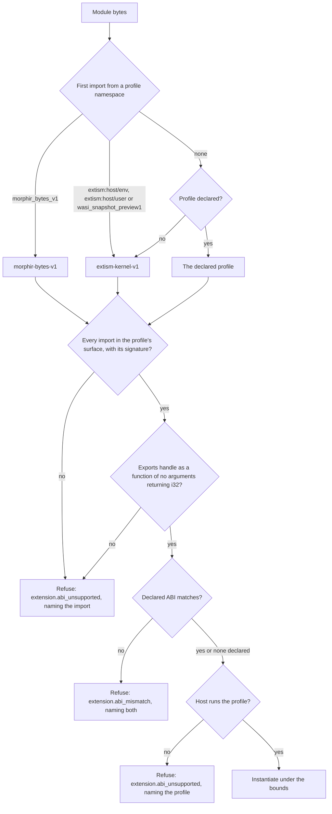

# WASM execution profiles

A WASM extension is one `.wasm` file. A host decides from the module's imports
how to deliver MEP messages to it, gives it a fixed and small set of host
functions, and stops it at fixed bounds. Those rules are the WASM execution
profiles. This page explains them for extension authors and for host
implementers.

The authority is the contract
[`spec/mep/wasm-execution-profiles.md`](https://github.com/finos/morphir/blob/main/spec/mep/wasm-execution-profiles.md),
`morphir/mep-wasm-execution-profiles` version `0.1.0-draft.1`, with its rules as
data in
[`wasm-execution-profiles.json`](https://github.com/finos/morphir/blob/main/spec/mep/wasm-execution-profiles.json).
When this page and the contract differ, the contract is right. The profiles add
no MEP method and no IR version, and a guest of either profile negotiates MEP
like any other extension.

## Which hosts run them

| Host | `extism-kernel-v1` | `morphir-bytes-v1` | State |
| --- | --- | --- | --- |
| MoonBit CLI (finos/morphir-moonbit) | Yes | Yes | Released. Does not deliver notifications to Extism guests yet ([finos/morphir-moonbit#329](https://github.com/finos/morphir-moonbit/issues/329)) |
| .NET CLI (finos/morphir-dotnet) | Yes | No, refused by name | In development ([finos/morphir-dotnet#570](https://github.com/finos/morphir-dotnet/pull/570)), not released, not yet qualified |

A host is qualified against the crafted corpus described in
[Qualifying a host](#qualifying-a-host). This page does not list a host as
qualified until a report says so.

## The two profiles

| | `extism-kernel-v1` | `morphir-bytes-v1` |
| --- | --- | --- |
| Status | Required: every host runs it | Transitional: a host may run it, and no new guest should target it |
| Built with | An Extism PDK (Rust, Python, the Morphir extension SDK), or any module that imports the Extism kernel | Any language that emits core WASM |
| How a message arrives | Extism input | The guest pulls it one byte at a time |
| How the response leaves | Extism output | The guest pushes it one byte at a time |
| Notifications | Only after the guest asks for them | All of them |
| Call deadline | 30 seconds | 10 seconds |

Build a new extension for `extism-kernel-v1`. The byte profile stays until its
three guests (the Gleam extension, the MoonBit portable guest and the Elm
preview built from it) ship on Extism. The next contract draft then removes it
([finos/morphir-moonbit#330](https://github.com/finos/morphir-moonbit/issues/330)).

An Extism guest does not need a PDK. A module that imports five kernel
functions (`input_length`, `input_load_u8`, `alloc`, `store_u8` and
`output_set`) can read its request and write its response one byte at a time,
from any language that can import a function.

## How a host classifies a module

A host classifies a module before it runs any of its code.



The first import decides. A module whose first profile import is from
`extism:host/env` and that later imports `morphir_bytes_v1.input_len` is an
Extism module with an import outside its surface, and the refusal names
`morphir_bytes_v1.input_len`.

A declared ABI, in a descriptor, a configuration entry or a command argument,
only confirms the classification. It never lets in an import the classified
profile excludes.

A module that needs a WASM feature the engine lacks, or that has a shared,
64-bit or second memory, is refused with `extension.wasm_feature_unsupported`.
That check has no fixed place in the order above, because an engine may
validate a module before the host classifies it.

## One call, one message

A WASM guest has no stream. Each `handle` call carries exactly one complete
MEP message as UTF-8 JSON text with no `Content-Length` header, and gives at
most one response. A host may parse and re-serialize messages, so a guest must
not depend on receiving the exact bytes the host was given.

A request over the request limit, 6 MiB by default, is refused before the
guest is called. A response over the response limit, 16 MiB by default, fails
the session and no part of it is forwarded.

### Result codes, `extism-kernel-v1`

The host keeps one instance for the session, sets each request as Extism
input, calls `handle` and reads Extism output.

| `handle` returns | Meaning |
| --- | --- |
| `0` with output and no error set | The output is the response |
| `0` with no output | A failure for a request. The expected result for a delivered notification |
| Anything other than `0` | A failure, even with output and no error set |
| Any value, with an Extism error set | A failure |

### Result codes, `morphir-bytes-v1`

The guest imports exactly `input_len`, `input_byte` and `output_byte` from
`morphir_bytes_v1`, and nothing else.

| `handle` returns | Meaning |
| --- | --- |
| Positive `n` | The guest pushed a response of `n` bytes |
| `0` | The guest pushed nothing and its instance ends, for any message |
| `-2` | The guest consumed a notification and has no response. For a message with an `id`, a failure |
| `-1` | The guest failed |

A result that does not match the bytes pushed, such as `0` after a pushed byte,
is a failure.

### Notifications for Extism guests

An Extism guest chooses how it receives notifications with the string member
`capabilities.notificationDelivery` of its `morphir.initialize` result:

```json
{"jsonrpc": "2.0", "id": 1, "result": {"protocolVersion": "0.2.0-draft.1", "capabilities": {"notificationDelivery": "call"}}}
```

| Value | The host |
| --- | --- |
| `none`, or absent | Delivers no notification. `morphir.exit` ends the instance without a call. Every published bundle is in this row |
| `call` | Delivers each notification as one `handle` call between requests. Output from that call fails the session |
| Anything else | Reads it as `none` |

`poll` is reserved for a guest that asks for pending notifications while it
works, so that it could receive `$/cancelRequest` for the request in progress.
It needs a host function that does not exist yet.

## What a guest can reach

A guest has no files, network, environment, arguments or configuration. It has
clocks, random bytes, and two small stores that live for one session. This is
the policy every host applies, grouped by area. The contract's `policy` object
holds each value as data.

| Area | Functions | The guest gets |
| --- | --- | --- |
| Configuration | `config_get` | Nothing: every key is missing |
| Session variables | `var_get`, `var_set` | A store of at most 1 MiB, keys and values together, that starts empty for each session. A zero value deletes a key. A write over the limit stops the call and fails the session |
| IR cache | `morphir_cache_ir`, `morphir_get_cached_ir` | A cache of at most 16 MiB and 1,024 entries for the session. A missing key reads as the JSON text `null`. A write over either limit fails the session |
| Workspace | `morphir_get_workspace_info` | `{"root": <a private empty directory>, "output_dir": ""}` |
| Logging | `log_trace` to `log_error`, `get_log_level`, `morphir_log` | Messages are recorded as guest output, never as the MEP response. The level is `info`, so `trace` and `debug` are dropped. `morphir_log` is not filtered |
| HTTP | `http_request`, `http_status_code`, `http_headers` | No connection. `http_request` is recorded with its method and URL, then stops the call and fails the session |
| WASI files | Any call on a descriptor above 2, such as `fd_prestat_get` or `path_open` on fd 3 | Errno 8 (`badf`): there is no preopened directory |
| WASI streams | `fd_read` on stdin, `fd_write` on stdout and stderr | stdin is empty. stdout and stderr are recorded as guest output |
| WASI process | `args_sizes_get`, `environ_sizes_get`, `proc_exit` | No arguments and no environment. `proc_exit(0)` ends the call successfully; any other code fails the session |
| WASI time and randomness | `clock_time_get`, `random_get` | Real values |
| Any other WASI function | `poll_oneoff` and the rest | Errno 76 (`notcapable`). Nothing reaches the host system |

`morphir-bytes-v1` imports no WASI, so a byte-profile guest has no clock and no
random bytes.

## Bounds

| Bound | Value | When it is reached |
| --- | --- | --- |
| Memory ceiling | 256 MiB for each linear memory. The Extism kernel's own memory has a separate 256 MiB ceiling | Growth is not granted |
| Call deadline | 30 seconds for `extism-kernel-v1`, 10 seconds for `morphir-bytes-v1` | The host stops the guest, discards the instance and ends the session with outcome `deadline` |
| Instruction budget | 5,000,000,000 units per call | The session fails with `extension.budget_exhausted` |

The budget unit is defined by each engine, so it guards against a busy loop and
is not a measure of cost. An engine that does not meter applies no budget and
says so. A host must enforce the memory ceiling and the call deadline to
qualify.

A call that traps while a memory is at its ceiling is reported as
`extension.memory_limit`. A call the guest ended itself, with an Extism error,
a non-zero result or no output, is a failure even at the ceiling. An Extism
guest that has a growth refused and still answers has succeeded.

## Failure codes

A refusal happens before any request; the module never runs.

| Refusal | When |
| --- | --- |
| `extension.abi_unsupported` | An import outside the surface or with another signature, a missing or mistyped `handle`, or a profile the host does not run |
| `extension.abi_mismatch` | The declared ABI differs from the classified profile |
| `extension.wasm_feature_unsupported` | A WASM feature the engine lacks, or a shared, 64-bit or second memory |
| `extension.runtime_unavailable` | The host has no usable WASM engine. The message gives the reason |

A fault ends a running session. The host never calls that instance again.

| Code or outcome | When |
| --- | --- |
| `extension.guest_trap` | The guest trapped for a reason that is not a bound |
| `extension.memory_limit` | A memory rule applies |
| `extension.budget_exhausted` | The guest ran past its instruction budget |
| outcome `deadline` | The call did not return before its deadline |
| `extension.incomplete_session` | Any other end the guest caused, such as an Extism error, a wrong result code, output for a notification, a response that is not one JSON object, or a host function that stops the call |
| `extension.request_limit` | The request was over its limit and the guest was not called |
| `extension.unexpected_response` | A response has the wrong JSON-RPC version or an id that answers no request |
| outcome `cancelled` | The user cancelled the command. This is not a guest fault |

## For host implementers

A host implements the import tables, call rules, policy and bounds of the
contract, and checks a module in the order shown above. The contract also
defines a worker mode, `<host> extension worker`, which serves one module over
stdio and reports start-up, refusals and faults on stderr as JSON lines. A
conformance runner drives a host only through that mode, so the same runner
and corpus apply to every host.

A host states in its runtime report which profiles it runs, which bounds it
enforces and which engine enforces them. Report an engine that is missing or
fails to load as `extension.runtime_unavailable`, and keep every command that
needs no WASM working.

## Qualifying a host

[`spec/mep/mck/wasm-host.cases.json`](https://github.com/finos/morphir/blob/main/spec/mep/mck/wasm-host.cases.json)
holds crafted modules that each do one wrong or unusual thing: import a
forbidden function, spin forever, grow memory to the ceiling, return the wrong
code. Each has an expected observation written from the contract, never
recorded from a host. Cases for `morphir-bytes-v1` apply only to a host that
runs it. A host that does not run it must still refuse a byte-profile module
by name.

A run produces a host qualification report, defined in
[`spec/mep/mck/wasm-host-report.md`](https://github.com/finos/morphir/blob/main/spec/mep/mck/wasm-host-report.md).
A host is qualified when the report gives no reason against it: it enforces
the memory ceiling and the call deadline, no case that applies to it failed,
and it cites a passing generic guest kit run of the same executable for each
profile it runs. Well-behaved guests cannot show that a host stops a loop or
refuses a socket, so crafted cases alone do not qualify a host, and neither
does a passing guest run alone.

A report covers one executable on one platform. A release cites the report for
each offering and platform it claims.
