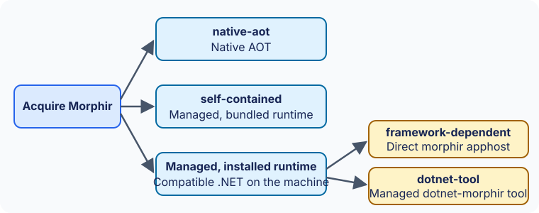
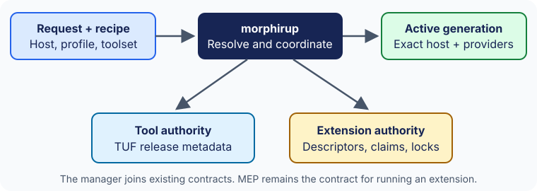
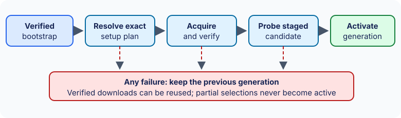
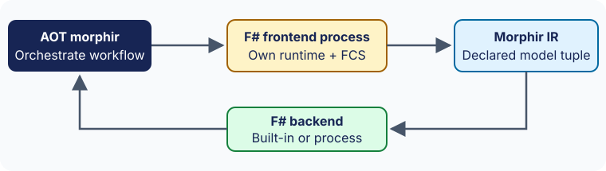
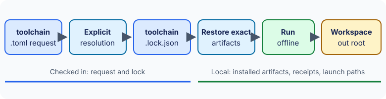
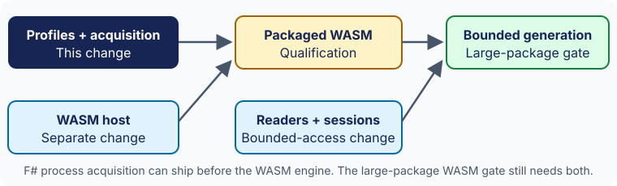

# Toolchain acquisition and selection with morphirup

:::caution Proposed interface, not implemented
Nothing on this page is implemented. `morphirup` does not exist yet, and no command, file or output shown here is a shipped interface. No artifact named here has been released, and no platform has been qualified. Versions such as `1.2.3` and `0.6.0` are illustrative, and digests such as `aaaa…` or `dddd…` are synthetic. This page tells the story of the approved OpenSpec change `add-deployment-and-acquisition`; the [toolchain acquisition contracts](../../spec/toolchain/index.md) define the documents it uses.
:::

Users should be able to get Morphir and its language tools without assembling runtimes, extension packages and configuration by hand. This page follows four people through that experience and records the decisions behind it, named as in the approved design: DEP-1, UP-1, UP-2, FS-1, LOCK-1, PATH-1 and QUAL-1.

- **Ada** installs Morphir on a machine without .NET, selects the F# toolset, compiles a small package and generates F#.
- **Ben** already maintains a .NET runtime and uses the framework-dependent host.
- **Chen** keeps `dotnet tool install Morphir.Tool`.
- **A colleague** restores Ada's checked-in selection in CI, and again offline.

```text
bootstrap morphirup -> select host + deployment + toolset
                   -> verify and stage artifacts -> activate locked toolchain
                   -> morphir compile -> model -> morphir generate
```

## Four questions, four answers (DEP-1)

The executable name does not say what you are running. Four separate questions do:

| Question | Name | Examples |
| --- | --- | --- |
| Which Morphir host? | Implementation | `dotnet`; later `moonbit` or others |
| How does that host run? | Deployment offering | `native-aot`, `self-contained`, `framework-dependent`, `dotnet-tool` |
| How did it get onto the machine? | Acquisition channel | a direct archive, the `morphirup` manager, the .NET tool channel, a system package manager |
| Which language tools can it use? | Toolset | the `fsharp` preset: F# compilation and F# generation |

A release channel (`stable`, `preview`, `insiders`, `preview/<segment>`) is a different thing again: it says which release to resolve, not how it arrives.



The four .NET offerings:

| Offering | Invocation | Runtime arrangement | F# frontend default |
| --- | --- | --- | --- |
| `native-aot` | `morphir` | Native compiled, no installed .NET | Self-contained process guest |
| `self-contained` | `morphir` | Managed/JIT, bundled runtime | Managed built-in when compatible |
| `framework-dependent` | `morphir` | Managed/JIT, compatible installed runtime | Same managed composition |
| `dotnet-tool` | `dotnet-morphir`; `dotnet morphir` | Current managed tool; SDK to install | Existing managed built-in |

Ada can choose AOT or the self-contained managed host; both expose `morphir`. Ben chooses the framework-dependent apphost. Chen keeps the .NET tool. Their installation instructions differ, while shared commands and configuration keep the same meaning. Every offering reports its implementation, release, deployment, platform and execution mode itself, rather than leaving a reader to infer them from a file name.

The first three offerings all ship an executable called `morphir`, so archive names carry the identity, for example `morphir-dotnet-1.2.3-native-aot-win-x64.zip`. In authenticated release metadata each separately published offering is its own tool id; see [offering-specific tool ids](../../spec/tool-release-metadata/index.md#offering-specific-tool-ids). Existing release assets are not renamed in place, and old download links survive migration.

The managed offerings share one command layer and one managed composition that includes the F# compiler services. The AOT entry point excludes that composition and uses a process frontend instead, so a compiler service never enters the AOT dependency graph.

## Ada's first install (UP-1)

Ada first obtains `morphirup`, a small Native AOT executable built in morphir-dotnet. It needs no installed Morphir and no .NET. It owns bootstrap, selection and lifecycle, and it has no compiler or generator of its own. A pure resolver produces a plan; bounded adapters do the authentication, download, extraction, extension installation and activation.



The manager joins two existing authorities rather than inventing a third:

- the host comes through [tool release metadata v1](../../spec/tool-release-metadata/index.md), a TUF profile with signed metadata, expiry, rollback protection and revocation;
- extensions come through their existing [release descriptors, claims, store and locks](../draft/extensions/distribution-and-acquisition.md). MEP remains the contract for running an extension, not for installing one.

Bootstrap verifies the manager artifact against authenticated release information, installs into a user-owned directory and needs no administrator rights. The official trusted root is delivered out of band, inside the manager release. Bootstrap edits no shell profile; Ada can run everything by absolute path.

Direct archives remain useful without the manager. NuGet and system package managers keep ownership of the installations they create. `morphirup` can inspect them and propose a separate side-by-side manager-owned install, but it never overwrites them.

## Plan, verify and activate one generation (UP-2)

Ada asks for F# setup:

```console
# Proposed interface. These commands do not exist yet.
morphirup setup --implementation dotnet --deployment native-aot --preset fsharp --channel stable --plan
morphirup setup --implementation dotnet --deployment native-aot --preset fsharp --channel stable --yes
morphirup show --json
morphirup doctor --json
```

`--plan` may refresh metadata but never runs a downloaded artifact and never changes the selected installation. The plan names, for each component, the source authority, exact release and digest, download and installed sizes, prerequisites, update owner, and whether a readiness probe will run acquired code with Ada's rights. Its digest lets approval-sensitive automation pin it: `--expect-plan` refuses a different plan. `--yes` authorizes the displayed operation in automation. It never means bypassing signatures, ignoring incompatibility, touching unrelated installations or installing a system SDK. The plan's shape is the [manager result](../../spec/toolchain/manager-result.md#plans).

A public toolset recipe is an ordinary authenticated TUF target. It maps each host offering to its published artifacts and binds every required operation to a built-in or an independently released provider, by exact descriptor and artifact digests. It does not change the extension descriptor format, and it does not pretend that every extension repository is signed. See the [toolset recipe](../../spec/toolchain/toolset-recipe.md).



Applying setup stages the whole candidate and runs its readiness checks before anything becomes active. Verified bytes go into the existing tool and extension content stores. The selection is recorded as an immutable generation under `MORPHIR_HOME/toolchains/generations/<id>/`, with local launch receipts and exact copies or references of the selected extension records and locks. A generation id is a local opaque id, not a release version. A project generation never replaces the global extension selection: hosts read an additive generation-scoped overlay and keep reading the global catalog.

Publication is journaled. The new lock and selection are written to a new generation, and then one pointer is switched under a lock. The pointer records the portable lock's digest.

### What a failure leaves behind

| The step that fails | What remains |
| --- | --- |
| Bootstrap verification | No manager is installed. Tampered bootstrap content is refused. |
| Planning, or an incompatible component | The plan reports the incompatible component and its alternatives. Nothing is installed or switched. |
| Download, or verification of a download | Bytes that verified stay in the content store and are reused on retry. Nothing unverified is kept, and the active generation is unchanged. |
| A readiness probe | Setup reports installed but not ready. The previous generation stays selected, and restarting setup reuses the verified downloads. |
| A crash between filesystem publications | The journal recovers the state before the next run. Uncertain or mismatched state never falls back to a mixed host and provider set. |
| Competing setups | Publication is serialized. Each run observes one complete generation. |

## F# as capabilities (FS-1)

Ada's host is AOT. Setup resolves the self-contained `org.finos.morphir.fsharp-frontend` process guest (the dotted id is decided; until the descriptor change finos/morphir#1149 lands, the signed fixtures bind it as `morphir-fsharp-frontend`; see [toolset recipe limits](../../spec/toolchain/toolset-recipe.md#limits-of-this-contract-version)), which carries the F# compiler services and its own managed runtime and talks to the host over the existing Content-Length MEP transport. Generation stays with the host's built-in `morphir.fsharp`. An explicit provider selection always wins over a built-in.



Ben's managed host compiles with its built-in in-process F# frontend, `morphir-dotnet.fsharp`, the same managed composition the tool uses today; his recipe resolves it by default and downloads no frontend. The existing framework-dependent frontend .NET tool remains an explicit delivery.

The F# generator also gets a standalone process delivery, `org.finos.morphir.fsharp-backend` (bound as `morphir-fsharp-backend` in the signed fixtures until finos/morphir#1149 lands), with its own identity and exact claims, so that MoonBit or another compatible host can acquire it without the .NET CLI. Default .NET setup does not download it, because the built-in already does the job. Selecting it is explicit, and that external path is part of first-delivery acceptance.

Compilation here means supported F# source to Morphir IR. It does not mean that any `.fsproj` builds without an SDK or a NuGet restore. If Ada wants to compile the generated F# into a .NET application, the plan reports that consumer build's SDK and package prerequisites as a separate fact. Each delivery declares its runtime, SDK and native prerequisites separately, and setup never installs an SDK implicitly.


## Request, lock and receipt (LOCK-1)

Ada commits two files: the request and the portable lock. The request says what the project wants:

```toml title="docs/spec/toolchain/fixtures/0.1.0-draft.1/request/approved.toml"
schemaVersion = "0.1.0-draft.1"
[host]
implementation = "dotnet"
deployment = "native-aot"
channel = "stable"
[toolset]
preset = "fsharp"
```

A team that works on several platforms lists them, and can choose the standalone backend explicitly:

```toml title="docs/spec/toolchain/fixtures/0.1.0-draft.1/request/team-platforms-external-backend.toml"
# The team prepares Windows and macOS closures and selects the external F# backend.
schemaVersion = "0.1.0-draft.1"
platforms = ["win-x64", "osx-arm64"]

[host]
implementation = "dotnet"
deployment = "native-aot"
channel = "stable"

[toolset]
preset = "fsharp"

[[toolset.providers]]
operation = "generate"
target = "fsharp"
delivery = "process"
```

The lock records the exact result: the request's identity, the authenticated recipe, the exact host and, for each recorded platform, the complete closure of host and provider artifacts with their digests and compatibility tuples. It holds no absolute path and no credential. This one-platform example uses synthetic digests:

```json title="docs/spec/toolchain/fixtures/0.1.0-draft.1/lock/approved-fragment.json"
{
  "schemaVersion": "0.1.0-draft.1",
  "critical": ["host", "platforms"],
  "requestSha256": "aaaaaaaaaaaaaaaaaaaaaaaaaaaaaaaaaaaaaaaaaaaaaaaaaaaaaaaaaaaaaaaa",
  "recipe": {
    "repositoryId": "bbbbbbbbbbbbbbbbbbbbbbbbbbbbbbbbbbbbbbbbbbbbbbbbbbbbbbbbbbbbbbbb",
    "target": "toolchains/recipes/fsharp/1.0.0.json",
    "sha256": "cccccccccccccccccccccccccccccccccccccccccccccccccccccccccccccccc"
  },
  "host": {
    "implementation": "dotnet",
    "version": "1.2.3",
    "deployment": "native-aot"
  },
  "platforms": {
    "win-x64": {
      "hostTarget": "artifacts/morphir-dotnet-native-aot/1.2.3/win-x64.zip",
      "hostSha256": "dddddddddddddddddddddddddddddddddddddddddddddddddddddddddddddddd",
      "providers": [
        {
          "operation": "compile",
          "language": "fsharp",
          "delivery": "process",
          "extensionId": "org.finos.morphir.fsharp-frontend",
          "version": "0.6.0",
          "repositoryId": "bbbbbbbbbbbbbbbbbbbbbbbbbbbbbbbbbbbbbbbbbbbbbbbbbbbbbbbbbbbbbbbb",
          "descriptorTarget": "extensions/fsharp-frontend/0.6.0/release.json",
          "descriptorSha256": "eeeeeeeeeeeeeeeeeeeeeeeeeeeeeeeeeeeeeeeeeeeeeeeeeeeeeeeeeeeeeeee",
          "artifactTarget": "extensions/fsharp-frontend/0.6.0/win-x64.zip",
          "artifactSha256": "ffffffffffffffffffffffffffffffffffffffffffffffffffffffffffffffff",
          "protocolVersion": "0.2.0-draft.1",
          "modelTuple": {
            "operation": "morphir.frontend.compileModel",
            "profile": "morphir-ir",
            "codec": "morphir-json",
            "envelopeVersion": "0.1.0-draft.1",
            "irVersion": "4.0.0"
          }
        },
        {
          "operation": "generate",
          "target": "fsharp",
          "delivery": "built-in",
          "extensionId": "morphir.fsharp",
          "version": "1.2.3",
          "modelInput": {
            "profile": "morphir-ir",
            "codec": "morphir-json",
            "irVersion": "4.0.0"
          }
        }
      ]
    }
  }
}
```

The installation receipt is local. It binds the SHA-256 of the exact lock bytes, the platform and every installed object, and records launch paths, ownership, how each artifact was authenticated, its claim check and its readiness. It is never checked in.

| File | Where | Checked in | Contract |
| --- | --- | --- | --- |
| Request | `.morphir/toolchain.toml` | Yes | [Toolchain request](../../spec/toolchain/toolchain-request.md) |
| Lock | `.morphir/toolchain.lock.json` | Yes | [Portable lock](../../spec/toolchain/toolchain-lock.md) |
| Receipt | `MORPHIR_HOME/toolchains/generations/<id>/` | No | [Installation receipt](../../spec/toolchain/installation-receipt.md) |

The request's identity is the SHA-256 of its exact UTF-8 bytes. Reformatting the file therefore needs an explicit lock refresh. That simple rule avoids defining canonical TOML across languages.

Existing `[toolchain.<name>]` sections in `morphir.toml` define task adapters and keep their meaning. The request lives in its own file so the two never collide.



### The colleague in CI

```console
# Proposed CI workflow after acquiring morphirup
morphirup restore --locked
morphirup run -- compile
morphirup run -- generate --target fsharp

# Offline replay once exact artifacts are present
morphirup restore --locked --offline
morphirup run --offline -- compile
```

Frozen restore uses only the lock:

| Situation | What frozen restore does |
| --- | --- |
| The request bytes changed since the lock was written | Refuses with `request_changed`. An explicit setup or update writes a new lock. |
| The stable channel has moved from release A to release B | Restores A, subject to the authority's revocation and verification rules, and does not rewrite the lock to B. |
| The machine's platform has no closure in the lock | Refuses with `platform_not_locked`. A musl machine never takes a glibc closure. Explicit setup or update can extend the lock. |
| Repository metadata has expired | An installed, verified generation still runs offline. Expiry blocks only new resolution. |
| A revocation has been learned | Enforced, online and offline. A generation containing a revoked artifact cannot launch or be rolled back to. |
| A locked archive is missing offline | Reports the missing component and digest, makes no network request and changes no selection. |

Each refusal has a stable code that the manager result reports. A changed request, for example:

```json title="docs/spec/toolchain/fixtures/0.1.0-draft.1/result/restore-request-changed.json"
{
  "schemaVersion": "0.1.0-draft.1",
  "command": "restore",
  "outcome": "failed",
  "diagnostics": [
    {
      "kind": "lock-binding",
      "code": "request_changed",
      "severity": "error",
      "message": "The request bytes no longer hash to the lock's requestSha256. Frozen restore changes nothing; run an explicit setup or update.",
      "document": "lock",
      "path": "requestSha256",
      "instruction": [
        "morphirup",
        "setup",
        "--yes"
      ]
    }
  ]
}
```

The missing-archive case:

```json title="docs/spec/toolchain/fixtures/0.1.0-draft.1/result/restore-offline-missing.json"
{
  "schemaVersion": "0.1.0-draft.1",
  "command": "restore",
  "outcome": "failed",
  "diagnostics": [
    {
      "kind": "offline-content-unavailable",
      "code": "offline_content_unavailable",
      "severity": "error",
      "message": "The locked F# frontend archive is not in the verified local store. Run morphirup restore --locked with network access.",
      "component": {
        "role": "provider",
        "operation": "compile",
        "language": "fsharp"
      },
      "target": "extensions/fsharp-frontend/0.6.0/win-x64.zip",
      "sha256": "ffffffffffffffffffffffffffffffffffffffffffffffffffffffffffffffff"
    }
  ]
}
```

A lock prepared for several platforms is resolved once, from one recipe. Its closures never come from independent resolutions of a moving channel. The test-only fixtures include [frozen locks for all six first-delivery platforms](../../spec/toolchain/toolset-recipe.md#fixtures).

## Selection and dispatch (PATH-1)

When a command needs a toolchain, the first source that names one wins:

1. an explicit selector on the command line;
2. the `MORPHIRUP_TOOLCHAIN` environment variable;
3. the nearest project toolchain file, searching from the current directory up to and including the host's established discovery boundary, so a workspace root's request applies to members without their own ([discovery](../../spec/toolchain/toolchain-request.md#discovery));
4. the user default.

An override selects an installed complete generation: the selector and `MORPHIRUP_TOOLCHAIN` take a generation id, such as `gen-0002`. `morphirup show` explains which source won:

```json title="docs/spec/toolchain/fixtures/0.1.0-draft.1/result/show-project-selection.json"
{
  "schemaVersion": "0.1.0-draft.1",
  "command": "show",
  "outcome": "succeeded",
  "selection": {
    "source": {
      "kind": "project",
      "path": "C:\\Users\\fixture\\src\\loans\\.morphir\\toolchain.toml"
    },
    "generationId": "gen-0001",
    "platform": "win-x64",
    "host": {
      "implementation": "dotnet",
      "version": "1.2.3",
      "deployment": "native-aot"
    },
    "lockSha256": "1f5573b35fb2772da39fca1ac51783ea160d7884f17097ba4e94fd69aee0b926"
  },
  "diagnostics": []
}
```

A broken explicit or project selection fails; it does not fall through to the user default. A lock holds exact identities, not a generation id. If no installed generation has a receipt that binds the project lock's bytes for this platform, the run reports how to restore it and neither runs the default nor acquires anything. This is the approved "missing project generation" scenario. `run` never downloads.

The manager owns a bin directory containing `morphirup` and an optional `morphir` dispatch proxy. On Windows the proxy is a real executable, so normal launch needs neither symlink privileges nor a PowerShell execution-policy exception. Dispatch resolves the selected executable to an absolute path and spawns it with an argument vector, never a shell string. It preserves argument boundaries, working directory, standard streams, exit status and cancellation. Background child windows stay hidden on Windows, and cancellation ends the whole process tree. A selected child cannot find the proxy again through PATH.

Chen's `dotnet-morphir` stays as it is. The manager does not rename the NuGet tool. An external tool installation stays externally owned and is updated with `dotnet tool`. When a managed selection exposes `dotnet-morphir`, `morphirup run -- generate --help` launches that entry point with exactly those arguments. An explicitly manager-owned tool delivery goes into an isolated tool path through the SDK, with its exact package provenance recorded; the manager never installs the SDK itself.

Persistent PATH or profile changes need an explicit `morphirup env --install`. It records exactly what it added so it can remove it again, adds no duplicate entries when repeated, and keeps foreign entries on removal. Default setup, bootstrap and CI edit no shell profile. `doctor` reports which `morphir` wins on PATH, runtime and ABI availability, the selected lock and update ownership, and changes none of them.

## Readiness, trust and WASM (QUAL-1)

Setup does not call a toolchain ready because archives extracted. Each component reaches one of these states, in order:

| State | Evidence |
| --- | --- |
| Acquired | The bytes are present. |
| Integrity-verified | The bytes match their authenticated or locked digests. |
| Capability-checked | The host and provider agree on the selected operation and model tuple. |
| Workflow-qualified | A fixed small F# source package compiled to the expected semantic IR and generated the expected F# files with the selected providers. This state belongs to the whole generation. |

Skipped or unsupported checks stay visible in the receipt. Setup activates the candidate when no check failed and every component is capability-checked: a skipped workflow check does not stop it, but the generation is then never called workflow-qualified, and a workflow check that ran and failed does stop it (maintainer decision, 9 November 2026). A valid archive whose frontend shares no tuple with the host is installed but not ready, and the candidate is not activated. A process probe runs with Ada's rights, under the existing launch controls, and plan-only mode never runs one.

Two facts that are easy to confuse stay separate:

- **Publisher authentication** says who published the bytes: the TUF repository authenticated them, or an authenticated recipe bound their digest, or the manager did not, because an external owner such as the .NET SDK installed them.
- **The claim check** says whether the installed artifact was run to compare its capability claims: `probed` or `unchecked`.

A recipe never turns `unchecked` into `probed`, and a probe never makes an artifact authenticated. An unsigned developer artifact is never part of a toolchain generation: no recipe binds it, so no lock names it and no receipt records it. It is installed outside generations under explicit developer policy. The [installation receipt](../../spec/toolchain/installation-receipt.md#installation) records both facts side by side.

A WASM recipe names the ABI its guest needs. The public runtime name stays `wasm`; the engine and its ABI are separate. A host that supports `morphir-bytes-v1` cannot qualify an `extism-kernel-v1` guest merely because both are WASM, and setup reports the missing ABI as not ready. It does not quietly pick another guest built for an ABI the host has either: resolution reports `abi_unavailable`, naming the missing ABI, unless the request chooses the other ABI explicitly. Process F# readiness establishes nothing about WASM capability. The WASM engine is a separate host change that must qualify its packaged engine across every offering before setup advertises it.



The fixed compile and generate expectations are product data, independent of whichever implementation is under test. Implementations take part through explicit adapters. Following the maintainer's decision of 9 November 2026, the compatibility kit's runner lives in finos/morphir-dotnet (`src/Morphir.Conformance`, with the `cli`, `library` and `mep-guest` adapters), and the cases, fixed expectations and report contracts stay in finos/morphir as data. The fixed F# case is the [readiness workflow case](../../spec/toolchain/readiness-workflow.md). AGENTS.md still describes the earlier arrangement, with the runner in this repository. Acquisition, crash and ownership behavior is covered by ordinary integration tests, not by a compatibility runner.

## Lifecycle after the first install

| Operation | Behavior |
| --- | --- |
| List | Shows installed generations, their owners and which one each selection uses. |
| Default | Selects a user default generation. |
| Update | Resolves new versions and stages a complete new generation, keeping the prior one usable. A failed update leaves the prior lock and active generation in place. A command running against the old generation keeps it until it exits; the next command sees the complete new one. |
| Rollback | Selects a verified earlier generation atomically, after re-verifying its bytes. A generation containing an artifact with a known revocation is refused. |
| Repair | Restores the same exact identities from verified content. It never resolves newer versions. |
| Remove | Removes only unreferenced manager-owned generations and disposable caches. It refuses a generation that is in use or referenced by an active selection. Trusted roots, known revocations and locks survive cleanup. |
| Self-update | Stages a new manager executable and replaces the old one through a platform-qualified helper after the old executable exits, so an interruption leaves a working manager. |

The manager updates or removes only what it owns. For an installation owned by the .NET tool channel, a direct archive or a system package manager, it reports the owner's update mechanism and leaves the files alone.

## Recovery

The approved acceptance plan exercises these interrupted and failed cases. In each, the previous generation stays usable and every run observes one complete selection:

- **An interrupted download.** Verified parts are reused and unverified bytes are discarded.
- **A failed probe.** Setup reports installed but not ready and keeps the previous selection.
- **Concurrent activation.** Publication is serialized under interprocess locks, and one generation wins whole.
- **A long command during an update.** The command keeps its generation, and later commands see the new one.
- **A crash between publication steps.** The journal recovers before the next run, and mixed state never runs.
- **A tampered archive.** It fails verification and never enters the store.
- **A learned revocation.** It is persisted before the failure is reported and enforced offline from then on.
- **An archive with a path traversal.** It is refused during extraction.
- **A PATH conflict.** It is reported, never resolved by overwriting another owner's file.
- **An interrupted self-update.** It resumes through the staged executable and the replacement helper.
- **Expired metadata.** New resolution is blocked, and installed verified generations keep running.

## Where state lives

| State | Location | Survives cleaning build outputs |
| --- | --- | --- |
| Installed hosts, extensions and generations | Morphir Home (`MORPHIR_HOME`), described in [ADR-0005](../../adr/ADR-0005-cli-managed-desktop.md) | Yes |
| Trusted roots, known revocations, selection pointers and journals | Morphir Home | Yes |
| Request and lock | The project's `.morphir/` directory, checked in | Yes |
| Compile and generate outputs | The configured workspace [out root](../out-directory.md), normally `.morphir/out` | No; they are disposable task outputs |

If a project moves its output root to `build/morphir`, compilation and generation use that root, and the selected host and providers stay in Morphir Home. Cleaning the outputs can never erase a toolchain, a lock or trust state. Installed executables never go into the out root.

## Scope

First delivery covers six platform pairs: Windows x64 and ARM64, macOS x64 and ARM64, and Linux glibc x64 and ARM64. A combination without evidence stays visibly unsupported. Linux musl, further package managers and managing an external SDK installation come later. The initial public acquisition paths are direct archives with bootstrap, and the existing .NET tool channel. MoonBit adoption follows with its own release and receipts, using the same contracts.

## Contracts and related documents

- [Toolchain acquisition contracts](../../spec/toolchain/index.md): the shared rules, identifiers, platforms and stable diagnostics.
- [Toolset recipe](../../spec/toolchain/toolset-recipe.md), [toolchain request](../../spec/toolchain/toolchain-request.md), [portable lock](../../spec/toolchain/toolchain-lock.md), [installation receipt](../../spec/toolchain/installation-receipt.md) and [manager result](../../spec/toolchain/manager-result.md).
- [Tool release metadata v1](../../spec/tool-release-metadata/index.md): trust, channels, revocation and offline policy for hosts.
- [Extension distribution and acquisition](../draft/extensions/distribution-and-acquisition.md): descriptors, claims, store and locks for extensions.
- [CLI-managed Desktop acquisition and launch](./desktop-acquisition-and-launch.md): the Rust CLI's existing tool acquisition design, whose trust machinery this proposal reuses.
