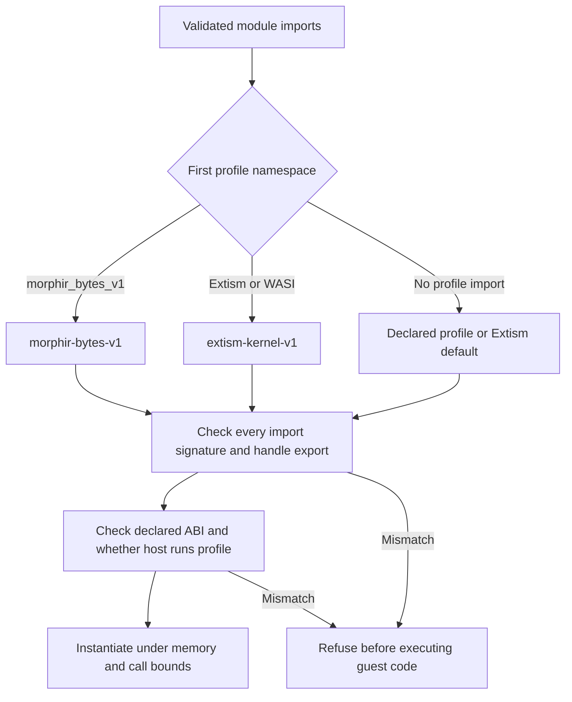

This page is for extension authors and host implementers. It publishes the two
execution profiles from [the shared profile contract](https://github.com/finos/morphir/blob/main/spec/mep/wasm-execution-profiles.json),
`morphir/mep-wasm-execution-profiles` at `0.1.0-draft.1`. The contract describes
what a conforming host must do. It does not establish that a particular build
implements it or qualifies an offering on another platform.

For an extension user, the installed artifact's runtime and recorded claims
decide how it is launched. A process guest and a WASM guest are distinct
deliveries. The process-based F# delivery does not wait for WASM qualification.
See [identity and selection](./identity.md) and [package installation](./packages.md).
Generation selection through `MORPHIR_EXTENSION_OVERLAY` supplies no
additional guest filesystem or network authority.

## Classification before execution

The first import from a profile namespace selects the profile. A declaration
confirms that classification; it cannot grant another import. With no profile
import, use the declared profile, or `extism-kernel-v1` when a host session
has no declaration. Worker mode always requires `--abi`.

Check profile, imports, `handle`, declared ABI, then host support in that
order, reporting the first failure. Every accepted import has its exact core
WASM signature and `handle` is `() -> i32`. An engine may perform
its WASM feature validation before classification. Shared, 64-bit or a second
memory is outside these profiles.

## Import and result tables

Every host runs `extism-kernel-v1`. The byte profile is transitional;
new guests should use Extism. A host can refuse the byte profile by name without
implementing its runtime. A refusal of an invalid byte import still names that
import before the unsupported-profile check.

### morphir-bytes-v1

Status: `transitional`. Per-call deadline: 10 seconds.

| Import | Exact core WASM signature | Provider |
| --- | --- | --- |
| `morphir_bytes_v1.input_len` | `() -> i32` | byte callback |
| `morphir_bytes_v1.input_byte` | `(i32) -> i32` | byte callback |
| `morphir_bytes_v1.output_byte` | `(i32) -> ()` | byte callback |

| handle result | Meaning | Observation |
| --- | --- | --- |
| `positive` | response | The guest pushed a response of that many bytes. |
| `0` | exit | The guest pushed nothing and its instance ends, for any message, not only morphir.exit. |
| `-2` | notification | The guest consumed a notification. For a message with an id this is a failure. |
| `-1` | failure | The guest failed; the session fails. |

### extism-kernel-v1

Status: `required`. Per-call deadline: 30 seconds.

| Import | Exact core WASM signature | Provider |
| --- | --- | --- |
| `extism:host/env.alloc` | `(i64) -> i64` | kernel |
| `extism:host/env.free` | `(i64) -> ()` | kernel |
| `extism:host/env.length_unsafe` | `(i64) -> i64` | kernel |
| `extism:host/env.length` | `(i64) -> i64` | kernel |
| `extism:host/env.load_u8` | `(i64) -> i32` | kernel |
| `extism:host/env.load_u64` | `(i64) -> i64` | kernel |
| `extism:host/env.input_load_u8` | `(i64) -> i32` | kernel |
| `extism:host/env.input_load_u64` | `(i64) -> i64` | kernel |
| `extism:host/env.store_u8` | `(i64, i32) -> ()` | kernel |
| `extism:host/env.store_u64` | `(i64, i64) -> ()` | kernel |
| `extism:host/env.input_set` | `(i64, i64) -> ()` | kernel |
| `extism:host/env.output_set` | `(i64, i64) -> ()` | kernel |
| `extism:host/env.input_length` | `() -> i64` | kernel |
| `extism:host/env.input_offset` | `() -> i64` | kernel |
| `extism:host/env.output_length` | `() -> i64` | kernel |
| `extism:host/env.output_offset` | `() -> i64` | kernel |
| `extism:host/env.reset` | `() -> ()` | kernel |
| `extism:host/env.error_set` | `(i64) -> ()` | kernel |
| `extism:host/env.error_get` | `() -> i64` | kernel |
| `extism:host/env.memory_bytes` | `() -> i64` | kernel |
| `extism:host/env.config_get` | `(i64) -> i64` | host |
| `extism:host/env.var_get` | `(i64) -> i64` | host |
| `extism:host/env.var_set` | `(i64, i64) -> ()` | host |
| `extism:host/env.log_trace` | `(i64) -> ()` | host |
| `extism:host/env.log_debug` | `(i64) -> ()` | host |
| `extism:host/env.log_info` | `(i64) -> ()` | host |
| `extism:host/env.log_warn` | `(i64) -> ()` | host |
| `extism:host/env.log_error` | `(i64) -> ()` | host |
| `extism:host/env.get_log_level` | `() -> i32` | host |
| `extism:host/env.http_request` | `(i64, i64) -> i64` | host |
| `extism:host/env.http_status_code` | `() -> i32` | host |
| `extism:host/env.http_headers` | `() -> i64` | host |
| `extism:host/user.morphir_get_workspace_info` | `() -> i64` | morphir |
| `extism:host/user.morphir_cache_ir` | `(i64, i64) -> ()` | morphir |
| `extism:host/user.morphir_get_cached_ir` | `(i64) -> i64` | morphir |
| `extism:host/user.morphir_log` | `(i64, i64) -> ()` | morphir |

| handle result | Meaning | Observation |
| --- | --- | --- |
| `0` | response | With output and no error set, the output is the response. |
| `0 without output` | failure | For a request, a failure. For a delivered notification, the expected result. |
| `non-zero` | failure | A failure, also when no error is set and the guest gave output. |
| `error set` | failure | The guest set an Extism error; a failure whatever handle returns. |

The Extism table accepts any subset of the listed kernel and host functions.
The guest and kernel each have a 268435456-byte
linear-memory ceiling. An Extism session can therefore hold twice that amount;
the ceiling is not a total resident-process-memory claim.

The Extism profile also accepts all 46 WASI preview 1 functions with the core
signatures in the named `wasi_snapshot_preview1.witx` definition.
The [full profile specification](https://github.com/finos/morphir/blob/main/spec/mep/wasm-execution-profiles.md#wasi-preview-1-wasi_snapshot_preview1)
records the sandbox behavior. No preopened directory, argument, environment
variable or stdin content is supplied. Clocks and random bytes are available.
Functions on descriptors above 2 return errno 8. Other unsupported operations,
including `poll_oneoff`, return errno 76. `proc_exit(0)` ends the
call successfully; a nonzero exit fails the session.

## Notifications and messages

Stdio workers use Content-Length framing. A WASM `handle` call receives
one UTF-8 JSON object without that header. Messages may be parsed and written
again; callers cannot require wire-byte preservation. Requests default to
6291456 bytes and responses to 16777216 bytes, including their frames.
An oversized request is stopped before the guest is called, and no partial
oversized response reaches MEP.

An Extism guest advertises `capabilities.notificationDelivery` in its
initialize result. `call` delivers one notification per handle call,
between requests, and that call must produce no output. `morphir.exit`
then ends the instance. Unknown or absent values mean `none`; no
notification call is made. The reserved `poll` value currently means
`none`. A call-delivered cancellation notification cannot interrupt a
guest already executing another call. Host-side cancellation and bounds remain
necessary. MEP 0.2.0-draft.1 treats the member as extra capability data; naming it
in a later handshake model is a separate protocol task.

## Host policy

Each row below is a leaf of the authoritative contract's policy object.
Session stores start empty and are discarded with their session. In particular,
`http_request` records method and URL and fails the call without making
a connection. Guest logs/stdout/stderr are `guest-output`, never command
stdout or a MEP response. `morphir_log` is unfiltered even though Extism
trace/debug logging is dropped.

| Policy member | Value |
| --- | --- |
| `config.missing` | `handle-0` |
| `var.storeBytes` | `1048576` |
| `var.missing` | `handle-0` |
| `var.zeroValueDeletes` | `true` |
| `var.overLimit` | `failure` |
| `var.lifetime` | `session` |
| `irCache.bytes` | `16777216` |
| `irCache.entries` | `1024` |
| `irCache.missing` | `null` |
| `irCache.overLimit` | `failure` |
| `irCache.lifetime` | `session` |
| `logging.getLogLevel` | `2` |
| `logging.levels` | `["trace","debug","info","warn","error"]` |
| `logging.dropped` | `["trace","debug"]` |
| `logging.recorded` | `guest-output` |
| `logging.morphirLog` | `unfiltered` |
| `http.request` | `stops-call-fails-session` |
| `http.recorded` | `["method","url"]` |
| `http.statusCodeWithoutRequest` | `0` |
| `http.headersWithoutRequest` | `handle-0` |
| `workspaceInfo.root` | `private-empty-directory` |
| `workspaceInfo.output_dir` | `` |
| `wasi.preopens` | `0` |
| `wasi.arguments` | `0` |
| `wasi.environment` | `0` |
| `wasi.stdin` | `empty` |
| `wasi.clocks` | `available` |
| `wasi.random` | `available` |
| `wasi.stdout` | `guest-output` |
| `wasi.stderr` | `guest-output` |
| `wasi.fdAboveTwoErrno` | `8` |
| `wasi.unsupportedErrno` | `76` |
| `wasi.procExitZero` | `call-succeeds` |

## Refusals and session faults

A refusal occurs before any request and names the rejected import, signature
or profile. A fault can occur while loading or during a call. It is not an
authentication result or a claim that another installed release is invalid.

| Refusal code | Condition |
| --- | --- |
| `extension.abi_unsupported` | An import is outside the classified profile's surface or has another signature, handle is missing or has another type, or the host does not run the classified profile. The message names the import as module.name, says that the module does not export handle as () -> i32, or names the profile. |
| `extension.abi_mismatch` | A declared ABI differs from the classified profile. The message names both. |
| `extension.wasm_feature_unsupported` | The module needs a WASM feature the engine lacks, or has a shared, 64-bit or second memory. |

| Worker fault kind | Host code or outcome | Condition |
| --- | --- | --- |
| `trap` | `extension.guest_trap` | The guest trapped for a reason that is not a bound. |
| `memory-limit` | `extension.memory_limit` | A memory rule applies: a trap at the ceiling, a trap after an observed refused growth, a refused growth on the byte profile, or an initial memory above the ceiling. |
| `budget-exhausted` | `extension.budget_exhausted` | The guest ran past its per-call instruction budget on a metering engine. |
| `call-deadline` | `deadline` | The call did not return before its deadline. |
| `failure` | `extension.incomplete_session` | Any other end of a session that the guest caused: -1, a misused -2 or a 0 with output on the byte profile; an Extism error, a non-zero result or no output for a request; output for a notification; a message that is not UTF-8 text holding one JSON object; a response frame over its limit; a request frame over a worker's --request-bytes; a host function that stops the call; proc_exit with a code that is not 0. |

Host cancellation is a cancelled outcome, not a guest fault. A trap at the
guest or kernel memory ceiling is `memory-limit`; an instruction budget,
deadline or cancellation chosen by the host retains that cause. A guest-reported
failure remains failure even at the ceiling. A module initially above the
ceiling faults before the first request.

## Qualification and support evidence

No .NET offering/platform is declared qualified by this page.

Qualification needs the exact executable and artifact identities, offering,
platform, engine, runner and corpus digest. Runtime availability reports engine
loading, not that qualification. Source-built or SDK test output cannot stand
in for acquired artifact execution on the named platform.

Both `memoryCeiling` and `callDeadline` must be enforced.
An instruction budget may be `not_enforced`, and its applicable budget
case must retain that outcome rather than being rewritten as passed. Other
applicable crafted cases must pass their independent expected observations.
Byte-session cases can be `not_applicable` only when the host does not
declare that transitional profile. Such a host still needs the byte-profile
refusal case. An Extism-only host needs published Extism guest proof; a host
declaring the byte profile also needs a published guest of that profile.
Crafted cases alone cannot qualify a host.

The [qualification requirements](https://github.com/finos/morphir/blob/main/openspec/changes/add-dotnet-wasm-extension-host/specs/mck/wasm-host-qualification/spec.md)
require the shared runner's report checker to recompute case outcomes and the
verdict from recorded observations. An edited verdict, missing identity or
report cited for another offering/platform is refused. Task 1.4's published
report format and fixed report-check cases are still being completed; existing
experimental reports that explicitly contain no verdict remain observations.

The generic guest kit adoption and exact released-artifact runs remain distinct
gates. The support table and prerequisite declarations stay pending until the
required artifact qualification and pinned-bundle parity evidence is accepted.
No API flag or source review turns a currently unsupported platform into a
qualified one, and security protections are not relaxed to obtain a pass.

The Rust native host's `morphir_get_workspace_info` signature deviation
remains open at [finos/morphir-rust#330](https://github.com/finos/morphir-rust/issues/330).
Keep its failing case visible; a deviation note never changes its result.
