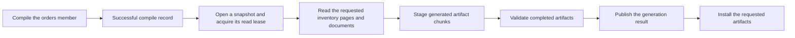
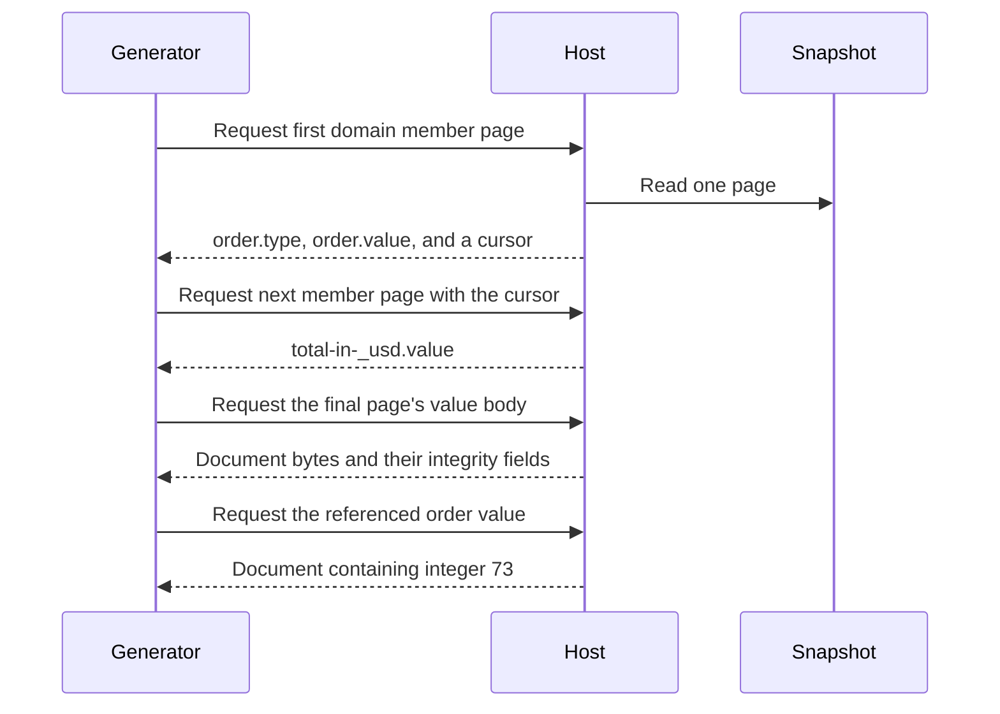

# Bounded generation from document trees

The `acme/orders` generator needs only a few documents at each step. It reads a module's inventory in pages, opens the last value body, follows that body's reference, and writes an artifact. The same exchange can run across a native process connection or a WASM byte call. This walkthrough describes the proposed MEP draft and its fixed inputs.

## Find the model from the compile result

The host resolves the output root in order from `--out-dir`, `MORPHIR_OUT_DIR`, the workspace root's `workspace.out_dir`, or `.morphir/out`. It resolves relative flag and environment paths from the invocation directory and configuration paths from the workspace root. Stages use the declared workspace member's identity.

For the `orders` member, a successful compile result at `<out>/packages/orders/compile.json` identifies the model in `compile.dest/morphir-ir/`. Generation opens the recorded model revision and holds its read lease until the operation ends. While that lease is live, another compile of the same member waits to replace its output.



The complete task publishes its result under `<out>/packages/orders/generate/`. Install then uses the successful generation record. On failure or cancellation, the host releases the lease and discards staged artifacts.

## Walk the final page

The [shared expected data](https://github.com/finos/morphir/blob/main/spec/mck/bounded-generation/fixtures/acme-orders/expected.json) records the model separately from any generator output. The workspace package has a public `domain` module and a private `audit` module. The dependency `morphir/SDK` supplies specifications. Their document paths retain the dependency segment `@`.

For the `domain` member inventory, the fixture sets a page size of two. Page one contains `order.type` and `order.value`. Page two contains `total-in-_usd.value`, the document for the semantic name `total-in-USD`. The body on that page refers to the **value** `acme/orders:domain#order`, which contains integer `73`. The type with the same name has its own document identity.



The negotiated tuple selects MEP `0.2.0-draft.2`, access version `0.1.0-draft.1`, one exact IR version, a codec, the tree layout and the contextual encoding. After the second member page, a continuing result can ask for the final value document.

```json
{
  "jsonrpc": "2.0",
  "id": 6,
  "result": {
    "state": "continue",
    "sessionId": "orders-generation",
    "round": 4,
    "requests": [
      {
        "requestId": "final-value",
        "kind": "document",
        "documentId": "pkg/acme/orders/domain/total-in-_usd.value"
      }
    ],
    "artifacts": [],
    "diagnostics": []
  }
}
```

The host sends the next `morphir.backend.generateModel.advance` request with that round, the matching request identity, the selected snapshot identity, and the document's length, digest and bytes. If the document is contextual, its bytes contain the file-local tables needed to expand its names. The [wire contract](https://github.com/finos/morphir/blob/main/spec/mep/model-access.md) defines the full exchange. The [session transcript](https://github.com/finos/morphir/blob/main/spec/mep/smithy/transcripts/session-model-access.md) follows both pages and gives complete request and result examples, including stale-round refusal, completion, failure and cancellation. The [older-session transcript](https://github.com/finos/morphir/blob/main/spec/mep/smithy/transcripts/session-model-access-unsupported.md) shows refusal when bounded access was never admitted.

## Compare the same model across profiles

Each row of the [case manifest](https://github.com/finos/morphir/blob/main/spec/mck/bounded-generation/fixtures/acme-orders/cases.json) uses the same logical package and independently recorded expectations. The plain tree supplies the expanded twin for each contextual document. Classic attributes, type and value roles, module visibility and dependency roles are part of the comparison.

| IR | Plain JSON | Plain YAML | Contextual JSON | Contextual YAML | Expanded baseline |
| --- | --- | --- | --- | --- | --- | --- |
| 3.1.0 | [Tree](https://github.com/finos/morphir/tree/main/spec/mck/bounded-generation/fixtures/acme-orders/v3.1/plain-json) | [Tree](https://github.com/finos/morphir/tree/main/spec/mck/bounded-generation/fixtures/acme-orders/v3.1/plain-yaml) | [Tree](https://github.com/finos/morphir/tree/main/spec/mck/bounded-generation/fixtures/acme-orders/v3.1/contextual-json) | [Tree](https://github.com/finos/morphir/tree/main/spec/mck/bounded-generation/fixtures/acme-orders/v3.1/contextual-yaml) | [Single file](https://github.com/finos/morphir/blob/main/spec/mck/bounded-generation/fixtures/acme-orders/v3.1/single-file.json) |
| 4.0.0 | [Tree](https://github.com/finos/morphir/tree/main/spec/mck/bounded-generation/fixtures/acme-orders/v4/plain-json) | [Tree](https://github.com/finos/morphir/tree/main/spec/mck/bounded-generation/fixtures/acme-orders/v4/plain-yaml) | [Tree](https://github.com/finos/morphir/tree/main/spec/mck/bounded-generation/fixtures/acme-orders/v4/contextual-json) | [Tree](https://github.com/finos/morphir/tree/main/spec/mck/bounded-generation/fixtures/acme-orders/v4/contextual-yaml) | [Single file](https://github.com/finos/morphir/blob/main/spec/mck/bounded-generation/fixtures/acme-orders/v4/single-file.json) |

The first host qualification uses native .NET and MoonBit and runs the same WASM generator under each host. A qualification receipt records the actual host and guest, tuple, input size, output equality, and enforced or measured bounds. The small fixture establishes correctness across representations. Large-package runs establish the resource claims.
