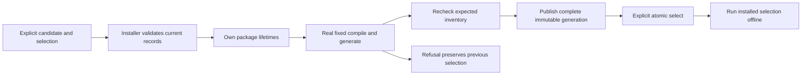

# Local composed toolchain generations

This contract extends the demonstrated [host-only local candidate](./local-developer-candidate.md)
to independently installed process providers. It remains explicit local developer
acquisition, not authenticated release acquisition. Implementations must retain
the complete host folder and use the existing extension installer, store,
published metadata formats and process connectors.

The first composed workflow uses the F# frontend and F# backend processes. The
managed host's built-in backend remains its ordinary default. Explicit process
selection must use the selected process rather than silently choosing that default.

## One new exact family

All five documents use `local-toolchains/0.1.0-preview.2`. Each document writes
`$schema` first and matches its full URL exactly. The schemas are:

| Document | Published schema | Location |
| --- | --- | --- |
| Candidate | [candidate](/schemas/local-toolchains/0.1.0-preview.2/candidate.schema.json) | Explicit setup input, then exact retained `candidate.json`. |
| Generation | [generation](/schemas/local-toolchains/0.1.0-preview.2/generation.schema.json) | `toolchains/generations/<generationSha256>/generation.json`. |
| Receipt | [receipt](/schemas/local-toolchains/0.1.0-preview.2/receipt.schema.json) | The same generation's `receipt.json`. |
| Selection | [selection](/schemas/local-toolchains/0.1.0-preview.2/selection.schema.json) | Home-relative `toolchains/default.json`. |
| Result | [result](/schemas/local-toolchains/0.1.0-preview.2/result.schema.json) | Manager command stdout. |

Preview.1 schemas, examples, reader branches and host-only identities remain
unchanged. No prerelease is converted implicitly. A reader supporting preview.1
alone refuses preview.2. MEP, IR, extension metadata and portable selection keep
their own existing versions. These schemas describe structure; actual byte
bindings, sorting, membership, paths, security and workflow outcomes require
runtime validation.

## Candidate identity and generation identity

`candidateSha256` is the digest of the exact input candidate bytes. The candidate
retains every preview.1 host member, including its complete `files` inventory,
and adds this closed object:

| `extensions` member | Meaning |
| --- | --- |
| `selectionSha256` | Digest of the exact supplied portable selection bytes. |
| `frontendId` | The selected process frontend's full extension identity. |
| `backendId` | The selected process backend's distinct full extension identity. |

Both roles must occur in the selection and agree with their installed records,
claims and actual negotiation. The selection keeps the existing
`toolchains/0.1.0-preview.1/selection.schema.json` format. Additional pins must
also bind validated installed records, but the two-role workflow does not qualify
unexercised providers.

`generationSha256` is the digest of the exact `generation.json` bytes written
after readiness. It binds the candidate, actual launch records and workflow
observations. It is not the candidate or archive digest. Changed launch arguments,
entry point, claims, provenance or observations change generation identity even
when the archive is unchanged. This is byte identity, not publisher authentication.



## Captured activation records

Under the existing shared state lock, the installer validates selected current
catalog and lock agreement, ids, versions, platform, archive/tree/manifest identity,
claims, provenance and applicable security state. It acquires package shared
lifetimes in the same operation and returns opaque owned activation records.
No guest, download or extraction runs under that lock.

An activation record binds the actual arguments, package entry point, executable
modes and all other launch-affecting facts. Its executable is derived from the
validated package and Home, never an input archive pathname. The manager cannot
manufacture the record from caller-supplied JSON. The installer exports records
in their existing formats:

```text
extensions/selection.json       exact supplied portable selection bytes
extensions/catalog.json         installer-generated selected-record projection
extensions/locks/<id>.json      exact individual extension lock bytes
extensions/metadata/...         additional existing-format envelopes, if required
```

The projection preserves every selected record's full JSON content and unknown
optional members. It need not preserve the entire global catalog's bytes.
Individual locks are preserved exactly. Every additional envelope must have an
explicit supported existing schema and a bound path and digest. No activation
fact comes from unbound logs or a mutable source directory.

## Readiness before a receipt exists

An unpublished preparation has **no retained-record authority**. Its captured
documents are expected current inventory, not permission to execute otherwise
unregistered records. The separate host performs these steps through the installer:

1. Open the exact supplied Home with existing no-follow and identity checks.
   Detect old or unsupported state and pending journal recovery before effects.
   A readiness launch does not recover or adopt state implicitly.
2. Under the shared state lock, validate current selected records, claims,
   provenance, package identities and applicable revocations. Recreate the same
   selected-record export and compare its exact catalog/lock/metadata bytes with
   the preparation's expectations. Any difference refuses without substitution.
3. Acquire package shared lifetimes there and return owned records derived from
   the actual current inventory. Release the state lock before launching.
4. Launch through the ordinary connector without another global-id lookup. Keep
   package lifetimes through actual process-tree and capture settlement.

The private stage contains candidate, selection and captured records, but no
generation manifest or receipt yet. An arbitrary or abandoned expectation directory
cannot revive a replaced record or bypass current validation. A name, environment
variable, asserted owner or busy lease file is not installer authentication.
There is no preparation token, signing key, IPC authority or provisional receipt.

The manager still owns its stage and mutation lease through settlement. Missing
or changed stage/input identities refuse. A directory containing either
`generation.json` or `receipt.json` cannot use unpublished rules; incomplete
published binding is a refusal, never a fallback to current inventory.

If inventory changes before a later readiness command, that command refuses.
Replacement after an operation acquires its record cannot change that operation's
arguments or release its package lifetime. Immediately before publication, the
manager rechecks the entire expected selected-record export under the state lock.
Changed state refuses publication without silently replacing the observed facts.
A fresh explicit setup may plan against the new state.

## Generation and workflow members

`generation.json` has exactly these members:

| Member | Meaning |
| --- | --- |
| `$schema` | Exact preview.2 generation schema URL. |
| `candidateSha256` | Digest of exact retained candidate bytes. |
| `selectionSha256` | Digest of exact portable selection bytes, equal to the candidate's binding. |
| `catalogSha256` | Digest of the installer-generated selected-record projection. |
| `locks` | Id-sorted unique `{ extensionId, sha256 }` entries for every selected lock. |
| `metadata` | Id/path-sorted unique `{ extensionId, path, sha256 }` entries for any additional required envelope. Paths are below `extensions/metadata/`. Empty only when the existing catalog/locks are self-contained. |
| `workflow` | Actual fixed-case observations described below. |

The workflow has exactly:

| Member | Meaning |
| --- | --- |
| `case` | `fsharp-compile-generate`. |
| `caseSha256` | Exact supported fixed case document digest. |
| `sourceSha256` | Exact supported `Pricing.fs` source digest. |
| `ir` | `{ sha256, semanticMatch: true }`. Digest of actual IR bytes and a separately completed comparison with the frozen semantic expectation. |
| `generatedFiles` | Path-sorted complete actual `{ path, bytes, sha256 }` output set, compared with the fixed expected set. |
| `providers` | Exactly one `frontend` and one `backend` observation. Each has `role`, `extensionId`, `version`, `mepVersion`, `modelTuple`, `checks`. |
| `checks` | The actual passed `workflow` check naming `fsharp-compile-generate`. |

Each provider's actual negotiated tuple uses the existing toolchain receipt's
`mepVersion` and `modelTuple` definitions. The frontend tuple names
`morphir.frontend.compileModel`, the backend `morphir.backend.generateModel`.
Provider checks contain one actual passed `integrity` and one actual passed
`capability` check, using the existing check vocabulary. Additional pins are not
made workflow-qualified by these two observations. A failed, skipped, unsupported
or absent check cannot produce a workflow-verified generation.

Full semantic/path checks remain required beyond JSON Schema: unique distinct
role ids, exact selection membership and coverage, sorted bindings, canonical
relative paths, no traversal/links, schema support, tuple/claim agreement, fixed
case identity and complete expected outputs. A structurally valid document is
not evidence that the recorded processes ran.

## Receipt, pointer and command results

The receipt retains the preview.1 host facts, `archiveSha256`, `installationPath`,
`entryPoint` and `owner`. The host folder remains
`store/tools/sha256/<archiveSha256>/`; entry-point semantics are unchanged. It adds
`generationSha256` beside `candidateSha256` and records `readiness: "workflow-verified"`.
That claim requires loading and checking the bound generation manifest and all
its records, including actual tuples and completed checks.

Publish the complete immutable directory at
`toolchains/generations/<generationSha256>/`. The manifest must hash to its
directory id; candidate and receipt must agree with it. The explicit selection
pointer then contains only `$schema`, `origin: "local-developer"`,
`generationSha256`, `receiptSha256`, and `receiptPath`, exactly
`toolchains/generations/<generationSha256>/receipt.json`.
Selection is published last. No failed readiness changes the previous selection.

Results keep `command`, `status`, `origin`, optional `diagnostic`, `receiptPath`
and `selectionPath`, and distinguish `candidateSha256` from `generationSha256`.
Successful installed/selected/shown results require both identities and a receipt.
A refused result requires an actual diagnostic. A setup plan requires the input
candidate digest and must not invent an observation-derived generation digest,
receipt or selection path. A selection plan names an already installed generation.
`selectionPath`, when present, is `toolchains/default.json`.

This illustrative plan is schema data, not an executed setup or acquired artifact:

```json
{
  "$schema": "https://morphir.finos.org/schemas/local-toolchains/0.1.0-preview.2/result.schema.json",
  "command": "setup",
  "status": "planned",
  "origin": "local-developer",
  "candidateSha256": "aaaaaaaaaaaaaaaaaaaaaaaaaaaaaaaaaaaaaaaaaaaaaaaaaaaaaaaaaaaaaaaa"
}
```

## Updates and retained generations

A supported published generation resolves its selected ids only through its
bound records and immutable package objects, with the installer's validation.
It never substitutes the current global record for a missing or broken snapshot.
Installing B may replace the shared A inventory record, but cannot rewrite A's
generation or package. Failed B readiness preserves A's pointer and future launch.
This guarantee applies to published A; an unpublished preparation may refuse on
changed current expectations as described above.

The host accepts retained-record mode only after checking the complete supported
generation binding under its manager-owned Home. A self-consistent arbitrary
overlay is not sufficient. Ordinary portable overlays continue to use current
installed inventory. Current applicable revocations remain enforced; snapshots
cannot undo a learned revocation or authenticate a developer publisher.

Collection treats supported generation references as roots in addition to current
extension locks. Unknown receipt/family/reference shapes block collection
conservatively. Removal requires unused generation and package lifetimes.
Catalog replacement alone does not authorize collection.

## Commands and required behavioral evidence

The composed branch uses:

```text
morphirup setup --candidate composed-candidate.json --local-archive host.zip --extensions-selection selection.json --home <H> --local-developer --dry-run
morphirup setup --candidate composed-candidate.json --local-archive host.zip --extensions-selection selection.json --home <H> --local-developer --yes
morphirup select --generation <generation SHA> --home <H>
morphirup show --home <H> --explain --json
morphirup run --home <H> -- compile ... --extension-id <frontend id>
morphirup run --home <H> -- generate ... --extension-id <backend id>
```

Providers are installed independently first with explicit local-source consent
through the existing installer. Preview.2 requires the selection input;
preview.1 refuses it. `--extension-id` is distinct from and mutually exclusive
with the existing path/command `--extension`. Existing path meanings remain.
The manager sets `MORPHIR_EXTENSION_OVERLAY` to the absolute generation directory,
overriding a foreign inherited value for its own selected run. Direct-host
overlays and existing lower selection levels keep their contracts.

Dry-run creates no lock, stage or receipt, executes no guest, performs no recovery
and changes no selection. Apply must prove real selected-provider compile and
generate, fixed semantic IR and exact 112-byte F# output without system .NET,
then installed offline repeat. Tests must also cover exact record drift, unknown
optional preservation, global A-to-B replacement with failed B readiness,
unpublished stale expectations, tuple/output tampering, partial publication,
concurrency, cancellation and whole-tree lifetime settlement.

These parent schemas, examples and authoring tests do not execute that workflow.
Runtime adoption, security/interop review, exact portable-lock CI restore,
authenticated acquisition and the remaining platforms/offerings still require
their own evidence. This contract is not production-release qualification.
