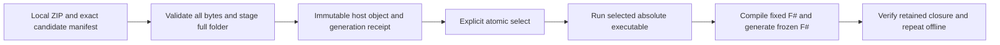

# Local developer toolchain candidates

The first usable local milestone imports an explicitly supplied Windows x64
self-contained managed Morphir folder archive. It uses the actual morphirup
installation, selection and execution paths. It is not production bootstrap or
acquired-release qualification. An archive digest establishes byte identity,
not publisher authentication. The user must explicitly choose local developer
policy before installation or execution of candidate code.



This is the `local-toolchains` family at `0.1.0-preview.1`. Each JSON document
starts with `$schema`, whose exact URL is
`https://morphir.finos.org/schemas/local-toolchains/0.1.0-preview.1/<name>.schema.json`.
The four names are `candidate`, `receipt`, `selection` and `result`. Readers
accept only their exact document URL, reject duplicate/unknown members at all
named levels, and never convert another family or prerelease. This explicit
local provenance family does not modify the published toolchains preview.1
schemas or invent a recipe, repository identity, signature or TUF result.

## Candidate and installed identity

`candidate.json` is a sidecar supplied alongside, not inside, its ZIP. Its raw
bytes have identity `candidateSha256`. These required members are closed:

| Member | Value |
| --- | --- |
| `$schema` | Exact candidate schema URL. |
| `origin` | `local-developer`. |
| `implementation` | `dotnet`. |
| `deployment` | `self-contained`. |
| `platform` | `win-x64`. |
| `version` | Canonical SemVer reported by the produced host, using the existing build version. No release version is selected by this milestone. |
| `sourceRepository` | `https://github.com/finos/morphir-dotnet`. Producer declaration, not attestation. |
| `sourceCommit` | Lowercase 40-character source commit identity. |
| `buildIdentity` | Nonempty exact producer build identity. Modified source must be disclosed and bound to a retained source manifest; a clean commit must not describe different source. |
| `archive` | Closed `{format: "zip", sha256: <lowercase SHA-256>, bytes: <positive byte length>}`. |
| `entryPoint` | Closed `{path: <portable relative path>, sha256: <lowercase SHA-256>}` within the full extracted host folder. |
| `files` | Exact complete array of `{path, sha256, bytes}` for all regular files, with unique portable paths, nonnegative lengths and at most 8192 entries. It includes runtime, FCS, backend and reference assembly dependencies. |

The official `SelfContained` release profile supplies the whole untrimmed,
non-single-file `Morphir.Managed` folder, including its bundled runtime and FCS
reference assemblies. The manager verifies exact archive length/digest and
entry-point digest and preserves the complete folder. It refuses unsafe paths,
links, duplicate archive targets, unsupported layouts and partial publication.
The schema's path pattern is only a lexical check. Existing portable-path,
archive and filesystem validators enforce containment and platform rules.

The full concrete [local candidate example](https://github.com/finos/morphir/blob/main/docs/spec/toolchain/local/candidate.example.json)
records the locally produced 320-file candidate, rather than abbreviating its
dependency inventory to an executable hash. Its producer explicitly records a
modified working tree. It is not publisher authentication or a release receipt.
The example alone is not an installable archive.

Verified host folders occupy `store/tools/sha256/<archiveSha256>/` below the
explicit Home. Immutable generation metadata occupies
`toolchains/generations/<candidateSha256>/`. That directory contains the exact
input `candidate.json` bytes and a generated `receipt.json`. The folder adapter
composes the existing archive checks, safe directories and cooperating mutation
lease. The extension-specific SingleFileStore layout and bounds do not apply
to host folders. This adds the missing host-folder path to the same manager,
not another installer.

The receipt repeats `origin`, `implementation`, `deployment`, `platform`,
`version`, `sourceCommit` and `buildIdentity`, and adds:

| Member | Value |
| --- | --- |
| `$schema` | Exact receipt schema URL. |
| `candidateSha256` | SHA-256 of the exact stored candidate sidecar bytes. |
| `archiveSha256` | Verified ZIP digest. |
| `installationPath` | `store/tools/sha256/<archiveSha256>`, relative to this Home. |
| `entryPoint` | Same portable relative entry point and verified digest. |
| `owner` | `manager-owned`. |
| `readiness` | `launch-verified`, only after the actual installed executable successfully reports the expected version. This does not claim workflow or production qualification. |

No receipt stores an archive source path, arbitrary external launch path or
fabricated authenticated repository. A missing or corrupt existing object is a
refusal, not permission to switch identities or repair foreign files silently.
Publication must preserve the prior selected generation on failure.

Installation, existing-object reuse and explicit selection verify every listed
file digest and length and refuse extra or missing files. Launch retains
VERIFY-B structural checks and LAUNCH-A process-tree leases. The offline
qualification compares the entire installed folder against the retained
candidate before and after execution; an unchanged executable alone does not
establish unchanged runtime or compiler dependencies.

The explicit Home is shared with the selected Morphir host. Setup admission
retains this slice's empty-or-recognized-local-state check before mutation; it
does not migrate, clean or overwrite foreign state. Later `run`, `show` and
`select` validate the manager-owned partitions: `store/tools`, `toolchains`,
`tmp/local-toolchain-*` and the manager's mutation lock. They do not refuse,
traverse or treat unrelated Home entries as manager authority. This includes
unrelated siblings under `store` and `tmp`.

The host may retain its existing task-publication locks under `locks/install`,
global configuration or a shared extension catalog. Those files must not make
the next manager command fail merely because they exist. Unexpected, linked,
corrupt or identity-mismatched state inside a manager-owned partition remains a
refusal. This ownership distinction adds no lock implementation, state cleanup
or authenticated-release claim.

## Selection and commands

`toolchains/default.json` is the user-default pointer in this explicit Home.
Its closed members are `$schema`, `origin: "local-developer"`,
`candidateSha256`, `receiptSha256`, and `receiptPath`, exactly
`toolchains/generations/<candidateSha256>/receipt.json`. Selection checks both
the immutable receipt and installed identity under the existing cooperating
lease and atomically publishes the pointer last. Run retains its selected
generation through actual child/capture settlement. It uses an absolute owned
executable path and argument vector, not shell evaluation. No project extension
selection, global catalog, shell profile or system installation is changed by
manager selection. Explicit host commands keep their own effects and authority.

The local milestone's command surface is:

```text
morphirup setup --candidate <candidate.json> --local-archive <candidate.zip> --home <absolute-home> --local-developer --dry-run
morphirup setup --candidate <candidate.json> --local-archive <candidate.zip> --home <absolute-home> --local-developer --yes
morphirup select --generation <candidateSha256> --home <absolute-home> [--dry-run]
morphirup show --home <absolute-home> [--explain] [--json]
morphirup run --home <absolute-home> -- <Morphir arguments>
```

`use` may be a thin alias of `select`, sharing its implementation and checks.
Setup installs the candidate but does not silently replace an existing default.
Select is explicit and accepts only an installed, launch-verified local
generation. Dry runs use the same input validation and plan path, but create no
Home, stage, object, lease, receipt or pointer and execute no candidate code.
`--yes` and `--dry-run` cannot be combined. Existing authenticated recipe
planning remains a separate unchanged command mode.

Manager JSON for these three commands is one exact `result.schema.json`
document with required `command` (`setup`, `select`, `show`), `status`
(`planned`, `installed`, `selected`, `shown`, `refused`) and
`origin: "local-developer"`. It may carry `candidateSha256`, `receiptPath`,
`selectionPath` and a closed `diagnostic` with `code` and `message`. Successful
install/select/show identify the candidate and receipt; planned results identify
the candidate without claiming stored state. Refused results require a real
diagnostic. Paths are Home-relative; `selectionPath`, when present, is exactly
`toolchains/default.json`. Progress is stderr. `run` transparently forwards the
child streams and exit status instead of mixing manager JSON into compiler
output. Show/explain prints local developer provenance and selected identities.

For this candidate, a successful plan has this JSON shape. It makes no claim
that installation or selection has happened:

```json
{
  "$schema": "https://morphir.finos.org/schemas/local-toolchains/0.1.0-preview.1/result.schema.json",
  "command": "setup",
  "status": "planned",
  "origin": "local-developer",
  "candidateSha256": "89ee87439452be1a0afd294fc40af0cb2aea9d3f80b0bb15d922a964134ca037"
}
```

## Evidence and remaining acceptance

The usable milestone requires one real empty-Home setup/select/show/run through
the native standalone manager and this runtime-bundled offering, fixed F#
compile/generate outputs, and an installed offline repeat with the candidate
archive withdrawn and system .NET unavailable. Logs, raw manifest, archive and
executable digests, receipt and selection bytes accompany a short command
walkthrough. A source-built candidate is always labeled as such.

Report usable milestones separately from the full acceptance checklist. The
next extensions use this same working path for independently installed process
providers, exact portable-lock CI restore, recovery, all four offerings and
supported platforms. Production bootstrap/authentication, acquired-release
qualification, external providers and WASM remain required where the final
acceptance names them; they do not block this first local managed journey.
