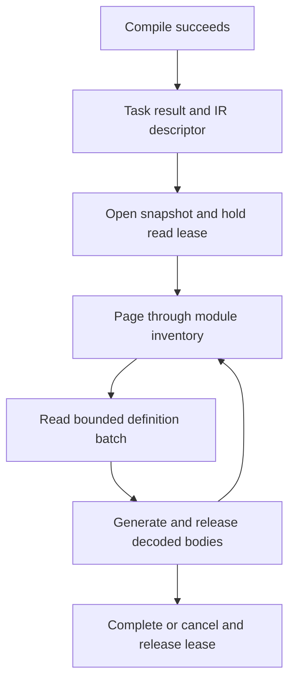

# Spec delta

## Purpose

Lets hosts and extensions discover and consume a consistent Morphir model in bounded portions, using recorded stage artifacts under the configurable workspace output root.

### A package moves between stages

An orders project compiles once. Its generator needs the public interface and one definition body at a time. It discovers the completed compile through a result record, opens a read lease and requests documents from that revision. Internal indexes and spill files belong to the consuming task; they are not installed as generated products.



For a workspace member `packages/orders`, the existing output convention gives:

```text
<resolved-out>/packages/orders/
  compile.json
  compile.lock
  compile.dest/morphir-ir/manifest.json
  compile.dest/morphir-ir/pkg/acme/orders/domain/module.json
  compile.dest/morphir-ir/pkg/acme/orders/domain/order.type.json
  compile.dest/morphir-ir/pkg/acme/orders/domain/total.value.json
  generate/example.json
  generate/example.dest/
```

The generator follows `compile.json`'s IR descriptor. The example paths illustrate the established naming convention; they are not a requirement that every consumer choose `compile` as its immediate producer. A transform can later supply the input artifact instead.

### Boundary to later work

Retained immutable build generations can eventually let compilation advance while readers keep an older generation. The first implementation uses the existing shared/exclusive lock contract. Evaluation, remote caches and arbitrary subexpression chunking do not follow automatically from these requirements.

## ADDED Requirements

### Requirement: Resolve one workspace output root
A host SHALL resolve one output root using `--out-dir`, then `MORPHIR_OUT_DIR`, then workspace-root `workspace.out_dir`, then `.morphir/out`. Flag and environment paths SHALL resolve from the invocation directory; configuration paths SHALL resolve from the workspace root. Member task paths SHALL use the member's declared workspace-relative identity.

#### Scenario: Relocated member build
- **WHEN** generation runs in `packages/orders` with `--out-dir C:/build/morphir-out`
- **THEN** its task artifacts and intermediate files use that resolved root and the member identity `packages/orders`
- **AND** it does not create a second output root inside the member

### Requirement: Discover stage inputs through successful records
A stage consuming a task output SHALL resolve its input through the producer's successful task result and artifact descriptor. It SHALL treat a missing or tombstoned result as unavailable, distinguish a successful result without the requested product, and resolve descriptor paths within the producer's task destination. Explicit user inputs SHALL be identified separately.

#### Scenario: Transform is the selected producer
- **WHEN** the pipeline selects a completed transform whose IR descriptor names `transformed-ir`
- **THEN** generation reads that descriptor without substituting `compile.dest/morphir-ir`

#### Scenario: Old files remain after failure
- **WHEN** a failed producer leaves files beside a tombstoned task result
- **THEN** generation refuses implicit consumption of those files as a successful stage output

### Requirement: Own intermediate artifacts by task
Indexes, captured inputs and spill files SHALL live under their owning task's destination within the resolved output root. Task result products SHALL exclude internal bookkeeping. Installation SHALL select declared products through the existing install contract, preserving the distinction between working outputs and installed outputs.

#### Scenario: Index is generated during code generation
- **WHEN** generation builds a lookup index and emits `Order.example`
- **THEN** both can be backed by its task destination
- **AND** only `Order.example` is declared as a generated product and selected for installation

### Requirement: Bind reads to one immutable snapshot
A snapshot SHALL bind a model identity, revision, dependency context and document inventory. Every successful read SHALL resolve within that binding. Sources that can change outside the producer's lease SHALL be captured into stable task-owned storage or verified through an equivalent immutable-source mechanism. A changed source SHALL fail the read rather than mix revisions.

#### Scenario: Explicit directory changes during a session
- **WHEN** a user supplies a mutable directory and edits `total.value.json` after the snapshot opens
- **THEN** the reader returns the captured revision or reports a source change
- **AND** it never combines the new body with documents from the earlier revision

### Requirement: Hold a producer lease through lazy consumption
A host reading a mutable task destination SHALL hold the producer's shared task lock from before reading its result through its last lazy read. Completion, cancellation and failure SHALL release that lease. A rerun requiring the producer's exclusive lock SHALL wait until its readers release the destination.

#### Scenario: Recompile while generation is waiting for another batch
- **WHEN** generation has opened the compile result and another compile starts before generation's final read
- **THEN** compilation cannot clear `compile.dest` during that session
- **AND** cancellation releases the lease so compilation can proceed

### Requirement: Keep semantic and storage identities distinct
Model access SHALL distinguish semantic node identity from logical document identity and physical location. Node identity SHALL include the owning package, module and type-or-value role. Document identity SHALL omit the serialization extension. Alias ids, escaped stems and byte offsets SHALL NOT replace semantic identity.

#### Scenario: Type and value share a name
- **WHEN** `order.type.json` and `order.value.json` exist in the same module
- **THEN** their semantic identities remain distinct
- **AND** writing the equivalent YAML documents preserves each identity

### Requirement: Dispatch by explicit supported contracts
Readers SHALL select the declared semantic IR, document encoding and layout contracts before decoding bodies. Plain JSON/YAML v3 trees SHALL use exactly `3.1.0`; v4 SHALL follow its support table. Readers SHALL preserve v3 attributes and definition/specification roles. Adopting this access contract SHALL NOT implicitly admit future IR versions or migrate v3 to v4.

#### Scenario: V3 Library remains classic
- **WHEN** a `3.1.0` JSON tree contains an expression with classic inferred-type attributes
- **THEN** its bounded reads retain those attributes under v3 semantics
- **AND** an expanded single-file Library can use integer `3` under the existing writer rules

#### Scenario: Unsupported future family
- **WHEN** a reader supporting v3.1 and v4.0 opens a tree of an unsupported future major
- **THEN** it reports unsupported version before decoding definition bodies

### Requirement: Enumerate through snapshot-bound pages
Discovery SHALL support bounded pages of modules and members with deterministic ordering. Continuation tokens SHALL bind the snapshot and discovery selection. A token from a different snapshot or selection SHALL be refused. Discovery SHALL NOT require retaining all definition bodies or the complete inventory in resident memory.

#### Scenario: Resume a large inventory
- **WHEN** a caller resumes a 64-entry page using its continuation token
- **THEN** the next page contains the next matching entries with no omissions or duplicates
- **AND** supplying that token for another snapshot fails

### Requirement: Bound reads before allocation
A reader SHALL enforce positive configured bounds on document bytes, decoded depth and nodes, batch bytes and resident decoded data. Counts SHALL include contexts and metadata. A file or inline document exceeding its bound SHALL fail with its logical location. Aggregate model size SHALL NOT be treated as a resident-memory allocation requirement.

#### Scenario: One enormous inline module
- **WHEN** a valid inline module exceeds the configured maximum document size
- **THEN** the reader refuses that document with a size-limit diagnostic before allocating an oversized buffer
- **AND** it does not silently split or migrate the model

### Requirement: State validation scope precisely
Opening an inventory SHALL NOT claim that unread bodies are valid. Each consumed document SHALL pass its version, identity, role and payload checks before use. A whole-tree structural guarantee SHALL require a complete bounded validation pass. Semantic guarantees SHALL require their own checks and SHALL remain distinct from byte integrity.

#### Scenario: Malformed unvisited value
- **WHEN** a snapshot inventory contains a value whose body has not been decoded
- **THEN** inventory discovery alone does not certify that body
- **AND** a whole-tree validation pass visits and rejects its malformed document

### Requirement: Bind derived indexes to exact artifacts
A derived index SHALL identify the source artifact digest, encoding, context contract and index contract. Byte offsets SHALL apply only to those exact bytes. A stale or unavailable optional index SHALL be rebuilt or bypassed through bounded access. An index SHALL NOT establish completeness of reference usage unless its contract and validation explicitly guarantee that property.

#### Scenario: Recompaction changes byte offsets
- **WHEN** a semantically equivalent recompaction changes the encoded source digest
- **THEN** the old byte-range index is not used for that representation
- **AND** the host can rebuild it under the consuming task's destination

### Requirement: Publish only completed task results
A consumer SHALL expose a successful artifact descriptor only after its operation and required validation complete. A failed run SHALL follow existing task tombstone rules and SHALL NOT install partial products. This contract SHALL NOT promise retention of a previous mutable `.dest` after a task rerun.

#### Scenario: Late invalid definition
- **WHEN** generation has staged files and a later definition fails validation
- **THEN** no successful result describes the partial output
- **AND** the run does not install those staged files

