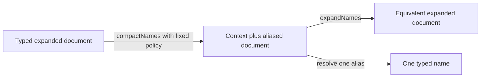

# Spec delta

## Purpose

Provides reversible, typed name aliases for Morphir documents, reducing repeated names without changing semantic identities or requiring consumers to materialize an expanded distribution.

### One repeated reference, one scoped alias

The running package repeats SDK references in signatures and expression attributes. A contextual document can carry their expanded spelling once. This is a storage envelope, not syntax accepted by the bare v3 or v4 codecs. Its JSON Schema is published at `https://morphir.finos.org/schemas/ir-context/0.1.0-draft.1/document.schema.json` (source `website/static/schemas/ir-context/0.1.0-draft.1/document.schema.json`), and its fixed examples are in `docs/spec/ir/context/examples/`.

```json
{
  "$schema": "https://morphir.finos.org/schemas/ir-context/0.1.0-draft.1/document.schema.json",
  "context": {
    "fqNames": {"q0": "morphir/SDK:basics#int"}
  },
  "document": {
    "formatVersion": 4,
    "name": "amount",
    "def": {
      "Public": {
        "TypeAliasDefinition": {
          "typeParams": [],
          "typeExp": {"Reference": {"fqname": {"$name": "q0"}}}
        }
      }
    }
  }
}
```

Expansion removes the contextual envelope and produces the ordinary document. Its type reference is:

```json
{"Reference": {"fqname": "morphir/SDK:basics#int"}}
```

This tiny example explains the mechanism; it does not claim a size saving. The envelope and table have costs, which the size experiment includes.



### Whole-file and bounded requirements

A whole-file reader reads the entire file, checks its context and expands every reference in memory. A whole-file writer compacts an expanded document it holds in memory. Bounded reading resolves names without building the expanded document and keeps resident memory within fixed limits. The first delivery of compacted files (morphir-dotnet `model convert`) is whole-file; bounded reading stays with tasks 2.2, 2.3, 3.2 and 3.3.

| Requirement | Whole-file reader and writer | Bounded reading |
| --- | --- | --- |
| Identify the envelope by its schema URL | All | — |
| Refuse an undeclared envelope | All | — |
| Refuse a malformed envelope | All | — |
| Preserve the document's semantic version | All | — |
| Use typed file-local tables | All | — |
| Refuse a malformed table entry | All | — |
| Reference aliases only at typed name positions | All | — |
| Resolve each position through its own table and encoding | All | — |
| Leave arbitrary content uninterpreted | All | — |
| Keep context resolution explicit and finite | All | — |
| Refuse duplicate members | All | — |
| Limit context tables and spellings | All (bounded reading adds resident-memory bounds) | — |
| Admit unknown optional context members safely | Ignoring unknown members; refusing unknown critical paths | Retaining the original bytes for pass-through |
| Make expansion lossless | All | — |
| Make compaction deterministic and cost-aware | All | — |
| Name the writer policy, and the seven policy requirements after it | All | — |
| Support bounded alias resolution | — | All |
| Order the context before the document | Refusing a context after the document | Accepting it through bounded spill or a further pass |
| Advertise the streaming order only when declared | All | All |
| Treat dictionaries independently of reference summaries | All | All |

### What remains an experiment

Shared contexts might reduce duplication across very small files, but also couple retrieval to another artifact. The first contract deliberately makes each file independently interpretable. An indexed-access experiment will compare this baseline with dictionary-only lookup and digest-bound occurrence indexes before proposing shared imports or independently readable blocks.

## ADDED Requirements

### Requirement: Identify the envelope by its schema URL
A contextual document SHALL be a JSON object whose `$schema` member is exactly `https://morphir.finos.org/schemas/ir-context/0.1.0-draft.1/document.schema.json`, with a `context` object, a `document` object and an optional `critical` array. All tree file kinds (manifest, module, type and value) and single-file distributions, of IR 3.1.0 and IR 4, SHALL support this envelope when claimed. Plain profiles SHALL keep their existing grammar; readers SHALL NOT infer support from an IR major alone.

#### Scenario: Legacy reader receives contextual storage
- **WHEN** a consumer supports plain v4 JSON but has not claimed contextual-document encoding
- **THEN** it is not selected to read the contextual artifact as plain v4 JSON
- **AND** the host uses a supported lossless expansion or reports unsupported encoding

### Requirement: Refuse an undeclared envelope
A top-level `$schema` member SHALL mark a file as an envelope, because no plain Morphir document defines that member. A reader SHALL refuse an envelope whose URL it does not declare with `context.undeclared_schema`, naming the file and the URL. A file without `$schema` SHALL be read as plain.

#### Scenario: An undeclared envelope version is refused
- **WHEN** a file's `$schema` is `https://morphir.finos.org/schemas/ir-context/0.2.0/document.schema.json` and the reader declares only `0.1.0-draft.1`
- **THEN** reading is refused with `context.undeclared_schema`, naming the file and the URL

### Requirement: Refuse a malformed envelope
A reader SHALL refuse a declared envelope with `context.invalid_envelope`, naming the file and the member, when it has no `context` member or no `document` member, when either is not a JSON object, or when `critical` is present and is not an array of strings. Member order SHALL stay `context.after_document`, unknown optional members SHALL stay ignored, and a `$schema` that is not a string SHALL be an undeclared URL.

#### Scenario: A critical member of the wrong JSON type
- **WHEN** a declared envelope's `critical` member is the string `"context.names"` rather than an array
- **THEN** reading is refused with `context.invalid_envelope`, naming the file and `critical`
- **AND** the reader does not report `context.unknown_critical` for it

#### Scenario: A missing document or a context that is not an object
- **WHEN** a declared envelope has no `document` member, or its `context` is an array
- **THEN** reading is refused with `context.invalid_envelope`, naming the file and the member

### Requirement: Preserve the document's semantic version
The enclosed document SHALL retain the exact semantic IR contract it represents, including its own `formatVersion`. Expansion SHALL produce a valid ordinary document of that version and kind before semantic use. Contextual encoding SHALL NOT relabel a v3 payload as v4 or add accepted members to an existing plain profile.

#### Scenario: Classic attribute slots survive
- **WHEN** a contextual v3.1 tree value contains classic names and expression attributes
- **THEN** expansion returns the equivalent v3.1 tree document with all attribute slots preserved
- **AND** it does not project those attributes into the v4 model

### Requirement: Use typed file-local tables
The context SHALL support optional `names`, `packagePaths`, `modulePaths` and `fqNames` tables. Their values SHALL be fully expanded canonical spellings of their respective Morphir types (a name, a package path, a module path, a `package:module#name` FQName), validated at admission. Alias ids SHALL be nonempty ASCII alphanumeric strings beginning with a letter. Missing tables SHALL mean empty tables.

#### Scenario: One alias id in distinct tables
- **WHEN** `names` and `fqNames` both define `a0`
- **THEN** a Name position resolves through `names` and an FQName position resolves through `fqNames`
- **AND** an FQName position cannot resolve through the Name table

### Requirement: Refuse a malformed table entry
A reader SHALL refuse with `context.invalid_entry`, naming the file and the entry, a known table that is not a JSON object, an alias id that is not ASCII letters and digits starting with a letter, and a spelling that is not a string or is not a spelling of its table's type. The limits SHALL be checked first.

#### Scenario: An FQName with a mixed-case segment
- **WHEN** `fqNames` maps `i` to `morphir/Sdk:basics#int`, whose segment `Sdk` is neither a word nor an initialism
- **THEN** reading is refused with `context.invalid_entry`, naming the file and `context.fqNames.i`

#### Scenario: A spelling that is not a name
- **WHEN** `names` maps `t` to `invoice_line`
- **THEN** reading is refused with `context.invalid_entry`, naming the file and `context.names.t`

#### Scenario: A limit is reported before the entry's form
- **WHEN** a table holds 16,385 entries, or one spelling is 1,025 bytes and not a name
- **THEN** reading is refused with `context.too_many_entries` or `context.name_too_long`, not `context.invalid_entry`

### Requirement: Reference aliases only at typed name positions
A reference SHALL be exactly the object `{"$name":"<id>"}` at a typed name position: a value the enclosed document's IR JSON Schema types as `Name`, `PackageName`, `ModuleName`, `Path` or `FQName`, a canonical-string envelope member of a v3 tree file, or a v4 type written as a bare FQName string. A reference SHALL NOT appear inside another typed position in this draft. Name-keyed maps SHALL remain expanded.

#### Scenario: A map key is not a position
- **WHEN** a v4 record type's fields map has the key `quantity`
- **THEN** the key stays spelled out, and only the field's type may be a reference

### Requirement: Resolve each position through its own table and encoding
A Name position SHALL resolve through `names`, a PackageName position through `packagePaths`, a ModuleName position through `modulePaths`, and an FQName position through `fqNames`. Expansion SHALL encode the spelling as the enclosed document's version writes that position: a canonical string in v4 and in v3 tree envelope members, classic word arrays in a classic v3 slot.

#### Scenario: FQName expands differently in classic JSON
- **WHEN** an alias occupies a classic v3 FQName slot
- **THEN** expansion returns the corresponding classic package/module/name arrays
- **AND** a v4 FQName slot expands to the corresponding canonical FQName string

#### Scenario: One table feeds strings and arrays in a v3 tree file
- **WHEN** a v3 tree type file uses aliases from `names` in its `name` member and in a classic record field name
- **THEN** the `name` member expands to the canonical string and the field name to classic word arrays

### Requirement: Leave arbitrary content uninterpreted
Expansion and compaction SHALL NOT rewrite ordinary strings, documentation, string literals, embedded document literals or opaque extension data as names. A member named `$name` in such a literal SHALL keep its ordinary value. Unsupported typed vocabulary SHALL fail according to the selected document contract rather than trigger heuristic replacement.

#### Scenario: A literal resembles an alias
- **WHEN** an embedded document literal contains `{"$name":"q0"}`
- **THEN** that literal remains unchanged by name expansion
- **AND** an actual FQName field containing the same object resolves through the context

### Requirement: Keep context resolution explicit and finite
The first contextual contract SHALL use only the file's own tables, with no remote loading, parent-directory inheritance, nested shadowing or alias-to-alias entries. Every used alias SHALL resolve in its typed table; an unresolved reference SHALL be refused with `context.unknown_alias`, naming the file and the id. Malformed known tables and malformed references SHALL be refused with the document and member location. A refused file SHALL give no document.

#### Scenario: A file is moved between directories
- **WHEN** a contextual type document is transported independently with its envelope
- **THEN** its aliases have the same expansion
- **AND** a missing alias is not supplied by a neighboring module file

#### Scenario: Unknown alias
- **WHEN** a document references `{"$name":"zz"}` and no table defines `zz`
- **THEN** reading is refused with `context.unknown_alias`, naming the file and `zz`

### Requirement: Refuse duplicate members
Duplicate members of a table, of the context or of the envelope SHALL be refused with `context.duplicate_entry`, naming the file and the member, even where a JSON parser would keep one of them.

#### Scenario: Duplicate table entry
- **WHEN** `fqNames` defines `i` twice in the same file
- **THEN** reading is refused with `context.duplicate_entry`, although a JSON Schema validator alone accepts the file

### Requirement: Limit context tables and spellings
A reader SHALL refuse a table with more than 16,384 entries with `context.too_many_entries`, and an expanded spelling longer than 1,024 UTF-8 bytes with `context.name_too_long`, before it expands any reference. A writer SHALL NOT exceed either limit. Context bytes SHALL count toward the reader's file size limit. `docs/spec/ir/context/examples/README.md` gives the reason for each value.

#### Scenario: A table one entry over the limit
- **WHEN** a `names` table holds 16,385 entries
- **THEN** reading is refused with `context.too_many_entries`

#### Scenario: Small alias references an oversized spelling
- **WHEN** `q0` maps to an expanded spelling of 1,025 bytes
- **THEN** admission refuses that context with `context.name_too_long` before repeated expansion allocates oversized names

### Requirement: Admit unknown optional context members safely
Readers SHALL ignore unknown optional envelope and context members. An optional `critical` list SHALL name exact member paths requiring understanding. Draft.1 SHALL recognize `$schema`, `context`, its four `context.<table>` paths, `critical` and `document`; any other critical path SHALL be refused with `context.unknown_critical` before alias resolution. Bounded readers SHALL also retain the original encoded artifact for opaque pass-through.

#### Scenario: Future optional table
- **WHEN** the context contains an unknown `prefixes` member that no alias uses and no critical path names
- **THEN** the reader ignores it
- **AND** marking `context.prefixes` critical causes `context.unknown_critical`

#### Scenario: Pass-through keeps the original bytes
- **WHEN** a bounded reader admits a file with an ignored `prefixes` member and passes the file on
- **THEN** it retains the original artifact bytes rather than re-encoding them

### Requirement: Make expansion lossless
For every supported model document and admitted compaction policy, `expandNames(compactNames(document))` SHALL equal the original typed document. Equality SHALL preserve all supported attributes, metadata, literals and semantically ordered collections. Semantic node addresses SHALL not depend on alias allocation. Byte digests SHALL continue to bind the actual encoded bytes.

#### Scenario: Parameter order expands back
- **WHEN** a compacted v4 value file's `inputTypes` lists `rate`, `amount`, `discount`, `limit` (case `ordered-inputs`)
- **THEN** its expansion lists the parameters in that order, as the original document did

#### Scenario: Different aliases name the same type
- **WHEN** two contextual representations use `q0` and `ref7` for the same FQName
- **THEN** their expanded documents and semantic node identities are equal
- **AND** their distinct encoded bytes are not assigned the same byte digest by assumption

### Requirement: Make compaction deterministic and cost-aware
A compactor SHALL identify its fixed writer policy and produce deterministic output for the same document and policy. That policy SHALL define alias allocation, ordering and ties, account for table/reference overhead, and retain expanded occurrences where introducing an alias does not save encoded bytes. Text minification SHALL remain independent of name compaction.

#### Scenario: A short name occurs once
- **WHEN** aliasing a single occurrence of `x` would increase encoded size
- **THEN** the compactor leaves that occurrence expanded
- **AND** repeating compaction with the same policy yields identical bytes

### Requirement: Name the writer policy
The first published writer policy SHALL be `morphir.compact/0.1.0-draft.1`, defined by the requirements below and the fixed cases in `docs/spec/ir/context/policy/morphir.compact-0.1.0-draft.1/`, whose expected bytes are worked out by hand from this text. A writer using it SHALL name it in its result. Its expected bytes SHALL NOT be produced by an implementation.

#### Scenario: The fixed cases match byte for byte
- **WHEN** a writer applies the policy to each case's `input.json`
- **THEN** its output bytes equal the case's `expected.json`

### Requirement: Write compacted output as RFC 8785 canonical JSON
A file written under the policy SHALL be in its written form: the RFC 8785 (JCS) text of the envelope with exactly `$schema`, `context` and `document`, or of the plain document when the policy declines, with the member order of order-carrying objects excepted. JCS sorts all other members, so the context precedes the document; a table with no entry is left out. Every size the policy compares SHALL be the UTF-8 byte length of written-form text.

#### Scenario: Tables in JCS order
- **WHEN** a compacted file's context has entries in all four tables
- **THEN** the tables appear as `fqNames`, `modulePaths`, `names`, `packagePaths`

#### Scenario: Non-ASCII content is measured as UTF-8
- **WHEN** a file to compact holds a doc string with `é`
- **THEN** the policy counts `é` as two bytes, and the written file holds `é` unescaped

### Requirement: Keep the order of order-carrying members
The members of an order-carrying object SHALL keep their order in the plain document given to the writer, and expansion SHALL return them in that order. JCS escaping, number form and the absence of whitespace SHALL still apply to them. Member order does not change a byte length, so every cost equals that of the JCS text. An order-carrying object SHALL be one whose member order the enclosed document's IR JSON Schema declares semantic.

#### Scenario: Parameter order survives compaction
- **WHEN** a v4 value file's `inputTypes` lists `rate` before `amount` (case `ordered-inputs`)
- **THEN** the written file lists `rate` before `amount`, although JCS would sort `amount` first
- **AND** every other object in the file is written in JCS order

#### Scenario: A declined file keeps parameter order
- **WHEN** the policy declines to compact a v4 value file whose `inputTypes` is not in sorted order
- **THEN** the plain document it writes keeps that order of `inputTypes`

### Requirement: List the order-carrying objects
In IR 4 the order-carrying objects SHALL be exactly the `inputTypes` of the value definition bodies `ExpressionBody`, `NativeBody`, `ExternalBody` and `IncompleteBody`, and the object form of a `ValueSpecification`'s `inputs`, wherever they appear; `website/static/schemas/morphir-ir-v4.json` says the key order of each is the parameter order. IR 3 SHALL have none: its parameters are arrays. No object inside a `DocumentLiteral` SHALL be one.

#### Scenario: A specification's inputs keep their order
- **WHEN** a v4 value file's `spec` has `inputs` `{"rate": …, "amount": …}`
- **THEN** the written file keeps `rate` before `amount`

#### Scenario: A record's fields are sorted
- **WHEN** a v4 record type lists the field `rate` before `amount`
- **THEN** the written file sorts the fields, because the schema declares no order for them

#### Scenario: IR 3 has no order-carrying object
- **WHEN** the policy writes a v3 value file
- **THEN** every object in it is written in JCS order, and its parameters keep their order as array items

### Requirement: Take candidates at outermost typed positions
A candidate SHALL be a pair of a table and an expanded spelling. Its occurrences SHALL be the typed name positions of the plain document holding it that are not inside another typed position. An occurrence's size SHALL be the JCS size of its value as the plain document writes it: the canonical string with its quotes, or the classic word arrays of a classic v3 slot.

#### Scenario: A classic slot weighs its arrays
- **WHEN** an FQName occupies a classic v3 slot
- **THEN** its occurrence size is that of its classic package, module and name arrays, not of its canonical spelling

### Requirement: Allocate alias ids in first-use order
Candidates SHALL be taken in the order of the byte offset of their first occurrence in the written form of the plain document (so in document order inside an order-carrying object), then by the ordinal order of the spelling, then by table in the order `names`, `packagePaths`, `modulePaths`, `fqNames`. Ids SHALL be `a` to `z`, then `aa`, `ab` and on (bijective base 26), one sequence for all tables. Only an aliased candidate SHALL consume an id.

#### Scenario: Ids follow first use, not input order
- **WHEN** the input lists a field of type F before a field of type G, but JCS sorts the G field first
- **THEN** G is aliased as `a` and F as `b`

### Requirement: Measure each cost as the bytes of its JCS text
`len(x)` SHALL be the UTF-8 byte length of an id, a spelling or a table name as JCS writes it inside a string, without its quotes; ids and spellings are ASCII, so it is their character count. Every other cost SHALL be the whole byte length of the JCS text it names, counting each quote, colon, comma, bracket and brace in that text and nothing else.

#### Scenario: A table name is measured without its quotes
- **WHEN** the policy measures the `fqNames` table
- **THEN** `len(fqNames)` is 7, and its header `"fqNames":{}` costs 12 bytes

### Requirement: Count the envelope's fixed bytes, table headers and entries
The envelope without its tables and document SHALL cost 118 bytes: `{"$schema":"` (12), the 79-byte URL, `","context":{` (13), `},"document":` (13) and `}` (1). Each table holding an entry SHALL cost its header `"<table>":{}`, `len(table) + 5` bytes: 12 for `fqNames`, 16 for `modulePaths`, 10 for `names`, 17 for `packagePaths`. Each entry `"<id>":"<spelling>"` SHALL cost `len(id) + len(spelling) + 5`, and `k` entries SHALL add `k − 1` commas.

#### Scenario: One entry in one table
- **WHEN** the context holds only the `fqNames` entry `a` with a 158-byte spelling
- **THEN** the envelope adds 118 + 12 + (1 + 158 + 5) + 0 = 294 bytes besides the document

### Requirement: Alias a name only when it saves more than its entry
With `R = 12 + len(id)`, the bytes of the reference `{"$name":"<id>"}`, and `E = len(id) + len(spelling) + 6`, the bytes of the entry `"<id>":"<spelling>"` with one comma, a candidate SHALL be aliased only when the sum over its occurrences of `size − R` is greater than `E`. A candidate whose saving equals `E` SHALL stay spelled out. A table that holds 16,384 entries SHALL take no more.

#### Scenario: A name used once stays spelled out
- **WHEN** a v4 file uses a fully qualified name once and the policy is applied
- **THEN** the written file spells that name in place and its table has no entry for it

#### Scenario: A saving equal to the cost
- **WHEN** aliasing a candidate saves exactly the bytes of its table entry
- **THEN** the candidate stays spelled out and consumes no id

### Requirement: Decline compaction that would be a loss
Let `H` be the bytes the envelope adds: 118, plus each table header, plus each entry, plus `k − 1` commas. The writer SHALL write the envelope only when the aliased candidates' savings are greater than `H`, so that the file is smaller than the plain one. Savings equal to `H` give a file of the same size, and the writer SHALL decline. When it declines, or when no candidate is aliased, it SHALL write the plain document in the written form; its result SHALL say that no alias was worth its cost.

#### Scenario: Compaction that would be a loss is not applied
- **WHEN** an alias saves more than its entry costs but less than the envelope adds
- **THEN** the written file is the plain document in the written form, with no envelope

#### Scenario: Savings equal to the overhead
- **WHEN** the aliased candidates save exactly `H` bytes (case `loss-boundary-declined`: 294 = 294)
- **THEN** the written file is the plain document in the written form, with no envelope

#### Scenario: Savings one byte above the overhead
- **WHEN** the aliased candidates save `H + 1` bytes (case `loss-boundary-accepted`: 296 against 295)
- **THEN** the envelope is written, one byte smaller than the plain document

### Requirement: Support bounded alias resolution
Bounded readers SHALL support resolving individual names without constructing the complete expanded document. Context bytes, entry counts and expanded spelling lengths SHALL count toward admission limits. Expansion exports SHALL support bounded writing. A valid context SHALL NOT bypass document, batch or resident-memory bounds.

#### Scenario: One name is read without the document
- **WHEN** a bounded reader is asked for the FQName at one position of a large compacted value file
- **THEN** it resolves that name through the context without building the expanded document

### Requirement: Order the context before the document
A whole-file reader SHALL refuse a contextual document whose `document` member comes before its `context` member, with `context.after_document`, naming the file and saying that the context must come first. A bounded general reader MAY accept that order using bounded spill or a further pass. A separately declared streaming form SHALL require the envelope's `$schema` and complete context before the document.

#### Scenario: A whole-file reader meets a context after the document
- **WHEN** a whole-file reader reads a file whose `document` member comes before its `context` member
- **THEN** reading is refused with `context.after_document`, naming the file

#### Scenario: Context comes last for a bounded reader
- **WHEN** a bounded general reader reads a document that places `document` before `context`
- **THEN** it accepts it using bounded spill or a further pass
- **AND** a streaming-only request rejects that representation with an ordering diagnostic or uses an explicit supported conversion

### Requirement: Advertise the streaming order only when declared
A nonstreaming document SHALL NOT be advertised as satisfying the streaming ordering guarantee merely because a canonical writer usually places the context first.

#### Scenario: A canonical file is not a streaming declaration
- **WHEN** a writer places `context` before `document` without declaring the streaming form
- **THEN** a consumer does not treat the file as satisfying the streaming ordering guarantee

### Requirement: Treat dictionaries independently of reference summaries
A context table SHALL NOT be treated as a complete occurrence or dependency index. Reference push-down SHALL require separately specified complete summaries or indexes bound to the source snapshot and contexts. Missing optional summaries SHALL permit a bounded scan; they SHALL NOT imply that a reference is absent.

#### Scenario: Unused alias and expanded reference
- **WHEN** the table contains an unused SDK alias and the body contains a different fully expanded SDK reference
- **THEN** table membership alone neither proves use of the alias nor absence of the expanded reference
