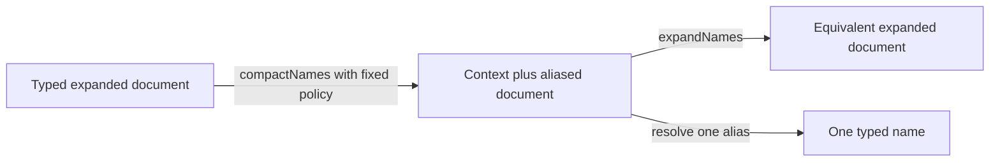

# Spec delta

## Purpose

Provides reversible, typed name aliases for Morphir documents, reducing repeated names without changing semantic identities or requiring consumers to materialize an expanded distribution.

### One repeated reference, one scoped alias

The running package repeats SDK references in signatures and expression attributes. A contextual document can carry their expanded spelling once. This is a proposed storage envelope, not syntax accepted by the current bare v4 tree codec.

```json
{
  "contextVersion": "0.1.0-draft.1",
  "context": {
    "fqNames": {"q0": "morphir/SDK:basics#int"}
  },
  "document": {
    "formatVersion": 4,
    "name": "amount",
    "def": {
      "Public": {
        "TypeAliasDefinition": {
          "typeParams": [],
          "typeExp": {"Reference": {"fqname": {"$name": "q0"}}}
        }
      }
    }
  }
}
```

Expansion removes the contextual envelope and produces the ordinary document. Its type reference is:

```json
{"Reference": {"fqname": "morphir/SDK:basics#int"}}
```

This tiny example explains the mechanism; it does not claim a size saving. The envelope and table have costs, which the size experiment includes.



### What remains an experiment

Shared contexts might reduce duplication across very small files, but also couple retrieval to another artifact. The first contract deliberately makes each file independently interpretable. An indexed-access experiment will compare this baseline with dictionary-only lookup and digest-bound occurrence indexes before proposing shared imports or independently readable blocks.

## ADDED Requirements

### Requirement: Select a separately versioned contextual encoding
Contextual documents SHALL use an explicitly selected encoding with `contextVersion` exactly `0.1.0-draft.1`, a `context` object and a `document` value. All tree file kinds and single-file distributions SHALL support this envelope when claimed. Plain profiles SHALL keep their existing grammar; readers SHALL NOT infer support from an IR major alone.

#### Scenario: Legacy reader receives contextual storage
- **WHEN** a consumer supports plain v4 JSON but has not claimed contextual-document encoding
- **THEN** it is not selected to read the contextual artifact as plain v4 JSON
- **AND** the host uses a supported lossless expansion or reports unsupported encoding

### Requirement: Preserve the document's semantic version
The enclosed document SHALL retain the exact semantic IR contract it represents. Expansion SHALL produce a valid ordinary document of that version and kind before semantic use. Contextual encoding SHALL NOT relabel a v3 payload as v4 or add accepted members to an existing plain profile.

#### Scenario: Classic attribute slots survive
- **WHEN** a contextual v3.1 tree value contains classic names and expression attributes
- **THEN** expansion returns the equivalent v3.1 tree document with all attribute slots preserved
- **AND** it does not project those attributes into the v4 model

### Requirement: Use typed file-local tables
The context SHALL support optional `names`, `packagePaths`, `modulePaths` and `fqNames` tables. Their values SHALL be fully expanded canonical spellings of their respective Morphir types, validated at admission. Alias ids SHALL be nonempty ASCII alphanumeric strings beginning with a letter. Missing tables SHALL mean empty tables.

#### Scenario: One alias id in distinct tables
- **WHEN** `names` and `fqNames` both define `a0`
- **THEN** a Name position resolves through `names` and an FQName position resolves through `fqNames`
- **AND** an FQName position cannot resolve through the Name table

### Requirement: Reference aliases only at typed name positions
A reference SHALL be exactly the object `{"$name":"<id>"}` at a schema-defined Name, PackagePath, ModulePath or FQName position. Expansion SHALL resolve through that position's table and encode the result in the enclosed document's version-specific representation. Name-keyed maps SHALL remain expanded in this first contract.

#### Scenario: FQName expands differently in classic JSON
- **WHEN** an alias occupies a classic v3 FQName slot
- **THEN** expansion returns the corresponding classic package/module/name arrays
- **AND** a v4 FQName slot expands to the corresponding canonical FQName string

### Requirement: Leave arbitrary content uninterpreted
Expansion and compaction SHALL NOT rewrite ordinary strings, documentation, string literals, embedded document literals or opaque extension data as names. A member named `$name` in such a literal SHALL keep its ordinary value. Unsupported typed vocabulary SHALL fail according to the selected document contract rather than trigger heuristic replacement.

#### Scenario: A literal resembles an alias
- **WHEN** an embedded document literal contains `{"$name":"q0"}`
- **THEN** that literal remains unchanged by name expansion
- **AND** an actual FQName field containing the same object resolves through the context

### Requirement: Keep context resolution explicit and finite
The first contextual contract SHALL use only the file's own tables, with no remote loading, parent-directory inheritance, nested shadowing or alias-to-alias entries. Every used alias SHALL resolve in its typed table. Duplicate table members, malformed known tables and malformed references SHALL be refused with the document and member location.

#### Scenario: A file is moved between directories
- **WHEN** a contextual type document is transported independently with its envelope
- **THEN** its aliases have the same expansion
- **AND** a missing alias is not supplied by a neighboring module file

### Requirement: Admit unknown optional context members safely
Readers SHALL ignore unknown optional envelope/context members and retain original encoded artifacts for opaque pass-through. An optional `critical` list SHALL name exact paths requiring understanding. Draft.1 SHALL recognize `contextVersion`, `context`, its four named tables, `document` and `critical`; any other critical path SHALL be refused before alias resolution.

#### Scenario: Future optional table
- **WHEN** the context contains an unknown `prefixes` member that no alias uses and no critical path names
- **THEN** the reader ignores it while retaining the original artifact
- **AND** marking `context.prefixes` critical causes a precise unsupported-critical-path refusal

### Requirement: Make expansion lossless
For every supported model document and admitted compaction policy, `expandNames(compactNames(document))` SHALL equal the original typed document. Equality SHALL preserve all supported attributes, metadata, literals and semantically ordered collections. Semantic node addresses SHALL not depend on alias allocation. Byte digests SHALL continue to bind the actual encoded bytes.

#### Scenario: Different aliases name the same type
- **WHEN** two contextual representations use `q0` and `ref7` for the same FQName
- **THEN** their expanded documents and semantic node identities are equal
- **AND** their distinct encoded bytes are not assigned the same byte digest by assumption

### Requirement: Make compaction deterministic and cost-aware
A compactor SHALL identify its fixed writer policy and produce deterministic output for the same document and policy. That policy SHALL define alias allocation, ordering and ties, account for table/reference overhead, and retain expanded occurrences where introducing an alias does not save encoded bytes. Text minification SHALL remain independent of name compaction.

#### Scenario: A short name occurs once
- **WHEN** aliasing a single occurrence of `x` would increase encoded size
- **THEN** the compactor leaves that occurrence expanded
- **AND** repeating compaction with the same policy yields identical bytes

### Requirement: Support bounded alias resolution
Readers SHALL support resolving individual names without constructing the complete expanded document. Context bytes, entry counts and expanded spelling lengths SHALL count toward admission limits. Expansion exports SHALL support bounded writing. A valid context SHALL NOT bypass document, batch or resident-memory bounds.

#### Scenario: Small alias references an oversized spelling
- **WHEN** `q0` maps to an expanded FQName beyond the configured spelling limit
- **THEN** admission rejects that context before repeated expansion allocates oversized names

### Requirement: Preserve unordered object semantics
General contextual JSON/YAML readers SHALL accept context and document members in either order. A separately declared streaming form SHALL require the envelope version and complete context before the document. A nonstreaming document SHALL NOT be advertised as satisfying that ordering guarantee merely because a canonical writer usually places context first.

#### Scenario: Context comes last
- **WHEN** a general contextual document places `document` before `context`
- **THEN** a general reader accepts it using bounded spill or a further pass
- **AND** a streaming-only request rejects that representation with an ordering diagnostic or uses an explicit supported conversion

### Requirement: Treat dictionaries independently of reference summaries
A context table SHALL NOT be treated as a complete occurrence or dependency index. Reference push-down SHALL require separately specified complete summaries or indexes bound to the source snapshot and contexts. Missing optional summaries SHALL permit a bounded scan; they SHALL NOT imply that a reference is absent.

#### Scenario: Unused alias and expanded reference
- **WHEN** the table contains an unused SDK alias and the body contains a different fully expanded SDK reference
- **THEN** table membership alone neither proves use of the alias nor absence of the expanded reference

