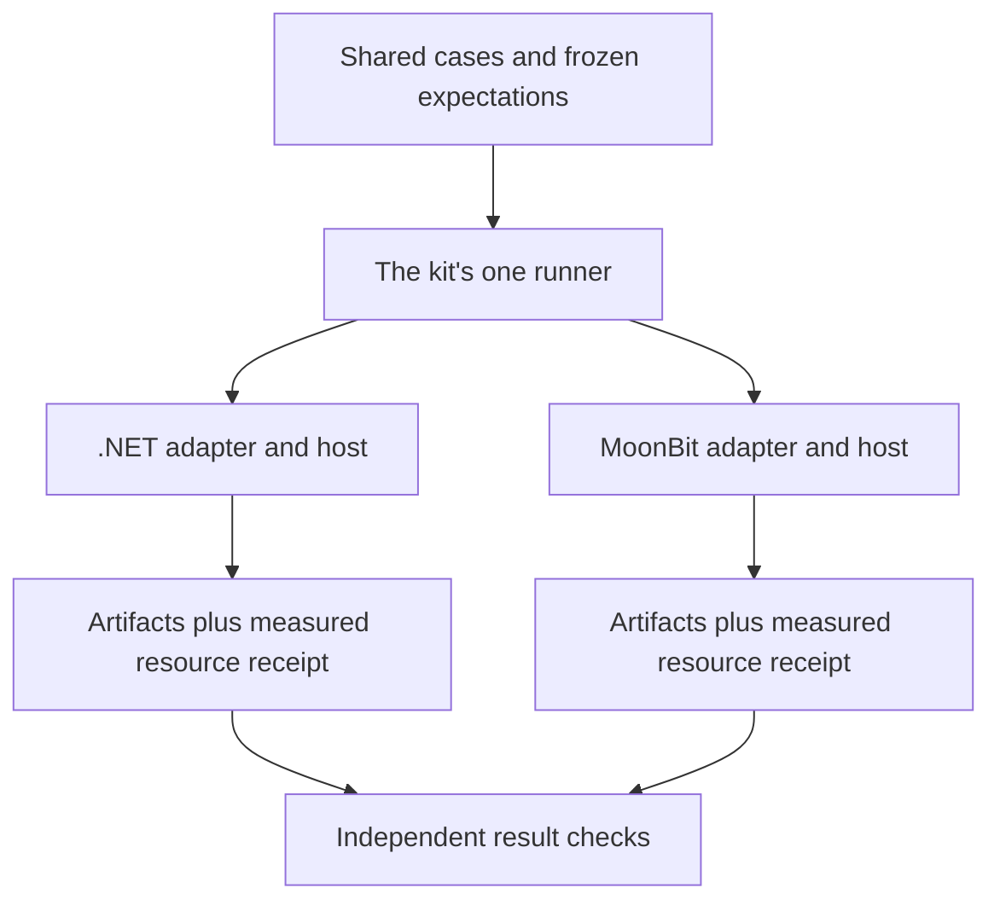

# Spec delta

## Purpose

Qualifies generation from large document-tree models using shared fixed expectations and measured resource evidence, with independent .NET and MoonBit implementation receipts.

### Prove the whole journey

Start with a tiny orders package whose generated files are easy to review. Freeze those expectations before running an adapter. Grow the same shape by adding definitions while keeping individual documents bounded. The last definition affects an expected output, so a generator that stops after the first page cannot pass.

The runner is moving from the Rust `morphir mck` to the .NET host in morphir-dotnet. The cases and expectations are data, so they are written to be consumed unchanged by whichever host runs them.

For each implementation and target, compare its single-file baseline, plain tree, contextual tree and expanded contextual tree. Cross-host runs of the same WASM generator also compare their fixed artifacts. Different target languages do not need byte-identical output.

### Interpreting completion

A small round-trip case proves name compaction correctness. A large resource case proves the selected generator and host path under recorded limits. Neither proves that every generator, every dependency graph or every WASM engine has bounded behavior. First-delivery receipts name the exact qualified paths.

## ADDED Requirements

### Requirement: Keep one shared compatibility runner
The parent repository SHALL own the cases, fixed expected results and report contract. Implementations SHALL participate through explicitly selected adapters to the kit's single runner, whichever host that runner lives in. Cases and expected results SHALL NOT depend on the runner's implementation. This capability SHALL NOT introduce a second compatibility checker or make morphir-rust runtime adoption a prerequisite.

#### Scenario: Select the .NET implementation
- **WHEN** a run explicitly selects the .NET adapter
- **THEN** the runner evaluates that implementation's observations against the shared fixed cases
- **AND** it does not substitute the runner's own IR codec as the implementation under test

#### Scenario: The runner moves to another host
- **WHEN** the kit's runner is rehosted from one implementation to another
- **THEN** the cases and fixed expected results are consumed unchanged
- **AND** a report produced before the move still passes the report check

### Requirement: Qualify .NET and MoonBit first
First-delivery evidence SHALL contain separate morphir-dotnet and morphir-moonbit receipts for in-process bounded readers, native host generation and a WASM generation extension path for each host. Other implementations SHALL be eligible for later qualification. Rust runtime parity SHALL NOT gate first delivery.

#### Scenario: Rust adoption is pending
- **WHEN** both first implementations satisfy all required cases and resource gates but morphir-rust has no bounded reader
- **THEN** first-delivery qualification can pass with Rust adoption explicitly recorded as deferred

### Requirement: Cover the supported format matrix honestly
Required baseline cases SHALL exercise v3.1 and v4.0 JSON/YAML trees in plain and contextual encodings. Single-file baselines SHALL use the equivalent supported version. Ion SHALL have separately labeled draft qualification when implemented. A passing JSON/YAML case SHALL NOT imply Ion, future IR or frontend batch-production support.

#### Scenario: V3 tree compared with a single file
- **WHEN** a v3.1 Library tree expands to the equivalent single-file Library at integer `3`
- **THEN** the comparison uses v3 semantics and preserves attributes instead of requiring identical version scalars

### Requirement: Freeze expectations independently
Cases SHALL contain independently authored expected artifacts or semantic results before adapters execute. A shared neutral generator fixture SHALL consume signatures and bodies, including references in the final inventory page. Expectations SHALL NOT be generated from the implementation under test or accepted solely because two implementations agree.

#### Scenario: Generator ignores the final page
- **WHEN** a deliberately changed value in the last page is absent from the observed generated result
- **THEN** the fixed expectation fails even if an earlier output prefix matches

### Requirement: Compare generation across representations
For the same implementation, generator, options and logical model, the kit SHALL compare complete generated artifacts from equivalent single-file, plain-tree, compacted-tree and expanded-tree inputs. Cross-host runs of the same shared WASM generator SHALL match fixed expected artifacts. Only explicitly specified normalization SHALL be applied.

#### Scenario: Compaction changes an output
- **WHEN** compacted input changes a generated filename or value relative to its expanded equivalent
- **THEN** qualification fails rather than treating the change as alias-dependent behavior

### Requirement: Qualify models larger than memory ceilings
A large qualification fixture SHALL exceed the declared guest linear-memory ceiling and the declared host resident-memory ceiling in aggregate expanded input bytes, while each document fits its configured bound. The run SHALL complete within those ceilings with fixed output expectations. Host, guest and descendant-process measurements SHALL identify their scope and source.

#### Scenario: Fixture is smaller than the ceiling
- **WHEN** a run succeeds but its aggregate model bytes do not exceed a required memory ceiling
- **THEN** it cannot satisfy the large-model resource gate

### Requirement: Measure resident working data and output
Receipts SHALL record peak host resident memory, guest memory, resident decoded bytes or nodes, maximum input/output batch sizes, retained context/index budgets, bytes read and written, and elapsed time. Repeated definitions SHALL not require unbounded resident body or artifact accumulation. An unenforced or unmeasured mandatory ceiling SHALL prevent resource qualification.

#### Scenario: Output buffers grow with the model
- **WHEN** decoded input stays bounded but the host accumulates all generated chunks in memory and exceeds its ceiling
- **THEN** the resource gate fails even though the resulting artifacts are correct

### Requirement: Exercise stage and snapshot failures
The kit SHALL cover a relocated output root, workspace-member isolation, descriptor-based stage lookup, missing/tombstoned producer records, recompilation during a read lease, stale indexes and explicit-source changes. It SHALL verify that failure exposes no successful partial task result and installs no partial generated artifacts.

#### Scenario: Compile attempts to clear an active input
- **WHEN** generation pauses between batches while holding a compile snapshot and compilation attempts to rerun
- **THEN** the producer waits until generation completes or cancels
- **AND** subsequent reads belong to the original snapshot

### Requirement: Exercise malformed and hostile exchanges
The kit SHALL cover ambiguous manifests, mismatched file versions and names, missing documents, invalid typed aliases, duplicate members, context ordering, oversized documents, exhausted cumulative budgets, stale rounds, unsafe artifact paths, missing artifact end markers, timeouts and cancellation. Diagnostics SHALL identify the relevant operation or logical location.

#### Scenario: Individually small contexts exhaust a batch
- **WHEN** many valid contextual documents exceed the negotiated aggregate batch allowance
- **THEN** the receiver rejects that batch without invoking semantic generation on its oversized contents

### Requirement: Keep indexed lookup experimental
Indexed-access experiments SHALL compare plain scanning, dictionary-only access and a digest-bound occurrence/location index. They SHALL record source/index sizes, index-build cost, cold and warm lookup bytes, decode work, memory and correctness. They SHALL include unused aliases, fully spelled references, reordered JSON members and changed encodings. Results SHALL NOT imply unmeasured push-down guarantees.

#### Scenario: Dictionary misses a fully spelled reference
- **WHEN** a lookup searches only the name table and overlooks a fully expanded occurrence in the body
- **THEN** the experiment records a correctness failure and cannot claim reference push-down

### Requirement: Preserve independently replayable evidence
Each receipt SHALL identify contract and kit digests, implementation revisions, host and guest identities, selected tuple, generator target, fixture scale, expected-artifact digest, enforced limits and measurement sources. Missing measurements SHALL be explicit. Correctness and resource outcomes SHALL be separate and independently checkable.

#### Scenario: Correct output without memory evidence
- **WHEN** artifacts match but mandatory peak-memory observations are absent
- **THEN** the receipt can record correctness success
- **AND** bounded-resource qualification remains unproven
