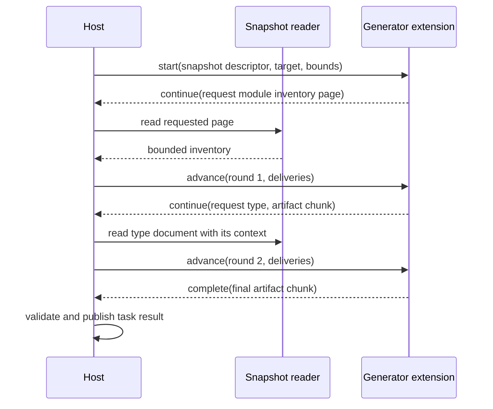

# Spec delta

## Purpose

Allows process and WASM extensions to generate from large models through resumable, negotiated exchanges with bounded input, retained state and output.

### The generator asks for its next working set

The orders generator needs a module's public shape, then individual bodies. Each call can finish before the next begins. A byte-call WASM guest therefore needs no nested filesystem callback or synchronous re-entry into the host.



Illustrative result payload, before generated contract models fix its wire fields:

```json
{
  "state": "continue",
  "sessionId": "generation-7",
  "round": 1,
  "requests": [{"id": "r1", "kind": "document", "documentId": "pkg/acme/orders/domain/order.type"}],
  "artifacts": [],
  "diagnostics": []
}
```

The session contract is proposed as access version `0.1.0-draft.1` on MEP `0.2.0-draft.2`. This example does not extend or claim implementation of the existing single-document methods.

### Transport boundary

Process connections and WASM byte calls implement the same externally visible state transitions. Nested callbacks, new WASM imports and a mandatory daemon are unnecessary for this first exchange. Final method names and serialized sum shapes belong in the parent contract model and generated transcripts before implementation; the example above is deliberately labeled illustrative.

## ADDED Requirements

### Requirement: Negotiate complete access offers
Bounded model operations SHALL require exact agreement on MEP draft, access version, operation, semantic IR version, model profile, codec, layout and contextual encoding. Peers SHALL negotiate complete tuples in host preference order, preserving existing target and language restrictions. Claims alone SHALL NOT replace live agreement.

#### Scenario: Contextual v3 is not offered
- **WHEN** a guest supports plain v3.1 and contextual v4.0 but the host requires contextual v3.1
- **THEN** no compatible tuple is inferred by combining independent capability lists
- **AND** the host reports the unavailable requested operation without dispatching it

### Requirement: Keep legacy session contracts unchanged
The new access methods SHALL require the new exact MEP draft. MEP `0.1` and `0.2.0-draft.1` methods SHALL retain their existing shapes and admission rules. Advertising bounded access SHALL NOT authorize it on an older negotiated session.

#### Scenario: Guest selects the old draft
- **WHEN** initialization selects `0.2.0-draft.1`
- **THEN** the host does not send start or advance messages for bounded access

### Requirement: Permit supported compatible fallback
A host SHALL permit a compatible existing operation when the requested behavior fits its supported limits and conversion policy. It SHALL disclose a protocol fallback and apply existing loss rules. If bounded operation is explicitly required, an inline fallback SHALL NOT bypass that requirement or be reported as bounded qualification.

#### Scenario: Small model and legacy generator
- **WHEN** a small model can be served losslessly through a legacy method within both peers' limits and bounded mode is not required
- **THEN** the host can use the supported operation with a diagnostic describing the fallback

#### Scenario: Large model exceeds inline limits
- **WHEN** a required bounded operation has no agreed tuple and the model exceeds the legacy payload limits
- **THEN** the host refuses that operation before loading the entire model for a retry

### Requirement: Start against a scoped snapshot
Starting generation SHALL bind an operation identity, snapshot identity and revision, dependency context, selected tuple, advertised target, options and positive limits. The guest SHALL receive no ambient host filesystem authority. Document and inventory requests SHALL resolve only within that operation's admitted snapshot and allowed view.

#### Scenario: Request escapes the snapshot
- **WHEN** a guest requests an absolute host filename or a document in another snapshot
- **THEN** the host refuses that request and supplies no unrelated bytes

### Requirement: Advance through an explicit result sum
Each generation step SHALL return exactly one state: continue, complete or failed. Continue SHALL carry bounded requests, artifact chunks and diagnostics, including empty collections where allowed. Complete SHALL signify all required work is finished. Failed SHALL carry failure diagnostics and SHALL NOT establish a successful model or artifact result.

#### Scenario: More input is required
- **WHEN** a generator cannot finish until a type definition arrives
- **THEN** it returns continue with that request instead of a successful result with a missing artifact

### Requirement: Bind deliveries to ordered rounds
Each advance SHALL identify the operation and expected round, and match deliveries to outstanding request ids and their selected snapshot. The host SHALL reject unsolicited deliveries, duplicate ids, mismatched digests and replayed or out-of-order rounds. A failed or expired operation SHALL NOT be resumed as though its state survived.

#### Scenario: Old response is replayed
- **WHEN** a response for round 2 is supplied after the operation has advanced to round 3
- **THEN** it is refused without appending its artifacts again

### Requirement: Request independently interpretable data
Requests SHALL support paged inventory and selected logical documents. Each delivered contextual document SHALL include its complete file-local context. The receiving adapter SHALL check integrity and decode the selected file contract before semantic use, retaining original profile content when required by that profile.

#### Scenario: Definition arrives alone
- **WHEN** the host delivers a contextual type file without the other files in its module
- **THEN** the guest can resolve its aliases from the delivered envelope
- **AND** it does not invent an inherited module context

### Requirement: Bound exchanges and retained state separately
Session admission SHALL bound outer frames, encoded/decoded bytes per exchange, documents per batch, decoding depth and nodes, resident guest state, host caches, artifact chunks, diagnostics and outstanding requests. Cumulative work, disk use, rounds and elapsed time SHALL have separate finite limits. Whole-model bytes SHALL NOT be equated with a per-frame limit.

#### Scenario: Many small batches exceed a cumulative allowance
- **WHEN** each batch is valid but the session exhausts its configured cumulative disk or work allowance
- **THEN** the session fails with the exhausted limit identified
- **AND** it cannot evade that allowance by requesting smaller batches

### Requirement: Chunk generated artifacts
Artifact emission SHALL support bounded chunks with safe relative paths, explicit offsets, byte encoding and an end marker. The host SHALL enforce contiguous non-overlapping chunks, per-artifact and aggregate allowances, and unique artifact identities. No successful artifact SHALL require one frame containing its complete content or the full output inventory.

#### Scenario: Generated file is larger than a frame
- **WHEN** `Order.example` is larger than the maximum output chunk
- **THEN** the guest emits consecutive bounded chunks
- **AND** the host stages the complete file without collecting all chunks in memory

### Requirement: Finish before publishing or installing
The host SHALL stage artifacts during continuation and publish a successful task result only after complete and final validation. Failed, cancelled, timed-out or malformed sessions SHALL NOT install partial artifacts. Every open artifact SHALL have its end marker before completion is admitted.

#### Scenario: Completion omits an artifact end marker
- **WHEN** the guest returns complete while `Order.example` remains open
- **THEN** completion is rejected and no successful output descriptor is published

### Requirement: Cancel and release all scoped resources
Cancellation, timeout, failure and completion SHALL release operation-owned state, snapshot leases and handles. A host SHALL enforce per-call deadlines and terminate an unresponsive guest before releasing resources that it might still access. Maximum rounds and session deadlines SHALL bound continuations that make no externally observable progress.

#### Scenario: WASM call never returns
- **WHEN** the current generation call exceeds its configured deadline
- **THEN** the host terminates that execution, marks the operation failed and releases its read lease
- **AND** a waiting producer can then rerun

### Requirement: Admit prerequisites at their actual scope
Required guarantees SHALL bind the admitted model revision, dependency context and scope. Reading a valid document SHALL NOT imply whole-model semantic validity. A conversion SHALL follow existing loss, reporting, revision and evidence-invalidation rules rather than carrying the original evidence over automatically.

#### Scenario: Generator needs whole-model type evidence
- **WHEN** the selected generator requires a whole-model guarantee and only document-integrity checks are available
- **THEN** the host obtains the required checked evidence or refuses that prerequisite before generation

### Requirement: Keep future document producers transactional
An operation claiming document-batch production SHALL stage documents under the host's output-root policy and expose its model descriptor only after successful completion and required validation. A producer SHALL NOT write arbitrary host paths or claim success while required documents are missing. First-delivery qualification SHALL NOT imply frontend batch-production support.

#### Scenario: Frontend leaves an incomplete tree
- **WHEN** a future batch-producing frontend ends without a required module document
- **THEN** the host refuses publication of that model
- **AND** generation cannot discover it as a successful producer result

