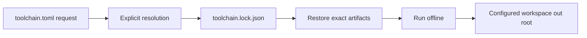

# Project toolchains

## Purpose

Make a project's Morphir host and language providers reproducible across developer machines and CI while keeping user defaults and workspace build outputs separate.

### A checked-in request and lock



Proposed `.morphir/toolchain.toml`:

```toml
schemaVersion = "0.1.0-draft.1"
[host]
implementation = "dotnet"
deployment = "native-aot"
channel = "stable"
[toolset]
preset = "fsharp"
```

The channel is a resolution request. `.morphir/toolchain.lock.json` records its exact result. Existing `[toolchain.<name>]` task adapters in `morphir.toml` keep their meaning.

## ADDED Requirements

### Requirement: Distinct versioned documents
Project selection SHALL use `.morphir/toolchain.toml` and an exact `.morphir/toolchain.lock.json`, or explicitly supplied paths. These SHALL be separate SemVer contracts beginning at `0.1.0-draft.1`. Existing `morphir.toml` toolchain adapter settings SHALL retain their meaning. Unknown optional members SHALL be ignored; unknown critical members and unsupported exact drafts SHALL be refused.

#### Scenario: Existing adapter configuration
- **WHEN** a project already declares `[toolchain.morphir-elm.tasks]` in `morphir.toml`
- **THEN** manager setup does not reinterpret or overwrite that declaration as a host selection

#### Scenario: Unsupported draft
- **WHEN** a manager supporting only `0.1.0-draft.1` reads a request with `0.1.0-draft.2`
- **THEN** it reports the unsupported exact contract version before changing installation state

### Requirement: Selection precedence
Selection SHALL prefer an explicit CLI selector, then `MORPHIRUP_TOOLCHAIN`, then the nearest project toolchain file within the host's established discovery boundary, then the user default. The manager SHALL report the selected identity and its source. A broken explicit or project selection SHALL fail rather than silently use the default.

#### Scenario: Project selection overrides default
- **WHEN** a project pins the .NET AOT host while the user default is another implementation
- **THEN** the project command uses the pinned .NET host
- **AND** `morphirup show` reports the project file as its source

#### Scenario: Missing project generation
- **WHEN** the project lock names a generation absent from local storage
- **THEN** a run reports how to restore it
- **AND** it does not run the user default or acquire files implicitly

### Requirement: Exact portable locks
A lock SHALL bind the request identity, repository identities, authenticated recipe digest, exact host and component versions, provider choices, protocol/model compatibility and per-platform artifact identities and digests. It SHALL contain no machine-specific absolute paths or credentials. Each recorded platform SHALL retain its complete dependency closure.

#### Scenario: Colleague uses another platform
- **WHEN** a Windows colleague restores a lock containing complete Windows and macOS resolutions
- **THEN** restore chooses the locked Windows closure without resolving channels again
- **AND** the resulting launch paths are local receipt data rather than edits to portable lock paths

### Requirement: Frozen restore
`morphirup restore --locked` SHALL restore only the exact matching request and platform closure in the lock. A changed request, unsupported platform or absent resolution SHALL fail without updating the lock. Explicit setup or update SHALL be required to create or extend a resolution.

#### Scenario: Channel has moved
- **WHEN** a lock pins release A and the requested stable channel now names release B
- **THEN** locked restore still uses A subject to the acquisition authority's revocation and verification rules
- **AND** it does not rewrite the lock to B

### Requirement: Offline execution and restore
Running an installed locked toolchain SHALL require no repository refresh. Offline restore SHALL use verified local artifacts and durable trust state only. Known revocations SHALL remain enforced. Missing artifacts SHALL produce an exact missing-content report; expired repository metadata SHALL not by itself prevent an installed verified generation from running.

#### Scenario: Disconnected build agent
- **WHEN** all locked artifacts are installed and repository metadata has expired
- **THEN** the agent can run the selected toolchain offline after local integrity and revocation checks

### Requirement: Explicit command dispatch
The manager SHALL support `morphirup run -- <arguments>` and a manager-owned `morphir` proxy using the same selection rules. Dispatch SHALL preserve argument boundaries, working directory, stdin, stdout, stderr, exit status and cancellation. It SHALL use the selected absolute executable and SHALL NOT recursively resolve itself through PATH.

#### Scenario: Selected dotnet tool
- **WHEN** a managed selection exposes `dotnet-morphir` and the user runs `morphirup run -- generate --help`
- **THEN** the manager launches that selected entry point with exactly the requested arguments
- **AND** it does not claim to have renamed the existing .NET tool command

### Requirement: Toolchain state and build outputs
Installed toolchains and durable trust/selection state SHALL live under configured Morphir Home. Project requests and locks SHALL remain project inputs. Build artifacts SHALL use the existing configurable workspace out root, default `.morphir/out`, and task-result conventions. Cleaning build outputs SHALL NOT remove toolchains, exact locks or trust state.

#### Scenario: Relocated workspace outputs
- **WHEN** a project changes its output root to `build/morphir`
- **THEN** compile and generation use that root
- **AND** the selected host and installed providers remain in Morphir Home

### Requirement: Explicit update and generation consistency
An update SHALL resolve and stage a new complete lock generation and publish it without exposing mixed host/provider selections. Concurrent runs SHALL observe one complete generation. A failed update SHALL preserve the prior lock and active generation; repair SHALL restore the same identities rather than resolving newer versions.

#### Scenario: Update while generation is running
- **WHEN** update publishes generation B while a generator is using A
- **THEN** that generator retains A until it exits
- **AND** a subsequent command sees the complete B selection
