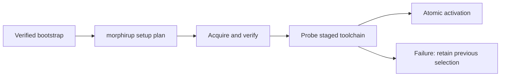

# Toolchain management

## Purpose

Provide a standalone acquisition and lifecycle entry point that installs compatible Morphir hosts and coordinates their extensions without duplicating extension protocol or repository contracts.

### From download to a working command

The proposed command `morphirup setup --implementation dotnet --deployment native-aot --preset fsharp --channel stable --plan` reports the exact acquisition actions. Executing the setup explicitly permits those downloads; a later compile does not update anything.

## ADDED Requirements

### Requirement: Standalone bootstrap
`morphirup` SHALL be available as a standalone executable for each supported native platform without requiring .NET, a language SDK or an existing Morphir installation. Bootstrap SHALL verify the selected manager artifact against authenticated release information and support a user-owned installation directory without elevation.

#### Scenario: First installation
- **WHEN** a user bootstraps on a supported machine without .NET or Morphir
- **THEN** `morphirup` can plan and acquire a standalone Morphir offering
- **AND** bootstrap does not install a system SDK or require administrator access

### Requirement: Explainable setup plans
Setup SHALL support a plan-only mode reporting the chosen implementation, deployment, platform, exact releases, runtime prerequisites, providers, download sizes and update owner for each component. Plan-only mode SHALL NOT install artifacts, change activation or execute an acquired extension. Metadata refresh SHALL be reported when needed.

#### Scenario: Inspect an F# plan
- **WHEN** setup plans an AOT F# toolchain
- **THEN** the plan identifies the host and process frontend artifacts and the built-in or acquired backend
- **AND** it states that running a process probe executes code with the user's rights

### Requirement: Compatible artifact resolution
Setup SHALL resolve host and component compatibility before activation using exact implementation identity, release, deployment, OS, architecture, ABI and declared operation/model capabilities. It SHALL NOT substitute a different implementation, deployment or platform unless explicitly selected by the user.

#### Scenario: Missing frontend artifact
- **WHEN** no frontend artifact matches the requested platform and capability tuple
- **THEN** setup reports the incompatible component and available alternatives
- **AND** the existing active toolchain remains unchanged

### Requirement: Reuse acquisition authorities
Host acquisition SHALL follow the existing authenticated tool release metadata profile. Extension acquisition SHALL use extension descriptors, claims, store and lock contracts. The manager SHALL coordinate these authorities and retain their provenance; it SHALL NOT treat MEP as an installation protocol or treat a checksum as publisher authentication.

#### Scenario: Independently released extension
- **WHEN** a toolchain references an extension released independently of the host
- **THEN** its installed identity, claims and digest remain those of that extension release
- **AND** setup records its repository and verification policy separately from the host's

### Requirement: Explicit extension trust policy
Public toolset recipes SHALL bind extension artifacts and descriptors to authenticated recipe metadata and exact digests, preserving the extension format. An independently supplied unsigned developer extension SHALL require explicit developer policy and SHALL remain labeled unchecked or developer-supplied. Setup SHALL NOT imply that legacy extension repositories already provide publisher authentication.

#### Scenario: Recipe binds a process archive
- **WHEN** an authenticated F# recipe selects a frontend archive
- **THEN** setup verifies both the referenced descriptor and selected archive against the recipe's authenticated hashes
- **AND** it retains the extension install-time claim-check status as a separate fact

### Requirement: Transactional activation
Setup and update SHALL stage and verify a complete candidate, perform its required readiness checks and publish one active selection only after success. Interrupted or failed work SHALL preserve the previous selection. Concurrent managers SHALL serialize publication; a running command SHALL retain its selected toolchain until exit.

#### Scenario: Process probe fails
- **WHEN** a newly acquired frontend fails its readiness probe
- **THEN** setup reports failure without switching the selected toolchain
- **AND** restarting setup can reuse verified downloads without treating partial state as active

### Requirement: Installation ownership
Receipts SHALL distinguish manager-owned, direct-archive, .NET-tool and system-package ownership. `morphirup` SHALL update or remove only its owned installations. For an externally owned installation it SHALL report the owning update mechanism, detect PATH conflicts and support an explicit side-by-side managed install without overwriting the external executable.

#### Scenario: Existing global tool
- **WHEN** `Morphir.Tool` is installed through `dotnet tool` and a user asks the manager to update it
- **THEN** the manager identifies the .NET tool ownership and provides the appropriate update instruction
- **AND** it does not replace files owned by the tool installation

### Requirement: Explicit lifecycle operations
The manager SHALL support listing installations, selecting a user default, explicit update, rollback, repair, removal and self-update. Update SHALL preserve a usable prior generation. Rollback SHALL reverify bytes and enforce known revocations. Removal SHALL refuse to remove a generation in use or referenced by an active selection unless those references are explicitly changed.

#### Scenario: Roll back after a failed workflow
- **WHEN** a user rolls back to the previous installed generation
- **THEN** the manager atomically selects its verified artifacts and provider bindings
- **AND** it refuses a generation containing an artifact with a known revocation

### Requirement: Controlled shell setup
Bootstrap SHALL report the manager bin directory and shell instructions. Persistent PATH or shell-profile changes SHALL require an explicit setup option and SHALL be idempotent and reversible for manager-owned entries. The manager SHALL work through its absolute path without modifying the shell.

#### Scenario: CI without shell modification
- **WHEN** CI installs the manager with shell modification disabled
- **THEN** it can invoke the manager and selected Morphir by explicit paths
- **AND** no user profile or global PATH is edited

### Requirement: Diagnostic results
Manager JSON output SHALL use a versioned result contract and contain one result document on stdout, with progress on stderr. Diagnostics SHALL distinguish unsupported artifacts, missing prerequisites, trust failures, unavailable offline content, ownership conflicts and failed readiness. Secret values SHALL NOT appear in plans, receipts or diagnostics.

#### Scenario: Unavailable offline component
- **WHEN** offline setup cannot find a locked archive in the verified local store
- **THEN** the result names the missing component and digest with an offline-content diagnostic
- **AND** no network request or active selection change occurs
