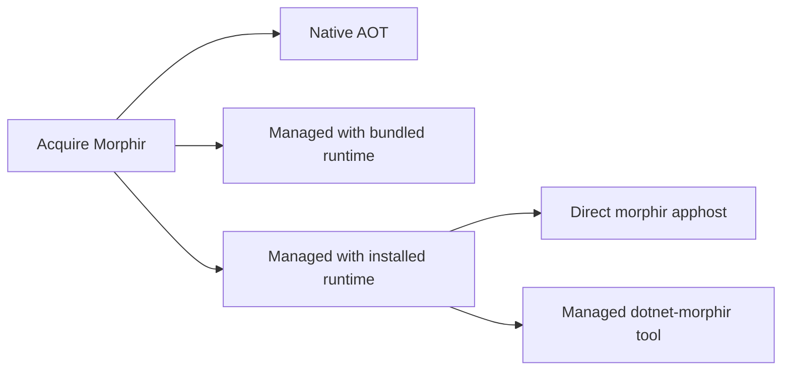

# .NET deployment profiles

## Purpose

Let users choose a Morphir .NET distribution according to runtime availability while keeping command behavior and extension capabilities discoverable.

### A developer chooses a runtime arrangement

For example, a machine without .NET can run the AOT host plus a self-contained F# frontend guest. A machine with a managed runtime can use the framework-dependent host. Both requests still select a frontend and backend by capability.

## ADDED Requirements

### Requirement: Four named offerings
The .NET distribution SHALL offer `native-aot`, `self-contained`, `framework-dependent` and `dotnet-tool`. The first three SHALL expose `morphir`; `dotnet-tool` SHALL preserve `Morphir.Tool`, `dotnet-morphir` and its existing `dotnet morphir` invocation. Acquisition channel and single-file packaging SHALL be reported separately from the offering.

#### Scenario: Direct framework-dependent launch
- **WHEN** a user starts the framework-dependent `morphir` on a machine with a compatible runtime
- **THEN** it starts directly without requiring the .NET SDK
- **AND** it identifies its offering as `framework-dependent`

### Requirement: Self-contained execution prerequisites
The `native-aot` and `self-contained` offerings SHALL run without a separately installed .NET runtime. Release metadata SHALL declare remaining operating-system and native-library prerequisites. A self-contained managed release SHALL retain JIT execution and SHALL NOT claim Native AOT behavior.

#### Scenario: Clean standalone machine
- **WHEN** the self-contained offering runs in a supported clean environment without `dotnet` on PATH
- **THEN** its core commands and declared bundled capabilities work
- **AND** it reports managed execution with an application-local runtime

### Requirement: Runtime diagnostics
Framework-dependent archives and tool installation instructions SHALL state the required runtime and the SDK requirement for tool installation. A missing or incompatible runtime SHALL produce actionable setup guidance through the manager's preflight and packaged installation documentation, including when the application cannot start.

#### Scenario: Framework-dependent application cannot start
- **WHEN** setup inspects a framework-dependent offering without its required runtime
- **THEN** setup reports the missing prerequisite and offers a standalone offering
- **AND** it does not report the host as ready

### Requirement: Shared command behavior
Offerings built from one release SHALL use the same command implementation and configuration semantics for shared capabilities. The version report SHALL identify implementation, release, deployment offering, platform and execution mode without inferring them from the executable name.

#### Scenario: Two morphir executables
- **WHEN** the Native AOT and self-contained executables report their identity
- **THEN** both identify implementation `dotnet` and the same release
- **AND** their deployment and execution fields distinguish them

### Requirement: Capability availability
Capability reporting SHALL distinguish built-in, installed and unavailable providers and SHALL state why a requested delivery is unavailable. Managed profiles SHALL share the managed capability composition; Native AOT SHALL use an external process for the F# frontend when it cannot host that frontend in-process.

#### Scenario: AOT F# setup
- **WHEN** a user selects the F# preset with the AOT host
- **THEN** setup selects a compatible F# process frontend
- **AND** it preserves the built-in F# generator when that generator satisfies the request

### Requirement: Release artifact identity
Every published offering SHALL have an unambiguous artifact identity containing implementation, exact release, deployment and target platform. Metadata SHALL declare launch paths, runtime requirements, capability differences and native assets. Distinct bytes SHALL NOT be republished under the same immutable artifact identity.

#### Scenario: Same release and platform with different deployment
- **WHEN** release metadata lists AOT and managed self-contained archives for Windows x64
- **THEN** the two artifacts have distinct identities and authenticated digests
- **AND** their executable basenames can both be `morphir.exe`

### Requirement: Packaging claims are qualified
A release claiming single-file delivery SHALL qualify startup and declared capabilities from its packaged artifact, including native-library loading or extraction. Trimming SHALL preserve the declared capabilities. Size reports SHALL identify the exact offering and include all shipped files; no fixed size reduction SHALL be inferred from a profile name.

#### Scenario: Native WASM dependency
- **WHEN** a single-file offering includes a WASM engine requiring native assets
- **THEN** release qualification verifies its supported loading or extraction arrangement in a clean environment
- **AND** a successful command in the build directory alone does not establish packaging support

### Requirement: Explicit support matrix
Release metadata SHALL declare support per offering and platform. Initial qualification SHALL cover Windows x64/ARM64, macOS x64/ARM64 and Linux glibc x64/ARM64. An unavailable combination SHALL remain visibly unsupported and SHALL NOT silently select another architecture, implementation or offering.

#### Scenario: Unsupported platform
- **WHEN** a Linux musl user requests an offering with only glibc artifacts
- **THEN** acquisition reports the unavailable platform and the available alternatives
- **AND** it does not install the glibc artifact as a matching artifact
