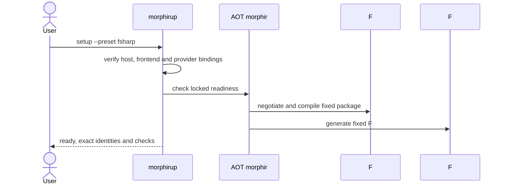

# Toolset setup

## Purpose

Make language tools installable as a compatible toolset and explain whether a requested frontend/backend workflow is ready, independently of how its host was acquired.

### F# on a machine without .NET

The default .NET selection uses its built-in F# backend. The same recipe can select a separately packaged F# process backend when a host lacks that built-in. Installing packages alone does not prove that either operation works.

## ADDED Requirements

### Requirement: Capability-based toolsets
A toolset recipe SHALL declare required operations, language/target identities and compatible model/protocol tuples, and bind each requirement to a built-in or independently acquirable provider. A setup preset SHALL select compatible deliveries rather than infer capability from a package name, implementation language or executable basename.

#### Scenario: F# preset
- **WHEN** a user selects preset `fsharp`
- **THEN** setup resolves F# source compilation and F# target generation as separate required operations
- **AND** it reports the provider and delivery selected for each

### Requirement: Preserve existing built-ins
Setup SHALL keep a compatible built-in provider unless the user explicitly selects another delivery. The .NET F# and C# backend identities and existing selection semantics SHALL remain valid. Toolset setup SHALL NOT require users to download a duplicate backend merely to use an already supported built-in.

#### Scenario: Built-in F# generator
- **WHEN** the selected .NET host has a compatible built-in `morphir.fsharp` backend
- **THEN** the F# setup plan binds generation to that built-in
- **AND** it downloads no external backend unless the request selects one

### Requirement: Standalone F# frontend delivery
The F# frontend SHALL have a self-contained process delivery including its compiler-service dependencies for supported platforms. It SHALL run under the AOT host without a system .NET runtime or SDK and SHALL use the existing MEP process transport. The existing framework-dependent frontend tool SHALL remain an available explicit delivery.

#### Scenario: No SDK or runtime installed
- **WHEN** the standalone F# preset is restored on a supported clean machine
- **THEN** the AOT host compiles the fixed F# package through the selected process guest
- **AND** no SDK installation, ambient `dotnet` command or runtime assembly loading in the AOT host is required

### Requirement: Independently acquirable F# backend
The F# generator SHALL have an independently versioned process delivery that reuses the existing generator and supported MEP backend methods. Its descriptor SHALL state exact capabilities and model tuples. Hosts lacking the .NET built-in SHALL be able to acquire this delivery without acquiring the .NET CLI as their host.

#### Scenario: Explicit external backend
- **WHEN** setup selects the standalone F# backend process delivery
- **THEN** a supported host negotiates with it and generates the fixed expected F# files
- **AND** its own extension identity does not impersonate or duplicate a built-in registry entry

### Requirement: Declared external prerequisites
Each delivery SHALL declare runtime, SDK and native prerequisites separately. Setup SHALL distinguish compiling supported F# source to Morphir IR from building arbitrary `.fsproj` projects and from compiling generated output. It SHALL NOT install an SDK implicitly or claim an arbitrary project-build workflow is ready because a frontend probe passed.

#### Scenario: Consumer compilation needs an SDK
- **WHEN** a user requests compilation of generated F# into a .NET application
- **THEN** the plan reports that consumer build's SDK prerequisite separately
- **AND** the Morphir frontend/backend readiness remains a distinct result

### Requirement: Existing installation policy is preserved
Setup SHALL use the host's extension configuration, store, claims and locks, preserving discovery levels and explicit provider selection. Host-specific staging policies SHALL remain explicit. A project request SHALL NOT authorize network acquisition on ordinary compile/generate, and a manager SHALL NOT execute a process probe in plan-only mode.

#### Scenario: Staged files with auto mode
- **WHEN** a .NET host has its existing local staged-file auto-install policy enabled
- **THEN** setup reports that policy separately from network acquisition
- **AND** a missing remote provider during compile still requires explicit setup or installation

### Requirement: Readiness has evidence
Setup SHALL distinguish acquired, integrity-verified, capability-checked and workflow-qualified components. F# workflow readiness SHALL require a small fixed compile-to-IR and generate-to-F# journey with selected providers. Receipts SHALL identify artifacts, host offering, selected tuples and completed checks; unsupported or skipped checks SHALL remain visible.

#### Scenario: Installation succeeds but negotiation fails
- **WHEN** the archive is valid but the host and frontend share no operation/model tuple
- **THEN** setup reports installed but not ready and names the incompatible tuple
- **AND** it does not activate the candidate as a qualified F# toolchain

### Requirement: WASM readiness follows host qualification
A recipe selecting a WASM extension SHALL name its required ABI and compatible host capability. Setup SHALL refuse a ready result when that ABI or operation is unavailable. Installed WASM bytes SHALL NOT be treated as evidence that the host's WASM engine or packaging is functional.

#### Scenario: Extism guest before host support
- **WHEN** a selected extension requires `extism-kernel-v1` and the selected host supports only `morphir-bytes-v1`
- **THEN** setup names the missing ABI and reports not ready
- **AND** it does not substitute another ABI based on the public runtime name `wasm`

### Requirement: Cross-offering qualification
The F# preset SHALL be qualified through all four supported .NET offerings using acquired release artifacts in clean environments. Standalone offerings SHALL be tested without a system runtime; managed-runtime offerings SHALL be tested with their declared runtime. Results SHALL cover direct invocation, manager dispatch, offline rerun and explicit external backend selection.

#### Scenario: Same package across offerings
- **WHEN** the fixed F# source runs through each qualified offering
- **THEN** equivalent IR and the fixed expected generated files are produced
- **AND** the receipts retain each offering's actual built-in or process provider choice
