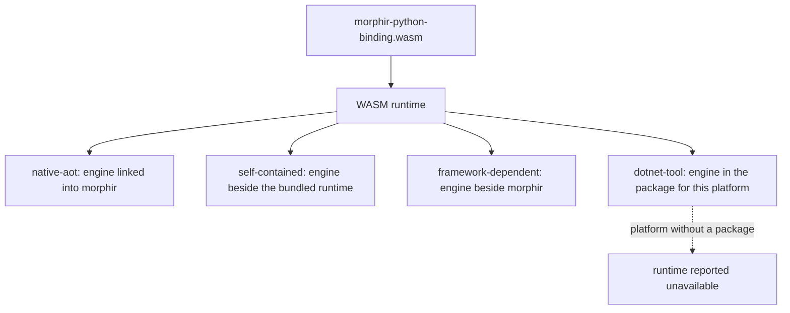

# Spec Delta

## Purpose

Defines what the .NET Morphir host adds to the shared WASM execution profiles: which offerings and platforms can run a WASM extension, how a user points the host at a module, how a run is cancelled, and how the host proves that its packaged engine works.

### The same module on four executables

The .NET distribution has four offerings, and a user should not have to know which one they hold to predict whether a WASM extension runs.



All four run the same session code against the same engine version, so a guest that works in one works in the others. They differ only in how the engine's native library reaches the process. That part can break without any test in the build directory noticing: an executable that passes there can fail on a clean machine because the library was never packaged.

### Asking the host what it can run

Proposed output. The command and field names are fixed with the implementation.

```console
$ morphir extension runtimes --json
{
  "result": {
    "offering": "native-aot",
    "platform": "linux-x64",
    "runtimes": [
      {
        "kind": "wasm",
        "available": true,
        "engine": {"name": "wasmtime", "version": "50.0.1"},
        "profiles": ["morphir-bytes-v1", "extism-kernel-v1"],
        "bounds": {"memoryBytes": 268435456, "deadline": "enforced", "budget": "enforced"}
      }
    ]
  }
}
```

On Linux musl the same command reports `"available": false` with reason `platform_unsupported`. The user learns this when they ask, or when setup checks readiness. They do not learn it from a missing-library error in the middle of a build.

### Running a module by hand

The worker mode turns the host into a plain stdio MEP peer for one module. It is how the shared conformance runner drives a .NET-hosted guest, and it is a useful way to reproduce a problem.

```console
$ morphir extension worker --abi extism-kernel-v1 \
    --module ./morphir-python-binding.wasm --json
{"event":"started","abi":"extism-kernel-v1","moduleSha256":"10acafa0...22b5"}   # stderr
Content-Length: 129                                                             # stdout: MEP frames only
```

## ADDED Requirements

### Requirement: Both profiles in every offering
Each of the `native-aot`, `self-contained`, `framework-dependent` and `dotnet-tool` offerings SHALL run `morphir-bytes-v1` and `extism-kernel-v1` guests as `mep/wasm-execution-profiles` defines, on every platform where that offering declares the WASM runtime available. All offerings of one release SHALL use the same engine version.

#### Scenario: Same guest across offerings
- **WHEN** the Python extension compiles the fixed generic package under each offering on Linux x64
- **THEN** every offering returns the same IR
- **AND** each reports the same engine name and version

### Requirement: Runtime availability is reported
The host SHALL report, without loading a module, whether its WASM runtime is available, the engine name and version, the supported profiles and the bounds it enforces. When the runtime is unavailable it SHALL state a reason. The report SHALL come from the running executable and not from its name or install path.

#### Scenario: Supported platform
- **WHEN** a user asks the Native AOT host on Linux x64 for its runtimes
- **THEN** the report lists `wasm` as available with both profiles and the enforced bounds

#### Scenario: Unsupported platform
- **WHEN** a user asks a host running on Linux musl
- **THEN** the report lists `wasm` as unavailable with reason `platform_unsupported`

### Requirement: Unavailable runtime fails by name
When a command needs a WASM extension and the runtime is unavailable, the host SHALL fail before reading the module with `extension.runtime_unavailable`, naming the offering, the platform and the reason. It SHALL NOT surface a native library loading error as the diagnostic.

#### Scenario: Engine library missing
- **WHEN** a framework-dependent host starts without its engine library and a command needs a WASM extension
- **THEN** the command fails with `extension.runtime_unavailable` and reason `engine_missing`
- **AND** commands that need no WASM extension still work

### Requirement: Tool installation is preserved off the supported platforms
The `dotnet-tool` offering SHALL remain installable on a platform without a WASM engine package. There it SHALL report the WASM runtime as unavailable and keep every other capability.

#### Scenario: Tool on Linux musl
- **WHEN** a user installs `Morphir.Tool` on Linux musl x64
- **THEN** installation succeeds and `dotnet morphir --version` runs
- **AND** the runtime report lists `wasm` as unavailable

### Requirement: Module from configuration
The host SHALL load a WASM extension from the path in `extensions.<name>.path` and SHALL treat a file as WASM by its content, not its file name. An optional declared ABI SHALL be checked as `mep/wasm-execution-profiles` requires. In this capability the host SHALL NOT discover modules by scanning folders or download them.

#### Scenario: Configured module
- **WHEN** `extensions.python.path` names the Python extension module and a command selects `python`
- **THEN** the host classifies and runs that module

#### Scenario: Path is not a WASM module
- **WHEN** the configured path names a text file
- **THEN** the host fails with a diagnostic that names the path and states that it is not a WASM module

### Requirement: Module identity in every report
The host SHALL compute the SHA-256 digest of the module bytes it runs and SHALL include that digest, the classified profile and the engine identity in session diagnostics and worker reports. When a digest is declared for the module, the host SHALL refuse different bytes before classification.

#### Scenario: Replaced module
- **WHEN** a declared digest differs from the digest of the file at the configured path
- **THEN** the host refuses the module and reports both digests

### Requirement: In-process execution with isolation per session
The host SHALL run each WASM session in its own instance with its own memory and session state. Two sessions of the same module SHALL NOT share memory, stores or caches. A failed session SHALL NOT end the host process or affect another session.

#### Scenario: Two extensions in one command
- **WHEN** one command runs a frontend guest and a backend guest
- **THEN** a trap in the backend guest fails only its session
- **AND** the frontend's result remains available to diagnostics

### Requirement: Cancellation stops the guest
When the user cancels a command or its session deadline passes, the host SHALL stop a running `handle` call within one second, discard the instance and report outcome `cancelled` or `deadline`. No guest code SHALL run after the host reports the outcome.

#### Scenario: Ctrl+C during a compile
- **WHEN** the user presses Ctrl+C while a guest is inside `handle`
- **THEN** the call stops, the outcome is `cancelled` and the exit status is 130

### Requirement: Guest output stays out of results
The host SHALL keep guest log messages and guest stdout and stderr separate from command results. It SHALL write them to the host's stderr or diagnostics, bounded to a fixed size per session with a truncation marker, and SHALL NOT write them to stdout.

#### Scenario: Chatty guest with JSON output
- **WHEN** a guest logs 10 MiB of text during a command run with `--json`
- **THEN** stdout holds only the command's JSON result
- **AND** stderr holds a bounded tail that states how much was dropped

### Requirement: Worker mode
The host SHALL provide `morphir extension worker`, taking `--abi`, `--module`, `--build-identity`, `--request-bytes`, `--response-bytes` and `--json`. It SHALL answer Content-Length framed MEP messages on stdin with frames on stdout. Stdout SHALL carry only MEP frames. Startup, refusal and fault reports SHALL go to stderr as one JSON object per line.

#### Scenario: Conformance runner drives a guest
- **WHEN** a conformance runner starts the worker mode with the Python module and runs the generic guest kit
- **THEN** every kit case completes over stdio with no .NET-specific runner code

#### Scenario: Refused module
- **WHEN** the worker mode is started with a module that imports `env.open_socket`
- **THEN** stderr carries a `refused` report with `extension.abi_unsupported`, stdout carries no bytes and the exit status is not zero

### Requirement: Worker build identity
`morphir extension worker --help --json` SHALL report a build identity for the executable. When `--build-identity` is given and differs, the worker SHALL exit before loading the module.

#### Scenario: Stale identity
- **WHEN** the worker is started with the build identity of another release
- **THEN** it exits with a `refused` report that names both identities

### Requirement: Packaged engine is qualified
A release SHALL claim the WASM runtime for an offering and platform only after the released artifact, on a clean machine of that platform, has run one guest of each profile and one refusal of each bound. A run from the build directory SHALL NOT count.

#### Scenario: Single-file artifact
- **WHEN** release qualification runs the single-file Native AOT artifact for Windows x64 in a clean environment
- **THEN** both profile guests answer and the runaway guest ends with outcome `deadline`
- **AND** the receipt records the artifact digest and how the engine was loaded

#### Scenario: Platform where static linking failed
- **WHEN** an offering ships the engine as a separate file on one platform
- **THEN** release metadata for that platform lists the file and does not claim single-file delivery

### Requirement: No ahead-of-time compatibility regressions
Adding the WASM runtime SHALL NOT add trim or ahead-of-time compilation warnings to the Native AOT host and SHALL NOT add warning suppressions. The host SHALL NOT load a compiled module from disk that it did not compile in the same process.

#### Scenario: Native AOT publish
- **WHEN** the Native AOT host is published with the WASM runtime
- **THEN** the publish reports zero IL2026 and IL3050 warnings and the project contains no suppression for them
