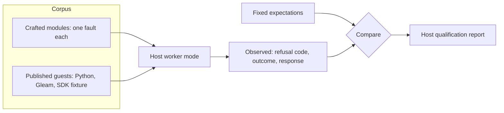

# Spec Delta

## Purpose

Qualifies a WASM extension host against the shared execution profiles, independently of the guests it happens to run. A host that passes can be trusted to refuse, bound and stop a module the same way every other qualified host does.

### Why a guest kit is not enough

The generic guest profile already drives a guest through compile and generate. A host that runs the Python extension correctly passes it. So does a host that also lets that extension open sockets, or never stops a loop. Well-behaved guests cannot show the difference. Only modules that misbehave on purpose can.



Each crafted module is a few lines of WebAssembly text that does one wrong thing. This one loops forever, and its expected observation is that the host stops it no later than the call deadline:

```wat
(module
  (import "extism:host/env" "input_length" (func (result i64)))
  (memory 1)
  (func (export "handle") (result i32)
    (loop $spin (br $spin))
    (i32.const -1)))
```

The corpus stores the text and the digest of the binary built from it. Expectations are written by hand from the profile contract. No host's output is ever used as an expectation, so two hosts that share a bug cannot qualify each other.

### What a report says

Illustrative record. Field names are fixed with the report contract.

```json
{
  "caseId": "bounds/spin-extism",
  "module": {"sha256": "9c1e...", "declaredAbi": "extism-kernel-v1"},
  "expected": {"fault": "call-deadline", "withinSeconds": [30, 32]},
  "observed": {"fault": "call-deadline", "elapsedSeconds": 30.04},
  "result": "pass"
}
```

A report covers one host executable on one platform. It makes no claim about another offering of the same release.

## ADDED Requirements

### Requirement: Crafted fault corpus
The kit SHALL contain crafted modules as WebAssembly text with the SHA-256 digest of each built binary. It SHALL include at least one module for each refusal code, each bound and each `handle` result code of `mep/wasm-execution-profiles`. Each module SHALL exercise one behavior.

#### Scenario: Coverage of the contract
- **WHEN** the kit is checked against the profile contract
- **THEN** every failure code and outcome the contract names has at least one crafted case
- **AND** a contract code with no case fails the kit's own check

#### Scenario: Binary does not match its text
- **WHEN** a built module's digest differs from the recorded digest
- **THEN** the runner refuses to run that case and reports both digests

### Requirement: Expectations are independent of hosts
Each crafted case SHALL have a fixed expected observation derived from the profile contract. An expectation SHALL NOT be produced by running a host. Timing expectations SHALL be ranges that follow from the contract's deadlines.

#### Scenario: New case
- **WHEN** a contributor adds a crafted case
- **THEN** the case carries its expectation and the contract requirement it tests
- **AND** review does not accept an expectation recorded from a host run

### Requirement: Hosts are driven through a stdio worker
The runner SHALL drive a host through a command that answers Content-Length framed MEP messages on stdio for one module and reports startup, refusals and faults on stderr as JSON lines. The runner SHALL select the host by executable path and arguments and SHALL contain no host-specific code.

#### Scenario: Two hosts, one command line
- **WHEN** the runner is given the .NET host and then the MoonBit host with the same worker arguments
- **THEN** both runs use the same runner code path and the same corpus

### Requirement: Published guests as positive evidence
The kit SHALL run the generic guest kit through the host for at least one published `extism-kernel-v1` guest, pinned by digest. A host that declares `morphir-bytes-v1` SHALL also run one published guest of that profile. A host SHALL NOT qualify on crafted cases alone.

#### Scenario: Refusals pass but compile fails
- **WHEN** a host passes every crafted case and the Python guest's compile returns a different IR
- **THEN** the host is not qualified

### Requirement: Cases follow the profiles a host declares
Every case for `extism-kernel-v1` SHALL apply to every host. A case that needs a `morphir-bytes-v1` session SHALL apply only to a host that declares that profile, and SHALL be recorded as `not_applicable` for any other. A host that does not declare the profile SHALL still pass the case that refuses a byte-profile module by name.

#### Scenario: Extism-only host
- **WHEN** the .NET host, which declares only `extism-kernel-v1`, is qualified
- **THEN** the byte-profile result-code cases are recorded as `not_applicable`
- **AND** the case that offers it a byte-profile module passes when the host refuses with `extension.abi_unsupported`

### Requirement: Unenforced bounds stay visible
The report SHALL record, for each bound, whether the host declared it enforced. A case for a bound the host does not enforce SHALL be recorded as `not_enforced`, not as passed. Qualification SHALL require the memory ceiling and the call deadline; the instruction budget MAY be `not_enforced`.

#### Scenario: Engine without metering
- **WHEN** a host declares the instruction budget as not enforced
- **THEN** the budget case is recorded as `not_enforced` and the host can still qualify

#### Scenario: Deadline not enforced
- **WHEN** a host declares the call deadline as not enforced
- **THEN** the host is not qualified

### Requirement: A runaway guest is stopped in time
A case whose module never returns SHALL pass when the host ends the call no later than the profile's call deadline plus a fixed margin, by the instruction budget or by the deadline. The report SHALL record which bound ended it. A call still running after the margin SHALL fail the case.

#### Scenario: Metering host
- **WHEN** a host that enforces the instruction budget runs the spinning Extism module
- **THEN** the call ends with fault `budget-exhausted` before 30 seconds and the case passes

#### Scenario: Host without metering
- **WHEN** a host without metering runs the same module
- **THEN** the call ends with fault `call-deadline` between 30 and 32 seconds and the case passes

### Requirement: Report identity
A host qualification report SHALL identify the runner, the corpus digest, the profile contract version, the host executable's path and digest, its declared offering, platform and engine, and each module's digest. `report-check` SHALL recompute the verdict from the recorded observations.

#### Scenario: Edited verdict
- **WHEN** a report's verdict is changed to qualified while a recorded observation fails
- **THEN** `report-check` rejects the report

### Requirement: One executable per report
A report SHALL qualify exactly one host executable on one platform. A release SHALL NOT cite a report for an offering or platform other than the one recorded in it.

#### Scenario: AOT report cited for the tool
- **WHEN** release metadata cites the Native AOT Linux x64 report as evidence for the `dotnet-tool` offering
- **THEN** the release check rejects the citation

### Requirement: Known deviations are recorded, not hidden
When a host is known to differ from the contract, the kit SHALL keep the case that shows it and the report SHALL show the failure. A deviation list MAY explain a failure and link its tracking issue. It SHALL NOT turn a failure into a pass.

#### Scenario: Rust host workspace-info signature
- **WHEN** the Rust host is run against the case that imports `morphir_get_workspace_info` as `() -> i64`
- **THEN** the report records the observed result and the linked deviation
- **AND** the Rust host is not reported as qualified for that case
