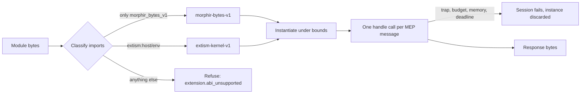

# Spec Delta

## Purpose

Defines how any Morphir host runs a WASM extension: the two ABI profiles a module can have, how MEP messages cross the module boundary, what a guest may reach, and how a host bounds and stops it. One definition lets a guest built once run the same way under every host.

### One module, from bytes to an answered request

Take the published Python extension `0.4.2`. It is one `.wasm` file that imports Extism kernel functions and exports `handle`. A host that has never seen Python runs it in four steps, and can refuse it at each one.



The step that surprises people is the first. The host decides the profile from the module's imports, before it runs any guest code. A release descriptor may declare an ABI, but the declaration can only confirm what the imports show. It cannot grant a module imports its profile lacks.

### The two profiles

| | `morphir-bytes-v1` | `extism-kernel-v1` |
| --- | --- | --- |
| Who builds it | Any language that emits core WASM (Gleam, MoonBit) | An Extism PDK (Rust, Python, the Morphir extension SDK) |
| Imports | Exactly three byte callbacks | Extism kernel and host functions, four Morphir functions, WASI preview 1 |
| Request reaches the guest | Guest pulls it one byte at a time | Extism input |
| Response leaves the guest | Guest pushes it one byte at a time | Extism output |
| `handle` result | Response length, or a code | Success or error |
| Notifications from the host | Delivered | Not delivered |
| Ambient authority | None | None beyond clocks and random bytes |

`morphir-bytes-v1` exists so that a runtime with no Extism support can host an extension. `extism-kernel-v1` exists because that is what the published bundles are.

### A message crossing the boundary

Over stdio, MEP frames each JSON-RPC message with a `Content-Length` header. A WASM guest has no stream, so one `handle` call carries exactly one message, as UTF-8 bytes with no header:

```json
{"jsonrpc": "2.0", "id": 1, "method": "morphir.initialize", "params": {"protocolVersion": "0.2.0-draft.1"}}
```

For `morphir-bytes-v1` the `handle` export returns a number that says what the guest did with it:

| Result | Meaning |
| --- | --- |
| Positive `n` | The guest pushed a response of `n` bytes |
| `0` | The guest handled `morphir.exit`; the instance ends |
| `-2` | The guest consumed a notification and has no response |
| `-1` | The guest failed |

### What a guest sees when it reaches outside

An Extism PDK links host functions whether or not the guest uses them, so refusing the import would refuse every published bundle. The profile accepts the import and bounds the call instead.

| The guest calls | It gets |
| --- | --- |
| `config_get` | No value |
| `var_get`, `var_set` | A store of at most 1 MiB that lives for the session |
| `log_*`, `morphir_log` | Its text recorded as guest output; `get_log_level` answers `info` |
| `http_request` | A failure; the method and URL are recorded, and no connection is made |
| `morphir_get_workspace_info` | `{"root": <private directory>, "output_dir": ""}` |
| `morphir_cache_ir`, `morphir_get_cached_ir` | A session cache of at most 16 MiB and 1,024 entries |
| WASI `path_open`, sockets, arguments, environment | An error code or an empty answer |
| WASI clocks, `random_get` | Real values |
| WASI `fd_write` to stdout or stderr | Its text recorded as guest output, never the MEP response |

This contract is version `0.1.0-draft.1`. It records the behavior the MoonBit worker host implements and the published guests rely on. It adds no MEP method and no IR version.

## ADDED Requirements

### Requirement: Conformant modules run without host changes
A host SHALL contain no behavior specific to an extension, language or publisher. A WASM module that conforms to MEP and to one ABI profile SHALL run with no host change. Its language, operations and source types SHALL come from its own claims.

#### Scenario: Unknown language
- **WHEN** a conformant Extism module claims a frontend for a language the host has never seen
- **THEN** describe and compile run with no change to the host

### Requirement: Classification before instantiation
A host SHALL read a module's imports and exports before instantiating it and SHALL classify it as exactly one of `morphir-bytes-v1` or `extism-kernel-v1`. An import outside the classified profile's surface, or with a different signature, SHALL be refused with `extension.abi_unsupported`, naming the import. No guest code SHALL run before classification succeeds.

#### Scenario: Python extension
- **WHEN** a host reads the Python extension `0.4.2` module
- **THEN** it classifies the module as `extism-kernel-v1`

#### Scenario: Import from an unknown namespace
- **WHEN** a module imports `env.open_socket`
- **THEN** the host refuses it with `extension.abi_unsupported`, naming `env.open_socket`
- **AND** the module is not instantiated

#### Scenario: Known name with another signature
- **WHEN** a module imports `morphir_bytes_v1.input_byte` as `(i64) -> i32`
- **THEN** the host refuses it with `extension.abi_unsupported`, naming that import

### Requirement: Declared ABI confirms and never widens
When a descriptor, configuration entry or command argument declares an ABI, the host SHALL require the classified profile to equal it and SHALL refuse a difference with `extension.abi_mismatch`. A declaration SHALL NOT allow an import that the classified profile excludes.

#### Scenario: Wrong declaration
- **WHEN** a declaration says `morphir-bytes-v1` for a module that imports the Extism kernel
- **THEN** the host refuses with `extension.abi_mismatch` and names both profiles

### Requirement: Handle export
A module of either profile SHALL export `handle` with no parameters and one `i32` result. A module without that export SHALL be refused with `extension.abi_unsupported`.

#### Scenario: Module without handle
- **WHEN** a module imports only Extism kernel functions and exports no `handle`
- **THEN** the host refuses it with `extension.abi_unsupported` and states that `handle` is missing

### Requirement: Byte profile import surface
A `morphir-bytes-v1` module SHALL import nothing except `input_len () -> i32`, `input_byte (i32) -> i32` and `output_byte (i32) -> ()` from the module `morphir_bytes_v1`. It SHALL NOT import WASI.

#### Scenario: Byte module that imports WASI
- **WHEN** a module imports the three byte callbacks and `wasi_snapshot_preview1.fd_write`
- **THEN** the host refuses it with `extension.abi_unsupported`, naming the WASI import

### Requirement: Byte profile call results
For `morphir-bytes-v1` the host SHALL treat a positive `handle` result as the response length, `0` as exit, `-2` as a consumed notification and `-1` as failure. A `-2` result for a message that has an `id` SHALL be a failure. Request and response bytes SHALL be valid UTF-8.

#### Scenario: Request answered with the notification code
- **WHEN** the host sends a request with `id` 4 and `handle` returns `-2`
- **THEN** the session fails
- **AND** the host does not wait for a response

#### Scenario: Response is not UTF-8
- **WHEN** a guest pushes bytes that are not valid UTF-8 and returns their length
- **THEN** the call fails and no partial response reaches the MEP session

### Requirement: Extism profile import surface
An `extism-kernel-v1` module SHALL import only the Extism kernel and host functions of `extism:host/env`, the Morphir functions of `extism:host/user`, and WASI preview 1 functions with their standard types. The contract SHALL list every accepted name and signature for one pinned Extism kernel version.

#### Scenario: Module built with the Morphir extension SDK
- **WHEN** a module imports `morphir_cache_ir` and `morphir_log` from `extism:host/user`
- **THEN** the host links them and the module runs

#### Scenario: Workspace info signature
- **WHEN** a module imports `morphir_get_workspace_info` as `() -> i64`
- **THEN** the host accepts it
- **AND** a module that imports it as `(i64) -> i64` is refused with `extension.abi_unsupported`

### Requirement: Extism profile calls
For `extism-kernel-v1` the host SHALL keep one instance for the session and call `handle` once per request, with the request as Extism input and the response read from Extism output. It SHALL deliver no notification to the guest, and `morphir.exit` SHALL end the instance. A call that sets an Extism error SHALL fail the session.

#### Scenario: Compile session
- **WHEN** the host runs `morphir.initialize`, `morphir.frontend.compile` and `morphir.shutdown` on the Python guest
- **THEN** each request is one `handle` call on the same instance
- **AND** `morphir.initialized` and `morphir.exit` are not delivered to the guest

### Requirement: One message per call
A host SHALL pass exactly one complete JSON-RPC message per `handle` call, as UTF-8 bytes without a `Content-Length` header, and SHALL accept at most one response per call. A message larger than the session's negotiated byte limit SHALL be refused before the guest is called.

#### Scenario: Oversized request
- **WHEN** a request exceeds the session's request byte limit
- **THEN** the host refuses it without calling `handle`
- **AND** the diagnostic names the limit and the request size

### Requirement: Host function policy
The Extism and Morphir host functions SHALL behave as the policy table under Purpose states. `http_request` SHALL fail without opening a connection. Session stores and caches SHALL start empty and SHALL NOT outlive the session. A store or cache write over its limit SHALL fail that call.

#### Scenario: Guest requests HTTP
- **WHEN** a guest calls `http_request` for `https://example.org/`
- **THEN** the call fails, no connection is made and the host records the method and URL

#### Scenario: IR cache between calls
- **WHEN** a guest stores IR with `morphir_cache_ir` during compile and reads it in the same session
- **THEN** it receives the stored value
- **AND** a new session starts with an empty cache

### Requirement: WASI sandbox
A guest that imports WASI preview 1 SHALL see no preopened directory, no arguments, no environment and an empty stdin. Clocks and random bytes SHALL be available. Writes to stdout and stderr SHALL become bounded guest output. Every other WASI function SHALL return an error code and SHALL NOT reach the host system.

#### Scenario: Guest opens a file
- **WHEN** a guest calls `path_open`
- **THEN** the call returns an error code, no file is opened and the session continues

#### Scenario: Guest prints
- **WHEN** a guest writes text to stdout through `fd_write`
- **THEN** the text is recorded as guest output
- **AND** it never appears in a MEP response

### Requirement: Memory ceiling
A host SHALL cap a guest's linear memory at 256 MiB, including a module that declares no maximum or a larger one. Growth past the ceiling SHALL NOT be granted. A call that fails while the guest's memory is at the ceiling SHALL fail the session with `extension.memory_limit`. An initial memory above the ceiling SHALL be refused before instantiation. Every call failure SHALL report the guest's memory size.

#### Scenario: Module without a maximum
- **WHEN** a module that declares no memory maximum grows until it reaches 256 MiB and then traps
- **THEN** the session fails with `extension.memory_limit`

#### Scenario: Guest recovers from a refused growth
- **WHEN** a growth is refused and the guest still returns a valid response
- **THEN** the call succeeds

#### Scenario: Large allocation refused below the ceiling
- **WHEN** a guest at 100 MiB asks for 200 MiB more, is refused and aborts
- **THEN** the session fails, and the diagnostic reports a memory size of 100 MiB against a ceiling of 256 MiB

### Requirement: Call deadline
Each `handle` call SHALL have a deadline of 30 seconds for `extism-kernel-v1` and 10 seconds for `morphir-bytes-v1`, inside any session deadline. At the deadline the host SHALL stop the guest, discard the instance and end the session with outcome `deadline`. Time spent in host functions SHALL count toward the deadline.

#### Scenario: Runaway guest
- **WHEN** a guest loops forever inside `handle`
- **THEN** the call stops at its deadline, the outcome is `deadline` and the instance is discarded

### Requirement: Instruction budget where the engine meters
Where a host's engine meters execution, the host SHALL apply a per-call budget of 2,147,483,647 units on MEP `0.2.0-draft.1` and 1,000,000,000 on MEP `0.1`, and SHALL fail an exhausted call with `extension.budget_exhausted`. The unit is engine-defined. A host SHALL report which bounds it enforced and the engine that enforced them.

#### Scenario: Budget exhausted
- **WHEN** a guest runs past its per-call budget on a metering engine
- **THEN** the session fails with `extension.budget_exhausted`, distinct from outcome `deadline`

#### Scenario: Engine without metering
- **WHEN** a guest runs on an engine with no metering
- **THEN** the host reports the deadline and memory ceiling as enforced and the budget as not enforced

### Requirement: Traps and unsupported features
A guest trap that is not a bound SHALL fail the session with `extension.guest_trap` and discard the instance. A module that needs a WASM feature the engine lacks, or that has a shared, 64-bit or second memory, SHALL be refused at load with `extension.wasm_feature_unsupported`, naming the feature when the engine reports it.

#### Scenario: Guest traps
- **WHEN** a guest executes `unreachable` during `handle`
- **THEN** the session fails with `extension.guest_trap` and the instance is discarded

#### Scenario: Shared memory
- **WHEN** a module declares a shared memory
- **THEN** the load fails with `extension.wasm_feature_unsupported` before any request

### Requirement: Failures end the instance
After any failure of a `handle` call, the host SHALL NOT call that instance again. A later request for the same extension SHALL use a new instance and a new session with empty session state.

#### Scenario: Request after a trap
- **WHEN** a session failed with `extension.guest_trap` and the user runs the command again
- **THEN** the host instantiates the module again and the session cache is empty
