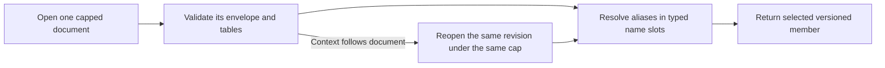

# Bounded Morphir YAML input

This portable package reads the normative [Morphir YAML profile](https://github.com/finos/morphir/blob/2b0cb1d64ccd0455aba3eaa2b143dbc7d276df70/docs/spec/ir/schemas/v4/yaml-profile.md)
on JS, native, Wasm and Wasm GC. It needs no host process or daemon.

`parse(source, limits~)` returns the duplicate-aware JSON-shaped value tree,
retaining numeric lexemes. `read_versioned(source, limits~)` uses the existing
version-specific IR decoder. `read(source, limits~)` also applies the shared
migration to current IR. Single files support versions 1 through 4 under that
decoder's support table. Quoted and block scalars stay strings, including dates.

`read_tree(files, limits~)` accepts a map of relative physical paths to text.
It assembles v4 and exactly v3.1.0 trees under their version-specific contracts.
JSON trees use the existing bounded JSON reader. YAML accepts `.yaml` and `.yml`.
The manifest selects one physical profile; ambiguous files, mixed profiles,
incorrect roles, stray package files and mismatched versions are refused.
Modules are sorted by logical path. The reader supports inline and listed nodes,
canonical filename escapes, `fileNames`, dependency specifications and Application
definitions. It ignores reserved `$meta` and unrelated non-tree extensions.

## Read a bounded tree

Use `open_bounded_tree(source, limits~)` to read plain v3.1.0 and supported v4
document trees one page or member at a time. For example, a generator for
`acme/orders` can page through the `domain` module with
`reader.members(package_name, module_name, limit=2)`. Its next page contains
the value `total-in-USD`, whose logical document is
`pkg/acme/orders/domain/total-in-_usd.value`. Call `reader.read_member` with the
package, module, member kind, and canonical name to decode that value. The
returned `TreeMemberBody` carries the original version and role, including
classic v3 inferred-type attributes. A type and a value named `order` are
independent selections.

`TreeSource` supplies a revision identifier, exact physical path probes, and
extensionless module paths ordered lexically under each package prefix.
Its metadata callbacks must avoid reading file bodies. Each callback must
serve the revision it receives or raise `TreeSourceError::RevisionChanged`.
The read callback must enforce the supplied UTF-8 byte cap before allocating
an oversized buffer, and raise `TreeSourceError::DocumentTooLarge` so the
reader can report the affected logical document. Source adapters own immutable
storage, path confinement and any filesystem or index work. File probes are
case-sensitive. JSON uses `.json`. YAML uses `.yaml` or `.yml`. The manifest
selects one profile and the reader refuses multiple physical spellings of a
selected logical document.

`reader.package_name()` and `reader.dependency_packages()` expose the names
declared by the manifest. `reader.modules(package, limit~)` pages one package
in lexical logical-path order. `reader.members(package, module, limit~)` pages
types before values and follows the array or mapping order within each kind.
Inline members use their module's logical document identity. Each page has
up to 256 entries and may return an in-process cursor. Pass that cursor to
the same reader with the same selection to continue. A changed revision,
another reader, or a different selection causes a refusal.

The bounded reader retains manifest routing metadata, one capped document
at a time, and the current page. Module and member discovery can read module
metadata. Split definitions and specifications are opened only on selection.
Inline entries are physically part of the capped module document and receive
typed payload validation when selected. Document reads apply the byte, depth,
node and assembly limits below per file. Callers control how many returned
pages and decoded bodies they retain. Discovery leaves unread bodies
unvalidated. Use `read_tree_versioned` or `read_tree` for whole-model assembly
and validation, including checks for stray tree files.

### Read file-local name tables

Use `open_bounded_tree(source, encoding=ContextualDraft1)` to admit the
[draft.1 contextual envelope](https://github.com/finos/morphir/blob/177371fa7a6199b7f177a8c1d886f583ee57e813/openspec/changes/add-bounded-model-access/specs/ir/name-compaction/spec.md)
in JSON or YAML. Plain reading is the default. The encoding selection is
explicit and separate from the manifest's IR version. Within an opted-in
tree, a file without an envelope keeps its plain representation.

When the orders generator selects `total-in-USD`, the value file's
`fqNames` table resolves its reference to `acme/orders:domain#order`. The
reader returns that typed reference without opening `order.value`. A
`$name` member inside a document literal remains ordinary data. Each
context has four separate typed tables, at most 16,384 entries per table,
and at most 1,024 UTF-8 bytes per spelling. The envelope, including ignored
optional context content, counts toward the encoded file's byte and
assembly limits.

The general reader admits a context after the document with a second
bounded read of the same revision. It releases the first parse tree
before that read. `ContextualDraft1Ordered` requires both the schema
marker and context before the document. This option checks input order.
The reader still parses one capped document at a time.

Use `reader.read_original_document` with a manifest, module or member
identity to pass through the original UTF-8 text. Inline members select
their containing module. The reader validates the selection and reopens
the artifact under the same revision and byte limit, preserving optional
content, formatting and numeric spellings.

## Limits

Default limits are finite and configurable:

| Resource | Default | Check |
| --- | --- | --- |
| Source bytes | 16 MiB | Before parsing. Whole-tree APIs also cap the total |
| Events and scanner tokens | 400,000 each | Before the next pull or token insertion |
| Physical nodes | 100,000 | Before scalar placement or container allocation |
| Depth | 128 | Before scanner/parser stack growth and container placement |
| Scalar UTF-16 units | 4 Mi | Before each scanner buffer append, including folding buffers |
| Semantic assembly work | 100,000 | Nodes and text units before typed shorthand expansion; cumulative for whole-tree assembly |

Configured depth cannot exceed the portable hard ceiling of 512.
Diagnostic cursors and physical paths are also bounded to 4,096 UTF-16 units.
Whole-tree APIs accept at most 4,096 captured files. Adapters must bound filesystem traversal
and capture before supplying a map. The engine exposes the same capture bound as
`data.model_tree_file_limit`.

The physical grammar comes from the MIT-licensed MoonBit event parser, with
[pinned provenance and local changes](parser/PROVENANCE.md). The Morphir layer
resolves scalars itself and refuses anchors, aliases, tags, directives, merge
keys, duplicate members, multiple documents, non-string keys and forbidden
numeric forms. Typed float decoding also refuses nonfinite values and nonzero
underflow. Arbitrary-precision document numbers retain their lexemes.

Normalization does not preserve YAML presentation. Callers retain original bytes
separately through the shared model-document owner for exact downloads. This
package implements input, not a canonical YAML writer.
