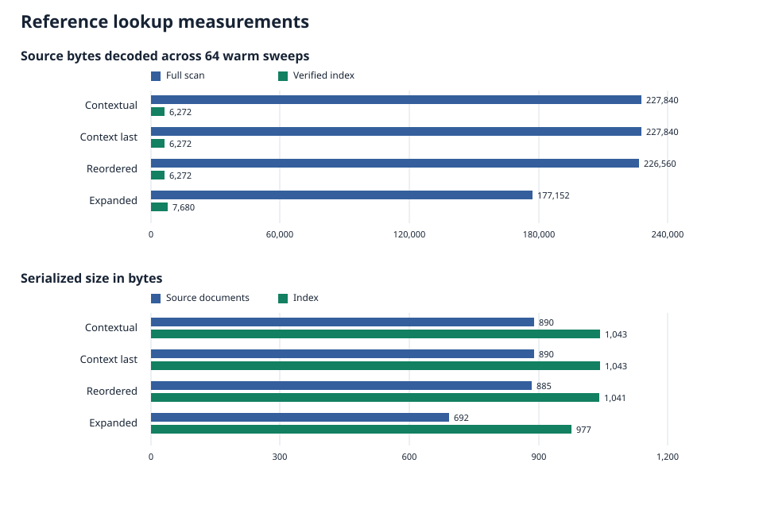

# Indexed reference lookup on the fixed controls

The scan and digest-bound index returned the same independently authored
occurrence sets on all four revisions. Dictionary-only lookup missed fully
spelled references and treated an unused alias as a candidate. The index can
reduce repeat decoding after verification. Opening it still consumes and
hashes every source byte in these controls.

The [Windows ARM64 receipt](measurement-win-arm64.json) records Bun 1.4.2,
source revision `94788bfc7141f8c8c137b4852997098bc158a3cc`, and SHA-256
digests for the independent expectations, every measured source and every
serialized index. The receipt includes process resident samples before and
after preparation, after warm queries, and the process peak.

| Revision | Source bytes (gzip) | Index bytes (gzip) | Index build | Index bind | Warm scan bytes | Warm index bytes |
| --- | ---: | ---: | ---: | ---: | ---: | ---: |
| Contextual | 890 (506) | 1,043 (390) | 2.253 ms | 0.704 ms | 227,840 | 6,272 |
| Context last | 890 (506) | 1,043 (391) | 1.685 ms | 0.605 ms | 227,840 | 6,272 |
| Reordered | 885 (503) | 1,041 (394) | 2.330 ms | 0.638 ms | 226,560 | 6,272 |
| Expanded | 692 (419) | 977 (359) | 1.455 ms | 0.732 ms | 177,152 | 7,680 |

Each warm measurement runs all four queries 64 times. The scan decoded 512
complete documents per revision. The index decoded 320 selected reference
values, consuming roughly 23–36 times fewer source bytes in the decoder.
Each method's initial file requests covered the complete two-document
revision. After preparation, all three methods queried retained memory.
The [replay guide](README.md#replay-and-measurements) defines each phase.

First-sweep lookup elapsed times were 1.594–2.346 ms for the scan and
0.131–0.413 ms for the prepared index. Preparation and source reads are
recorded separately. Peak resident memory ranged from 43,143,168 to
46,292,992 bytes for the scan, 30,162,944 to 30,855,168 bytes for dictionary
lookup, and 32,292,864 to 32,636,928 bytes for the index. These are
whole-process observations, including Bun. Each worker measured a single
tiny run. The raw index exceeded the original source size in every case.
The gzip column sums compression of the two individual source files and
compares that with compression of one index file.

The alias table missed the fully spelled `add` value in both documents, and
its contextual `int` result missed the other document's spelled type. It
returned an alias candidate for `unused` where the frozen typed occurrence
set is empty. An empty dictionary result gives no coverage of the typed body.

The index refused the contextual offsets after the context moved to the end,
after fields were reordered, and after aliases were expanded. It also refused
a same-length spelling edit. A UTF-8 test places multibyte text before the
reference and checks the exact byte slices. These controls support verified
lookup within a retained revision. They leave disk-range reads, larger-model
resident ceilings, and any shared-context or push-down contract unqualified.
