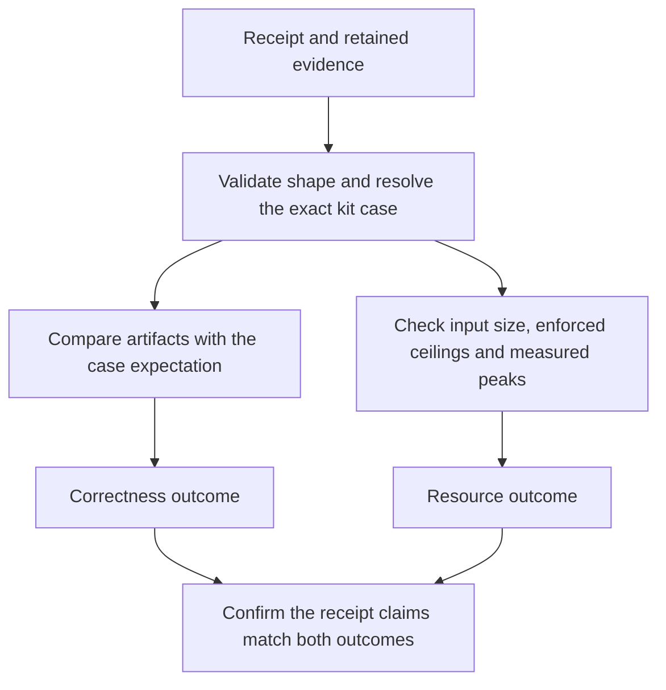

# Bounded-generation receipts

A receipt records one explicitly selected adapter, one case and one host path. The kit can compare the orders result with its frozen expectation before judging the memory evidence. Matching output establishes correctness for that run. Resource qualification also needs a large case, enforced ceilings and measurements at the right scope.

The receipt family starts at `0.1.0-draft.1`. Its [schema](../../../website/static/schemas/bounded-generation-kit/0.1.0-draft.1/receipt.schema.json) identifies the exact draft. The kit's existing runner verifies this report. The parent repository owns the schema, cases and expected values.

## Bind the case and observations

| Members | Evidence |
| --- | --- |
| `kit`, `fixture` | Exact contract and corpus digests, case identity, small or large scale, expanded input bytes and largest individual document. |
| `runner`, `adapter`, `host`, `guest`, `platform` | Repository, revision and binary identity for each participating program, plus the host operating system and architecture. The WASM path records the guest module digest. Record a separate guest identity whenever another extension artifact executes. |
| `execution`, `tuple`, `target`, `generatorOptionsSha256` | An in-process reader, native generation or WASM generation path, with the exact agreed tuple, target and options. |
| `comparison` | Digest from the independent case and digest of the observed reader facts or complete artifact inventory. A case expecting refusal uses diagnostic facts. An absent observed digest means the comparison did not run. |
| `limits`, `measurements` | Configured ceilings with enforcement evidence and observed peaks or counters. Each missing or inapplicable value carries a reason. |
| `correctness`, `resources` | Separate decisions a checker recomputes from the case and evidence. |

The report checker resolves the exact kit and case by digest, checks the identities and replays the comparison. The independent case supplies the expected digest. An artifact inventory uses the RFC 8785 JSON form of a list of `{path, sha256}` entries sorted by the UTF-8 bytes of their relative path. The digest covers the whole inventory. Each artifact digest covers its original output bytes. Reader and diagnostic observations use the canonical result required by the case. Diagnostic facts include the refusal and whether a successful output record or installed artifact appeared.

The optional `critical` list contains RFC 6901 JSON Pointers to understood members. An unknown critical path fails with `unknown_critical`. The checker refuses a report with an invalid schema shape (`invalid_shape`), an altered case expectation (`expected_digest_mismatch`), or an outcome that disagrees with replay (`outcome_mismatch`). It also refuses a wrong kit identity or contradictory evidence (`contradictory_evidence`). Unknown optional members follow the versioned contract policy.

## Read the measurement scope

| Measurement | Scope |
| --- | --- |
| `peakHostResidentBytes` | Operating system resident bytes of the host process. |
| `peakDescendantResidentBytes` | Peak sum of resident bytes of the host's live descendants at the same observation. Use `not-applicable` only when the run establishes that there were none. |
| `peakHostTreeResidentBytes` | Host and live descendants measured together. Compare the resulting peak with `hostTreeResidentBytes`. |
| `peakGuestLinearMemoryBytes` | Peak committed linear memory of the WASM instance. Use `not-applicable` for the reader and native paths. |
| `peakDecodedResidentBytes`, `peakDecodedResidentNodes` | Peak retained decoded working set. Keep at least one measured dimension with its matching enforced ceiling. |
| `maxInputBatchBytes`, `maxOutputBatchBytes` | Maximum decoded bytes of one admitted batch in each direction. A reader with zero emitted bytes records that measured zero. |
| `peakContextBytes`, `peakIndexBytes` | Peak retained context and discovery index storage in memory. Count a disabled cache as zero. |
| `bytesRead`, `bytesWritten`, `elapsedMilliseconds` | Total operation I/O bytes and elapsed time from admission to resource release. |

Each recorded source names the measurement or enforcement method and the SHA-256 of its retained evidence. A sampling method identifies the tool, interval and observed process scope. The process-tree observation accounts for simultaneous residents. When the same samples cover a host with no descendants, the host and tree peaks must agree. The checker refuses contradictory measurements before replaying the claimed outcomes. Guest linear memory remains a separate measure even when the engine shares the host process. The limits record the configured maximum for one document, working sets, input and output batches, and the host and guest ceilings.

## Replay the two decisions

The checker computes correctness as `passed` when the full observed result matches the case, `failed` for a mismatch and `not-run` when the comparison did not run. It uses `comparison.mismatch` or `comparison.missing` for the latter two outcomes.

For a large case, the expanded input must exceed the host resident ceiling and, for WASM, the guest linear-memory ceiling. The largest individual document must fit its ceiling. Measured peaks must stay within their matching limits. Every required limit must be enforced and every required measurement accounted for. A small case produces `not-run` for resource qualification with `resource.small_case`.

An exceeded ceiling, oversize document or insufficient large input produces `failed`, with `resource.ceiling_exceeded`, `resource.document_oversize` or `resource.input_too_small`. Missing required measurements or unenforced limits leave the resource decision `not-run`, with `resource.measurement_missing` or `resource.limit_not_enforced`. A known failure takes precedence over missing evidence. A required measurement marked inapplicable is a missing measurement unless the recorded execution scope allows it. The checker returns every applicable reason in ordinal order and returns an empty reason list for a pass.

Each decision applies to the recorded case and execution path. The runner combines the required paths and scales when it decides whether the release evidence qualifies.

## Follow a report check

The [sample orders receipt](fixtures/receipt-qualified-wasm.json) describes a synthetic WASM run. Its 3 MiB of expanded input exceeds the 2 MiB host ceiling and 1 MiB guest ceiling. A 32 KiB document fits the 64 KiB document limit. Matching artifact digests pass the correctness check. The host and guest peaks fit their limits, so the resource check also passes.

The [fixed controls](receipt.controls.json) apply an RFC 6902 patch to a fresh copy of the sample for each case. The independent `caseExpectation` stays fixed, including when a patch changes both report digests. Each control declares the expected schema result and either two replayed outcomes or a report refusal. For example, removing the guest peak evidence leaves matching artifacts and yields `not-run` for resources. Keeping the same missing evidence while claiming a resource pass makes the checker refuse the report.
