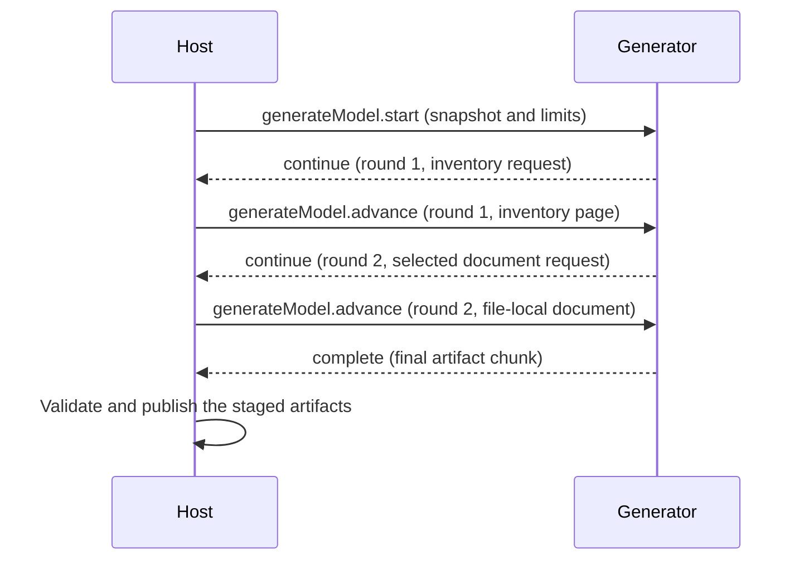

# Bounded generation (MEP 0.2.0-draft.2)

The orders generator can begin with a module inventory, ask for the last value body, and finish its output without receiving the entire package. Each exchange uses the same JSON-RPC messages over a process connection or a WASM byte call. The host holds the snapshot lease, answers requests from that snapshot, and stages artifact bytes until the generator completes.



## Negotiate one complete offer

`morphir.initialize` carries an optional `modelAccess` offer. The extension describes support in `capabilities.modelAccess` and returns the admitted support in the same member of the initialize result. Omit the member from a legacy-only offer or result. The selected protocol must be exactly `0.2.0-draft.2` before any of these methods can run. An older protocol continues to use its existing methods and result shapes.

The offer is an object with `tuples` and `limits`. A host lists each complete tuple once in preference order. The response keeps that order and includes only tuples offered by both peers. A host selects one of those tuples at start. Each limit in the response and in the start request is at most the corresponding limit already offered by both peers.

| Tuple member | Draft value |
| --- | --- |
| `protocolVersion` | Exact SemVer `0.2.0-draft.2`, equal to the live protocol |
| `accessVersion` | Exact SemVer `0.1.0-draft.1` |
| `operation` | `morphir.backend.generateModel` |
| `irVersion` | Exact semantic `3.1.0` or `4.0.0` |
| `profile` | `morphir-ir` |
| `codec` | `morphir-json` or `morphir-yaml` |
| `layout` | `document-tree` |
| `contextualEncoding` | `plain` or the exact [context envelope schema URL](https://morphir.finos.org/schemas/ir-context/0.1.0-draft.1/document.schema.json) |

The codec and contextual encoding are separate tuple members. A contextual JSON offer grants no contextual YAML ability. Version values use canonical SemVer spelling and exact draft equality. IR's integer shorthand is confined to IR files and does not change a negotiated tuple.

## Start and advance one snapshot

| JSON-RPC method | Named parameters | Result |
| --- | --- | --- |
| `morphir.backend.generateModel.start` | `sessionId`, `snapshot`, `input`, `target`, `options`, `requiredGuarantees`, `limits` | A generation step |
| `morphir.backend.generateModel.advance` | `sessionId`, `round`, `deliveries` | A generation step |
| `morphir.backend.generateModel.cancel` | `sessionId` | `{ "sessionId": "…" }` once operation-owned state is released |

The host chooses a nonempty `sessionId` that it never reuses on the same connection. `snapshot` carries `snapshotId`, `modelId`, `revision`, `contextDigest` and `scope`. The snapshot and scope identities are opaque nonempty strings. `contextDigest` is a lowercase SHA-256 digest of the bound dependency and configuration context. None of these values is an ambient file path. `input` is the selected complete tuple. The target must be supported by the extension. `options` is target-specific JSON and `requiredGuarantees` uses the existing guarantee and scope pairs. The host establishes those guarantees for the snapshot view before dispatch.

Each step echoes `sessionId` and has exactly one `state`.

| State | Other members | Meaning |
| --- | --- | --- |
| `continue` | `round`, `requests`, `artifacts`, `diagnostics` | Another advance is required. Collections can be empty. |
| `complete` | `artifacts`, `diagnostics` | Final chunks can be present. Every artifact must now be closed and pass validation before publication. |
| `failed` | Nonempty `diagnostics` | The operation is terminal. Discard its staged output. |

The first continuation has `round: 1`. An advance echoes that exact round and supplies one delivery for each outstanding request in request order. A continuing result asks for the next round, incremented by one. When a continuation has no requests, the advance sends an empty delivery list. A host with a delivery failure cancels the operation and reports the failure. It does not substitute empty content. If cancellation cannot be acknowledged within the call deadline, the host terminates the execution before releasing the snapshot lease. Completion, failure and cancellation make later advances invalid. A stale, duplicate or out-of-order round must not append or publish output again.

An extension that receives a bounded call without admission returns `-32013`. An admitted extension that receives an invalid round, session identity or delivery returns `-32602`. An invalid advance cannot consume the outstanding round.

### Requests and deliveries

Request objects have a nonempty `requestId` unique for the operation. The two variants use a `kind` tag.

| Kind | Request members | Delivery members |
| --- | --- | --- |
| `inventory` | `requestId`, `kind`, `selection`, `pageSize`, optional `cursor` | `requestId`, `kind`, `snapshotId`, `entries`, optional `nextCursor` |
| `document` | `requestId`, `kind`, `documentId` | `requestId`, `kind`, `snapshotId`, `documentId`, `decodedByteLength`, `sha256`, `content` |

`selection` is an opaque identity for a module or member listing in the admitted snapshot. The reserved selection `root` enumerates the view's modules. A module entry can advertise a `memberSelection` that enumerates its members. The host determines order from the snapshot inventory and binds each continuation cursor to the same snapshot and selection.

Each object in `entries` has exactly one key, `module`, `type` or `value`. The key selects the payload object, which requires `documentId`, `packageName`, `modulePath` and `role` (`definition` or `specification`).

| Key | Additional payload members |
| --- | --- |
| `module` | Optional `memberSelection`. |
| `type` | Required `name`. |
| `value` | Required `name`. |

The receiver rejects a `module` payload that includes `name` or a `type` or `value` payload that includes `memberSelection`. [Examples of all three variants](smithy/transcripts/session-model-access.md)

`documentId` names the logical document within the snapshot, without the physical extension or a host path. The reserved identity `manifest` can be requested before enumeration. `content` contains canonical padded RFC 4648 base64 of the selected document's original bytes. Check the length and lowercase SHA-256 before parsing under the exact selected tuple. A contextual delivery includes the file's entire local table. Receiving a type or value file on its own never requires a second file to resolve one of its aliases.

For example, the generator asks for a type after examining an inventory page.

```json
{
  "jsonrpc": "2.0",
  "id": 2,
  "result": {
    "state": "continue",
    "sessionId": "orders-generation",
    "round": 2,
    "requests": [
      {"requestId": "type-order", "kind": "document", "documentId": "pkg/acme/orders/domain/order.type"}
    ],
    "artifacts": [],
    "diagnostics": []
  }
}
```

### Artifact chunks

A chunk carries `path`, `offset`, `decodedByteLength`, `sha256`, `content` and `end`. The path is relative to the operation's staging root and uses forward slashes. It must pass the host's artifact path admission policy. For one artifact, the first offset is zero and subsequent offsets are exactly the previous offset plus decoded length. The hash and padded base64 cover only the bytes of that chunk. The final chunk sets `end: true`, including the zero-byte chunk of an empty artifact. A closed path cannot be reopened. Artifacts published to the task result have full-file digests computed by the host after staging.

## Enforce bounds at their scope

All limits are positive integers represented exactly on the wire. Per-frame and per-call bounds are at most 2,147,483,647. The cumulative byte and work counters can reach 9,007,199,254,740,991, the highest safe integer in a JavaScript JSON reader. The host enforces its own limits even when the guest's evidence is missing or incorrect.

| Scope | `limits` members |
| --- | --- |
| One frame or exchange | `maxFrameBytes`, `maxEncodedBytesPerExchange`, `maxDecodedBytesPerExchange`, `maxDocumentsPerBatch`, `maxDepth`, `maxNodes`, `maxDiagnosticsPerExchange`, `maxOutstandingRequests` |
| Resident data | `maxGuestStateBytes`, `maxHostCacheBytes` |
| Staged outputs | `maxArtifactChunkBytes`, `maxArtifactBytes`, `maxTotalArtifactBytes`, `maxSessionDiskBytes` |
| Work and deadlines | `maxSessionWorkUnits`, `maxRounds`, `maxCallMilliseconds`, `maxSessionMilliseconds` |

Count JSON-RPC frame bytes before admitting the frame. Count the encoded and decoded content of document deliveries and chunks in their exchange, and bound decoded nodes, depth and retained caches independently. The work budget bounds cumulative processing in the admitted execution profile. The session disk limit includes spill files and staged artifacts. A limit failure aborts publication and identifies the limit in the diagnostic.

## Verification boundary

The [bounded model access change](../../openspec/changes/add-bounded-model-access/tasks.md) tracks source models, generated IR and fixed transcripts for this draft. A valid message shape alone cannot prove exact tuple agreement, cursor ownership, resource limits, digest integrity or publication behavior. Those are conformance checks over actual host and adapter observations.
