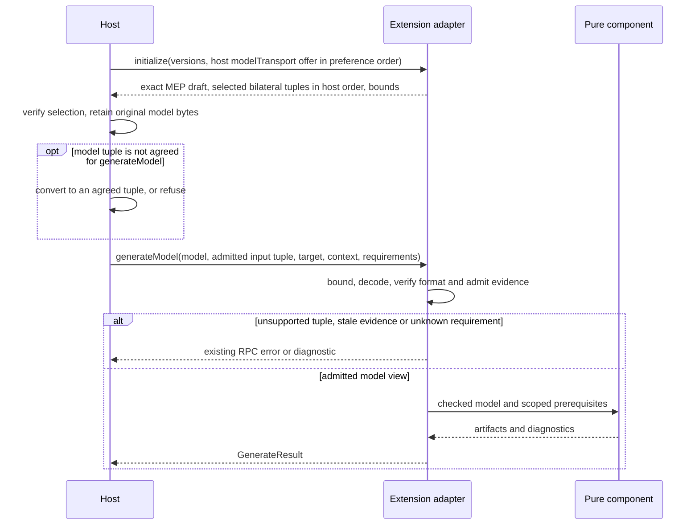

# MorphirModel transport

This draft specifies the additive `morphir.frontend.compileModel` and
`morphir.backend.generateModel` methods. The canonical types are in
[`contract/src/mep.gleam`](contract/src/mep.gleam). This is a protocol contract,
not a claim that the current SDK, host, or an extension implements these methods.
The [reference corpus](mck/README.md) checks examples and literal assets;
bounded executable guest qualification is available through
[`morphir mck mep`](mck/README.md). Broader independent host qualification remains
[#965](https://github.com/finos/morphir/issues/965).

## Versions and compatibility

The new methods require exactly MEP `0.2.0-draft.1`. This protocol change adopts
full SemVer, as required by the accepted
[versioning decision](../../kb/bundles/morphir/morphir-cli/decisions/0003-semver-is-the-default-contract-versioning-scheme.md).
Prereleases match exactly. The legacy `0.1` handshake and its existing JSON
compile/generate request and result shapes remain unchanged. Peers can offer
both versions; a session chooses one. Negotiating `0.1` never enables the new
methods, even if an unknown capability object happens to contain model offers.

The model envelope has its own exact version, `0.1.0-draft.1`. Semantic IR
versions, capability claims versions, and extension distribution versions are
independent. No MEP version implies support for every semantic IR version.

The reference examples use the current draft IR `4.0.0` target. The existing
[IR format-version contract](../../docs/spec/ir/format-version.md) accepts both
integer `4` and string `"4.0.0"`, with integer `4` as canonical writer output.
Those spellings do not declare IR 4 stable or released. Its draft maturity is
separate from its wire spelling; do not add a MEP-style prerelease suffix to
`formatVersion`. This draft neither mints IR `4.1.0` nor changes the IR support
table.

## Bilateral admission

`InitializeParams.modelTransport` contains the host offer. It is optional and
omitted by legacy-only peers. `ExtensionCapabilities.modelTransport` contains
the extension's selected session support. It is also optional; absence or an
empty tuple list grants no model operation. The extension selects the
intersection of its own support with the host offer, in host order (see
[Offer order and the default tuple](#offer-order-and-the-default-tuple)). The
host verifies that subset before dispatch. Static claims and extension
description cannot substitute for the live host offer and initialized session
capabilities.

When a static claim set is available, the new draft permits only
`modelTransport` to narrow within the claim: session tuples and guarantee IDs
are subsets, and positive session limits do not exceed the claimed limits or
the host offer. A session cannot introduce an unclaimed model transport member.
Other capability members retain existing agreement rules. `modelTransport` is
negotiation metadata for frontend/backend methods, not an additional extension
type. The current SDK's equality-based claim checker needs a separate runtime
update before accepting this narrowing; this draft does not claim it does so.

Each tuple contains all of `operation`, `profile`, `codec`, `envelopeVersion`,
and `irVersion`. Compare all five exactly. Never form a Cartesian product of
independent codec, profile, or IR lists. `output` on compile and `input` on
generate must equal an admitted tuple, including the method's operation.
Language/source-count and backend target capabilities must also admit the
request. A target is a separately advertised language or output target, not a
model profile. Selecting a compile tuple does not authorize generation. The corresponding
frontend/backend capability must be present. Its language, source-count, target
and IR-version restrictions still apply. The tuple authorizes the rich method;
legacy `frontend.compile` and `backend.generate` booleans authorize only their
legacy methods and need not be true for a rich-only provider.

Session limits cannot exceed either peer's limits. All four limits are positive
integers at most `2147483647`. `guarantees` contains the identifiers both peers
can interpret, selected from their intersection; it does not establish any
prerequisite. Unknown required guarantees refuse invocation. The consumer also
enforces its own prerequisites; an empty request list cannot disable them.



### Offer order and the default tuple

The host offer lists every tuple that the host supports for an operation, in
the host's preference order. The first offered tuple for an operation is the
host's default for that operation. No wire member names the default: the order
of `tuples` gives it. Tuples for different operations can interleave, so
compare order only among tuples that have the same `operation`.

The extension selects the offered tuples that it supports and keeps the host's
order. It does not reorder them to show its own preference. For each operation,
the host uses the first agreed tuple. The first agreed tuple is the first tuple
in the host offer for that operation that is also in the session support.
Because the extension keeps the host order, it is also the first session tuple
for that operation.

When the host requires one format for an operation, for example because the
user gave an explicit model format, the host offers only that tuple for the
operation. If the extension does not support that tuple, the agreement for the
operation is empty.

An empty agreement for a requested operation is the only negotiation failure.
The host refuses the operation and sends no request for it. A host reports this
refusal as `extension.tuple_unavailable`. This is a host outcome code, not a new
JSON-RPC error number. When the host does not require a format, an extension
that does not support the host's default but supports another offered tuple is
not an error: the session uses the first agreed tuple. For generation, a model
that the host has in a tuple outside the agreement is also not an error when the
host can convert it (see
[Host conversion for generation](#host-conversion-for-generation)).

In this example the host prefers Ion and also offers JSON for compilation. A
JSON-only extension agrees on JSON, and the host compiles with JSON. Tuples show
only `operation` and `codec`. Each codec uses its profile from the table in
[Profiles and encoded payloads](#profiles-and-encoded-payloads), and all tuples
have the same envelope and IR versions.

```text
host offer       [compileModel/ion-binary, compileModel/morphir-json]
extension        [compileModel/morphir-json]
session support  [compileModel/morphir-json]   -> use morphir-json

host offer       [compileModel/ion-binary]      (host requires Ion)
extension        [compileModel/morphir-json]
session support  []                             -> extension.tuple_unavailable
```

This is a clarification of the `0.2.0-draft.1` draft. It adds no wire member.

## Profiles and encoded payloads

The draft defines these complete profile/codec pairs. An implementation only
supports the IR versions explicitly present in its tuples.

| Profile | Codec | Decoded document |
| --- | --- | --- |
| `morphir-model` | `ion-binary` | One `morphir_model`-annotated Ion struct containing `ir`, `enrichments`, and `provenance` |
| `morphir-ir` | `morphir-json` | One UTF-8 JSON object representing the selected semantic IR distribution |

For `morphir-model`, the top-level struct must contain exactly one each of
`ir`, `enrichments` and `provenance`; duplicate reserved fields refuse admission.
This restriction does not forbid repeated names inside arbitrary unknown Ion
data. `ir` retains the selected IR version's object structure.
`enrichments` is a list of structs with a nonempty namespaced `owner` and an
arbitrary Ion `data` value. `provenance` is a list of arbitrary Ion values.
Unknown optional body members, enrichments, annotations, and provenance must
survive retention. This wrapper does not redefine a separately specified Ion IR
codec or promise that existing IR readers accept the wrapper. Library, Specs,
and Application remain variants of the semantic IR Distribution; the envelope
does not duplicate them in an outer stage enum.

The JSON profile carries plain IR. It supports explicit, lossless JSON use and
keeps Morphir JSON a supported format. It cannot silently replace rich Ion
content. A requested projection that would discard an enrichment, annotation,
precision, decimal scale, or provenance must refuse with the existing
`data.lossy_conversion` diagnostic. There is no automatic JSON retry after Ion
admission fails. The only exception in this draft is a host conversion for
generation that the user explicitly allows to lose data (see
[Host conversion for generation](#host-conversion-for-generation)). Any other
explicit lossy export policy needs its own contract.

Both codecs use `ModelPayload`: `codec`, `layout`, `decodedByteLength`, `sha256`,
and `content`. Layout is exactly `single-document`. Content is canonical padded
RFC 4648 base64 with no whitespace, including for JSON. Decoded length is an
integer from zero through `2147483647` and must equal the bytes. The digest is
64 lowercase hexadecimal SHA-256 digits over those exact decoded bytes.
`ion-binary` derives media type `application/ion` and requires the Ion 1.0 binary
version marker `E0 01 00 EA`; see the
[Ion binary specification](https://amazon-ion.github.io/ion-docs/docs/binary.html).
`application/ion` is listed in the
[IANA provisional registry](https://www.iana.org/assignments/provisional-standard-media-types).
`morphir-json` derives `application/json` and UTF-8. No redundant `mediaType`
member is negotiated. A payload contains one complete document with its local
symbol tables; external symbol tables, compression, file references and
multi-document trees are outside this draft.

The receiving boundary applies limits before allocation or parsing:

1. Enforce the transport's independently configured outer frame limit.
2. Bound base64 ASCII bytes before decoding, and check canonical encoding.
3. Bound decoded allocation, verify exact byte length, then verify SHA-256.
4. Decode the selected codec under depth and node limits. Verify the profile,
   envelope version, selected semantic IR version and complete distribution.
5. Check critical paths and admit every required guarantee before invoking the
   component. A matching digest proves byte integrity, not model correctness.

`maxEncodedBytes` and `maxDecodedBytes` bound the sums of payload content bytes
and decoded bytes in one request or response, including all dependency and
evidence payloads. They also bound each payload. `maxDepth` bounds each decoded
document, counting its root as depth one. `maxNodes` bounds the sum of decoded
value nodes, counting containers and scalar values; Ion annotations and field
names do not add nodes. System symbol-table handling must itself remain bounded
by the decoded byte budget. Outer JSON members are subject to the transport's
own parser limits. Limits apply to malformed inputs and errors as well as valid
models. These aggregate rules prevent many small evidence entries bypassing a
payload budget.

## Identity, enrichment and guarantees

`modelId` is a nonempty stable logical identity. `revision` is a nonempty
immutable logical revision, not the encoded payload digest. Changes to semantic
content or facts mint a new revision. A component must invalidate affected
evidence unless its explicit contract proves that guarantee and scope survive.
Exact transcoding may keep the logical revision while recomputing length and
digest. Host conversion for generation is different: the converted model keeps
its `modelId` but always has its own revision (see
[Host conversion for generation](#host-conversion-for-generation)). Opaque
retention keeps the complete original bytes, including unknown Ion facts,
ordered annotations, symbols, decimal scale and provenance.

Evidence is a claim with `guarantee`, `modelId`, `modelRevision`,
`contextDigest`, `scope`, `producer`, and an independently encoded evidence
payload. Evidence content is checker-defined Ion or JSON; it is not itself a
model-profile body. It follows the same codec encoding, integrity and aggregate
bounds. All identity/scope strings are nonempty; guarantee IDs are namespaced.
`contextDigest` is a 64-character lowercase SHA-256 digest of the declared
context. The producer and consumer must agree on context construction for the
operation, including dependency revisions and relevant configuration. This draft
does not define a universal context canonicalization or proof vocabulary;
without an agreed construction and checker, evidence cannot establish a
prerequisite. The receiver recomputes or otherwise validates the context under
its configured checking/trust policy.

Evidence must match the exact model identity, revision, context and scope.
Scopes name stable model/node identities, never ambient filesystem paths. No
implicit parent-scope or whole-model subsumption is defined. A supported
guarantee identifier means the peer can interpret it. Even fully matching
fields require an accepted checker or trust policy. `producer` is attribution,
not authentication. A host can establish a checked view locally without making
that view an automatically trusted remote assertion. Unknown optional evidence
remains opaque and preserved; unknown required guarantees refuse admission.

The model's `critical` list is optional and defaults to empty. Entries are exact
registered member paths relative to the envelope, with no wildcards or array
indexes. This draft registers `envelopeVersion`, `modelId`, `revision`,
`irVersion`, `profile`, `payload`, `payload.codec`, `payload.layout`,
`payload.decodedByteLength`, `payload.sha256`, `payload.content`, `evidence`, and
`critical`. Knowing `payload` does not admit `payload.futureMember`. No paths
inside opaque profile content or individual evidence entries are registered.
Refuse any unrecognized critical path and identify it. Ignore unknown optional
protocol members; preserve unknown profile content by retaining its bytes.

## Compile and generate

`CompileModelRequest` reuses `SourceSet`, `CompilePackage` and `CompileOptions`.
It carries complete `CompileModelDependency` models, a required context digest,
and the selected output tuple. Dependencies default to empty. In this draft,
all dependency models must use the output tuple's profile, codec, envelope and
IR version; mixed-format dependency negotiation is deferred. The frontend's
advertised language and multi-document/source-count restrictions still apply.
`options.irVersion` must equal `output.irVersion`. No legacy incremental baseline
or reuse of unvalidated frontend state is implied.

`CompileModelResult` is a sum. Success is
`{success:true, model:..., diagnostics:[], modules:[]}` and requires the full
model. Failure is `{success:false, diagnostics:[]}` and forbids `model`, even
`null`. Missing diagnostics and success modules default to empty. The successful
model must match the selected output tuple and negotiated limits. Compilation
errors are structured diagnostics, not successful results with a missing model.

`GenerateModelRequest` carries the retained model, selected input tuple, exact
advertised target, context digest, required guarantees and options. Absent
`requiredGuarantees` and `options` default to empty. The adapter checks model
format agreement, consumer prerequisites and evidence before passing a checked
view to the generator. Generation reuses `GenerateResult`, `Artifact` and
`Diagnostic`, including the existing artifact binary/base64 rule.

Unsupported methods use `-32601`. Invalid shapes, digests or bounds use
`-32602`; an unavailable negotiated capability uses `-32013`. Evidence rejection
can use `-32602` with a structured reason. Compiler/generator semantic failures
use their existing diagnostics. Corpus observation labels are not new RPC error
numbers. Errors and logs must not echo arbitrary payload content or secrets.

### Host conversion for generation

The host can have a model in a tuple that the session does not agree for
`morphir.backend.generateModel`. For example, the host has a `morphir-model`
Ion model, and the session agrees only on the `morphir-ir` JSON tuple for
generation. If the host can convert the model to a tuple that the session
agrees for `generateModel`, the host must convert the model and send the
converted model. The request `input` is that agreed tuple. This is not an
error. The request is the same as any other `generateModel` request in that
tuple.

When the host can convert the model to more than one agreed tuple, it selects
the target tuple in this sequence:

1. The host must prefer a lossless conversion. It converts to the first agreed
   tuple in host order to which it can convert the model without loss (see
   [Offer order and the default tuple](#offer-order-and-the-default-tuple)).
   A lossless conversion to a later agreed tuple comes before a lossy
   conversion to an earlier agreed tuple.
2. Only when the host cannot convert the model to any agreed tuple without
   loss does it select the first agreed tuple in host order to which it can
   convert. Then the loss rules below apply: the host refuses the conversion
   unless the user explicitly allows loss for that operation.

In this example the session agrees two `generateModel` tuples, `T1` before `T2`
in host order:

```text
host can convert to   T1 with loss, T2 without loss
                      -> convert to T2, no permission needed
host can convert to   T1 with loss, T2 with loss
                      -> select T1, then the loss rules apply
host can convert to   T1 without loss, T2 without loss
                      -> convert to T1
```

The operation fails with `extension.tuple_unavailable` only when the host cannot
convert the model to an agreed tuple. Then the host sends no request.

These rules apply to a host conversion:

1. **Lossless by default.** A conversion is lossy when the converted model
   cannot carry all content of the original model, for example an enrichment,
   an annotation, precision, decimal scale or provenance. The JSON profile
   rules in [Profiles and encoded payloads](#profiles-and-encoded-payloads)
   apply. A conversion from `morphir-ir` JSON to `morphir-model` Ion loses
   nothing. A conversion from `morphir-model` Ion to `morphir-ir` JSON is
   lossless only when the original has no content that JSON cannot carry.
2. **Lossy conversion refused.** When the host can convert the model to no
   agreed tuple without loss, it refuses the lossy conversion with its
   lossy-conversion error, for example `data.lossy_conversion` with exit code 2
   in the MoonBit CLI. This refusal is not `extension.tuple_unavailable`. The
   host refuses before it sends a request, sends no request and publishes no
   artifact. The error message tells the user how to allow the loss.
3. **Loss allowed explicitly.** The host does a lossy conversion only when the
   user explicitly allows loss for that operation, for example with the flag
   `--allow-model-loss` on one `morphir generate` command in the MoonBit CLI.
   The permission applies to that one operation only. When the host drops data,
   it tells the user about each kind of data that it dropped, for example
   metadata, provenance or annotations, and writes the same list in the
   conversion record (rule 6). A host with a machine-readable report also adds
   the conversion to it, for example
   `conversion: {from, to, dropped}` in the MoonBit CLI JSON report.
4. **Identity.** The converted model is a new model payload. It has its own
   `decodedByteLength`, `sha256` and `revision`. It keeps the `modelId` of the
   original. The host derives the new `revision` deterministically from the
   SHA-256 digest of the converted payload bytes, so the same converted bytes
   always get the same revision. For example, the MoonBit CLI uses
   `sha256:<64 lowercase hexadecimal digits>`. Only a converted model gets its
   revision in this way; other models keep the rule in
   [Identity, enrichment and guarantees](#identity-enrichment-and-guarantees).
   The host keeps the original
   model bytes. The conversion does not replace the retained model.
5. **Guarantees and evidence.** Required guarantees and evidence that apply to
   the original payload do not carry over automatically. Evidence binds the
   original revision, so it does not match the converted model. The host can
   send evidence for the converted model only when that evidence binds the new
   revision and its checker or trust policy accepts it. The extension admits
   the converted model and its evidence as it admits any other model.
6. **Conversion record.** The host keeps a record that links the converted model
   to the original. The record contains the original tuple and the converted
   tuple, the original revision and payload SHA-256, the converted revision and
   payload SHA-256, and the list of dropped data. The list is empty when the
   conversion is lossless. The record does not need to contain the original
   bytes. The record location is reserved for the host. The host must not let
   an artifact from the extension overwrite the record. If an artifact in the
   result uses the conversion record path, the host publishes nothing from
   that result. The error code and exit status of
   this refusal are host-defined. For example, the MoonBit CLI writes
   `mep/conversion.json` next to the generated artifacts and refuses the
   command when an artifact uses that path.
7. **Before dispatch.** The host converts before it sends the request. This is
   not a retry after the extension refuses admission. The extension does not
   ask for a conversion, and the host does not resend a refused request in a
   different tuple.
8. **Scope.** This rule applies only to `generateModel`. This draft does not
   define host conversion for `compileModel` dependencies.

```text
host model        morphir-model/ion-binary
session support   [generateModel/morphir-ir/morphir-json]
lossless          -> send the converted JSON model (same modelId, new revision)
lossy             -> lossy-conversion error, no request
lossy, allowed    -> send the converted JSON model, report the dropped data
no conversion     -> extension.tuple_unavailable, no request
```

The spec leaves these details to the host:

- which conversions it implements;
- the name of its lossy-conversion error and how the user allows loss;
- the error code and exit status when an extension artifact uses the
  conversion record path;
- the format and location of the conversion record and of the dropped-data
  report;
- whether it tells the user about a lossless conversion.

The MoonBit CLI implements this rule in its host library, which every MoonBit
host front end shares
([finos/morphir-moonbit#281](https://github.com/finos/morphir-moonbit/pull/281)).
This rule adds no wire member and does not change the `0.2.0-draft.1` draft
version.

## Delivery boundaries

This contract refines [#967](https://github.com/finos/morphir/issues/967) using
additive methods and complete tuples while preserving legacy JSON fields.
Generated SDK types and wire adapters follow
[finos/morphir-rust#241](https://github.com/finos/morphir-rust/issues/241).
Host/guest admission and executable conformance follow
[#965](https://github.com/finos/morphir/issues/965), through the existing native
MCK runner. JSON Schema and WIT generation remain separate deliverables. The
MoonBit engine can then implement these boundaries with `moonrockz/ion` while
its pure frontend/generator components keep their own checked model views.
