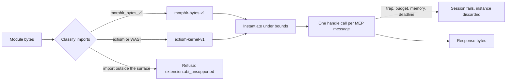

# WASM execution profiles

This document defines how a Morphir host runs an extension that is a WebAssembly module. It covers the two ABI profiles a module can have, how MEP messages cross the module boundary, what a guest may reach, how a host bounds and stops a guest, and how failures are named.

The contract is `morphir/mep-wasm-execution-profiles`, version **`0.1.0-draft.1`**. [`wasm-execution-profiles.json`](wasm-execution-profiles.json) holds the same tables as data; when the two differ, the JSON file is correct and this document has a bug. The contract adds no MEP method and no IR version. It records what the MoonBit worker host implements and what the published guests rely on, so that a second host has rules to implement and a guest built once runs the same way under each.

A profile is independent of the MEP version a session negotiates. A guest of either profile can speak MEP `0.1` or `0.2.0-draft.1`.

## From bytes to an answered request

Take the published Python extension. It is one `.wasm` file that imports Extism functions and exports `handle`. A host that has never seen Python runs it in four steps and can refuse it at each one.



1. **Classify.** The host reads the imports and exports and decides the profile. No guest code has run.
2. **Instantiate** under a memory ceiling.
3. **Call `handle`** once for each MEP message, under a deadline and, where the engine can, an instruction budget.
4. **Stop.** The guest handles `morphir.exit`, or a bound or trap ends the session and the instance is discarded.

## Classification

A host classifies a module before it instantiates it. The imports choose the profile:

1. A module that imports from `morphir_bytes_v1` is `morphir-bytes-v1`.
2. Otherwise, a module that imports from `extism:host/env`, `extism:host/user` or `wasi_snapshot_preview1` is `extism-kernel-v1`.
3. A module that imports from none of these takes the declared profile, or `extism-kernel-v1` when none is declared.

Every import must then be a function in the classified profile's import surface, with the surface's exact signature. The first that is not is refused with `extension.abi_unsupported`, and the refusal names it as `module.name`. The module must export `handle` as `() -> i32`; a module without it is refused with the same code.

A descriptor, configuration entry or command argument may declare an ABI. The declaration only confirms: when it differs from the classified profile, the host refuses with `extension.abi_mismatch`. It never allows an import the classified profile excludes.

A module that needs a WASM feature the engine lacks, or that has a shared, 64-bit or second memory, is refused with `extension.wasm_feature_unsupported`. A module whose initial memory is above the ceiling is refused with `extension.memory_limit`.

## The two profiles

| | `morphir-bytes-v1` | `extism-kernel-v1` |
| --- | --- | --- |
| Who builds it | Any language that emits core WASM (Gleam, MoonBit) | An Extism PDK (Rust, Python, the Morphir extension SDK) |
| Imports | Exactly three byte callbacks | Extism kernel and host functions, four Morphir functions, WASI preview 1 |
| Request reaches the guest | Guest pulls it one byte at a time | Extism input |
| Response leaves the guest | Guest pushes it one byte at a time | Extism output |
| `handle` result | Response length, or a code | Success, or an Extism error |
| Notifications from the host | Delivered | Not delivered |
| Call deadline | 10 seconds | 30 seconds |
| Ambient authority | None | None beyond clocks and random bytes |

`morphir-bytes-v1` exists so that a runtime with no Extism support can host an extension. `extism-kernel-v1` exists because that is what the published bundles are.

## Messages

Over stdio, MEP frames each JSON-RPC message with a `Content-Length` header. A WASM guest has no stream. One `handle` call carries exactly one complete message as UTF-8 bytes, with no header, and returns at most one response:

```json
{"jsonrpc": "2.0", "id": 1, "method": "morphir.initialize", "params": {"protocolVersion": "0.2.0-draft.1"}}
```

A request larger than the session's request byte limit is refused with `extension.request_limit` before the guest is called. A response larger than the response byte limit fails the session with `extension.response_limit`. Requests and responses must be valid UTF-8.

## `morphir-bytes-v1`

The module imports nothing except these three functions. It does not import WASI, so it cannot read files, the environment, the clock or random numbers.

| Module | Name | Signature | Purpose |
| --- | --- | --- | --- |
| `morphir_bytes_v1` | `input_len` | `() -> i32` | Length of the current message in bytes |
| `morphir_bytes_v1` | `input_byte` | `(i32) -> i32` | The byte at an offset of the current message |
| `morphir_bytes_v1` | `output_byte` | `(i32) -> ()` | Append one byte to the response |

Nothing is allocated in guest memory by the host. The host holds the message, and the guest pulls and pushes bytes.

The result of `handle` says what the guest did with the message:

| Result | Meaning |
| --- | --- |
| Positive `n` | The guest pushed a response of `n` bytes |
| `0` | The guest handled `morphir.exit`; the instance ends |
| `-2` | The guest consumed a notification and has no response |
| `-1` | The guest failed; the session fails |

A `-2` result for a message that has an `id` is a failure. The host does not wait for a response the guest will not give.

## `extism-kernel-v1`

The module may import from three namespaces. Anything else is outside the surface.

### Kernel functions, `extism:host/env`

These are the 20 functions of the Extism kernel, with upstream names and signatures. A host satisfies them with a kernel module or an equivalent implementation; a guest may import any subset.

| Name | Signature | Name | Signature |
| --- | --- | --- | --- |
| `alloc` | `(i64) -> i64` | `input_set` | `(i64, i64) -> ()` |
| `free` | `(i64) -> ()` | `output_set` | `(i64, i64) -> ()` |
| `length_unsafe` | `(i64) -> i64` | `input_length` | `() -> i64` |
| `length` | `(i64) -> i64` | `input_offset` | `() -> i64` |
| `load_u8` | `(i64) -> i32` | `output_length` | `() -> i64` |
| `load_u64` | `(i64) -> i64` | `output_offset` | `() -> i64` |
| `input_load_u8` | `(i64) -> i32` | `reset` | `() -> ()` |
| `input_load_u64` | `(i64) -> i64` | `error_set` | `(i64) -> ()` |
| `store_u8` | `(i64, i32) -> ()` | `error_get` | `() -> i64` |
| `store_u64` | `(i64, i64) -> ()` | `memory_bytes` | `() -> i64` |

### Extism host functions, `extism:host/env`

An Extism PDK links these whether or not the guest uses them, so a host accepts the imports and bounds the calls.

| Name | Signature | What the guest gets |
| --- | --- | --- |
| `config_get` | `(i64) -> i64` | No value |
| `var_get` | `(i64) -> i64` | A value from the session store |
| `var_set` | `(i64, i64) -> ()` | A store of at most 1 MiB that lives for the session; a write over the limit fails the call |
| `log_trace`, `log_debug`, `log_info`, `log_warn`, `log_error` | `(i64) -> ()` | The text is recorded as guest output; `trace` and `debug` are dropped |
| `get_log_level` | `() -> i32` | `info` |
| `http_request` | `(i64, i64) -> i64` | A failure. The method and URL are recorded and no connection is made |
| `http_status_code`, `http_headers` | `() -> i32`, `() -> i64` | Values that reflect that no request was made |

### Morphir host functions, `extism:host/user`

| Name | Signature | What the guest gets |
| --- | --- | --- |
| `morphir_get_workspace_info` | `() -> i64` | `{"root": <private directory>, "output_dir": ""}` |
| `morphir_cache_ir` | `(i64, i64) -> ()` | A session cache of at most 16 MiB and 1,024 entries; a write over either limit fails the call |
| `morphir_get_cached_ir` | `(i64) -> i64` | The cached value, within the same session |
| `morphir_log` | `(i64, i64) -> ()` | The text is recorded as guest output |

Session stores and caches start empty and do not outlive the session.

### WASI preview 1, `wasi_snapshot_preview1`

A guest may import any WASI preview 1 function with its standard type. The sandbox gives it almost nothing:

| The guest asks for | It gets |
| --- | --- |
| Preopened directories, arguments, environment | None |
| stdin | Empty |
| Clocks, `random_get` | Real values |
| `fd_write` to stdout or stderr | The text is recorded as guest output, never the MEP response |
| Anything else, such as `path_open` or sockets | An error code; the call does not reach the host system |

### Calls

The host keeps one instance for the session. For each request it sets the request as Extism input, calls `handle`, and reads the response from Extism output. A call that sets an Extism error fails the session.

The host delivers no notification to the guest. `morphir.initialized` is not sent, and `morphir.exit` ends the instance without a call.

## Bounds

| Bound | Value | When it is reached |
| --- | --- | --- |
| Memory ceiling | 256 MiB for each linear memory, including a module that declares no maximum or a larger one | Growth is not granted. A call that fails while the guest's memory is at the ceiling fails the session with `extension.memory_limit` |
| Call deadline | 30 seconds for `extism-kernel-v1`, 10 seconds for `morphir-bytes-v1`, inside any session deadline | The host stops the guest, discards the instance and ends the session with outcome `deadline` |
| Instruction budget | 2,147,483,647 units per call on MEP `0.2.0-draft.1`; 1,000,000,000 on MEP `0.1` | The session fails with `extension.budget_exhausted` |

Three points follow from how engines differ:

- **The budget unit is engine-defined.** The same number is not the same amount of work under two engines. The budget is a guard against a busy loop, not a portable measure of cost. A host whose engine does not meter applies no budget and says so.
- **Time in host functions counts toward the deadline.**
- **A refused growth is not itself a failure.** A guest that handles the refusal and answers has succeeded. Every call failure reports the guest's memory size, so a guest that aborted after one large refused request is still explained.

A host reports which bounds it enforces and the engine that enforces them. A host cannot qualify without the memory ceiling and the call deadline.

## Failures

A refusal happens before any request. A fault ends a session that was running. After any fault the host does not call that instance again; a later request uses a new instance and a new session with empty session state.

| Code | Kind | When |
| --- | --- | --- |
| `extension.abi_unsupported` | Refusal | An import is outside the classified profile's surface or has another signature, or `handle` is missing or has another type |
| `extension.abi_mismatch` | Refusal | A declared ABI differs from the classified profile |
| `extension.wasm_feature_unsupported` | Refusal | The module needs a WASM feature the engine lacks, or has a shared, 64-bit or second memory |
| `extension.memory_limit` | Refusal or fault | The initial memory is above the ceiling, or a call failed at the ceiling |
| `extension.request_limit` | Refusal of one request | The request is over the session's request byte limit |
| `extension.response_limit` | Fault | The response is over the session's response byte limit |
| `extension.budget_exhausted` | Fault | The guest ran past its per-call budget on a metering engine |
| `extension.guest_trap` | Fault | The guest trapped for a reason that is not a bound |
| outcome `deadline` | Fault | The call did not return before its deadline |

A host's worker mode reports a fault with one of five kinds: `trap`, `memory-limit`, `call-deadline`, `budget-exhausted` or `failure`. `failure` covers a guest that reports failure itself: `-1` or a misused `-2` on the byte profile, an Extism error, or bytes that are not UTF-8.

## Known deviations

| Host | Observed at | Difference | Tracking |
| --- | --- | --- | --- |
| finos/morphir-rust `morphir-host-native` | `extension/rust/v0.4.0-2` | Declares `morphir_get_workspace_info` as `(i64) -> i64`. The contract, the Rust extension SDK and the MoonBit host use `() -> i64` | [finos/morphir-rust#330](https://github.com/finos/morphir-rust/issues/330) |

## Sources

Each rule was read from these places and the import tables were compared entry by entry:

- finos/morphir-moonbit at `28271c6`: `pkgs/morphir-host/worker/wasm/profile.mbt` (classifier and import surfaces) and `README.mbt.md` (adapters, policy, bounds, worker events).
- moonrockz/extism at `v0.1.1`: `pkgs/extism/kernel/kernel.mbt` (the 20 kernel functions and their types).
- Upstream Extism: `kernel/src/lib.rs` and `runtime/src/pdk.rs` (kernel exports and host functions).
- finos/morphir-rust at `extension/rust/v0.4.0-2`: `crates/morphir-extension-sdk/src/host.rs` (Morphir host function declarations).

## Qualification

[`mck/wasm-host.cases.json`](mck/wasm-host.cases.json) holds crafted modules that each do one wrong or unusual thing, with expected observations written from this contract. See [the MCK cases](mck/README.md).
