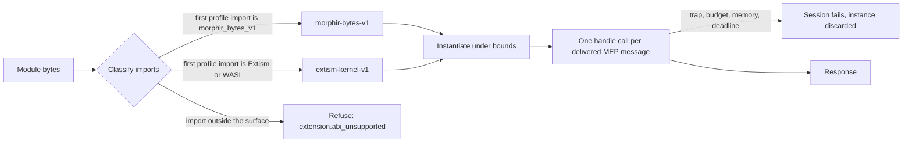

# WASM execution profiles

This document defines how a Morphir host runs an extension that is a WebAssembly module. It covers the two ABI profiles a module can have, how MEP messages cross the module boundary, what a guest may reach, how a host bounds and stops a guest, how failures are named, and the worker mode through which a runner qualifies a host.

The contract is `morphir/mep-wasm-execution-profiles`, version **`0.1.0-draft.1`**. [`wasm-execution-profiles.json`](wasm-execution-profiles.json) holds the same rules as data. When the two differ, the JSON file is correct and this document has a bug; `tools/check-wasm-host-kit.ts` fails when this document leaves out an import, a code, a bound, a policy value or a worker argument of the JSON. The contract adds no MEP method and no IR version. It records what the MoonBit worker host implements and what the published guests rely on, so that a second host has rules to implement and a guest built once runs the same way under each.

A profile is independent of the MEP version a session negotiates. A guest of either profile can speak MEP `0.1` or `0.2.0-draft.1`.

## From bytes to an answered request

Take the published Python extension. It is one `.wasm` file that imports Extism functions and exports `handle`. A host that has never seen Python runs it in four steps and can refuse it at each one.



1. **Classify.** The host reads the imports and exports and decides the profile. No guest code has run.
2. **Instantiate** under a memory ceiling.
3. **Call `handle`** once for each message the profile delivers, under a deadline and, where the engine can, an instruction budget.
4. **Stop.** The guest's instance ends, or a bound or trap ends the session and the host discards the instance.

## The two profiles

| | `morphir-bytes-v1` | `extism-kernel-v1` |
| --- | --- | --- |
| Status | `transitional` | `required` |
| Who builds it | Any language that emits core WASM (Gleam, MoonBit) | An Extism PDK (Rust, Python, the Morphir extension SDK), or any module that imports the kernel |
| Imports | Exactly three byte callbacks | Extism kernel and host functions, four Morphir functions, WASI preview 1 |
| Request reaches the guest | Guest pulls it one byte at a time | Extism input |
| Response leaves the guest | Guest pushes it one byte at a time | Extism output |
| `handle` result | Response length, or a code | 0 with output, or a failure |
| Notifications from the host | Every one is delivered | Delivered only after the guest advertises `call` delivery |
| Call deadline | 10 seconds | 30 seconds |
| Ambient authority | None | None beyond clocks and random bytes |

Every host runs a `required` profile. A host may run a `transitional` profile, and no new guest should target one. A host that does not run a module's profile refuses the module with `extension.abi_unsupported`, and the message names the profile.

`morphir-bytes-v1` was added when one host could run Extism modules only for Python on one platform and had no browser route. That host now runs Extism guests on native, Node and the browser through one shared kernel. Serving a byte per host call is also slow on a host whose callbacks cross a managed boundary: a 1 MiB message is more than two million calls. So the byte profile stays only until its three guests (the Gleam extension, the MoonBit portable guest and the Elm preview built from it) ship on Extism, and the next draft drops it.

An Extism guest needs no PDK. A module that imports five kernel functions, `input_length`, `input_load_u8`, `alloc`, `store_u8` and `output_set`, reads its request and writes its response a byte at a time, the way a byte-profile guest does, and any language that can import a function can do that.

## Classification

A host classifies a module before it instantiates it. The imports choose the profile:

1. The first import from a profile namespace decides the profile. `morphir_bytes_v1` makes the module `morphir-bytes-v1`; `extism:host/env`, `extism:host/user` or `wasi_snapshot_preview1` makes it `extism-kernel-v1`.
2. A module that imports from no profile namespace takes the declared profile.
3. A module that imports from no profile namespace, with no profile declared, is `extism-kernel-v1`. Only a host session can leave the profile undeclared: worker mode requires `--abi`, so this rule cannot be observed through a worker.

Every import must then be a function of the classified profile's import surface, with the surface's exact signature. The first that is not is refused with `extension.abi_unsupported`, and the message names it as `module.name`, for example `morphir_bytes_v1.input_len` in a module whose first import was `extism:host/env.input_length`. The module must export `handle` as `() -> i32`; a module that does not is refused with the same code and a message that says it does not export `handle` as `() -> i32`.

A descriptor, configuration entry or command argument may declare an ABI. The declaration only confirms: when it differs from the classified profile, the host refuses with `extension.abi_mismatch` and names both profiles. It never allows an import the classified profile excludes. A host that does not run `morphir-bytes-v1` still compares a byte-profile declaration with the classified profile.

A module that needs a WASM feature the engine lacks, or that has a shared, 64-bit or second memory, is refused with `extension.wasm_feature_unsupported`, naming the feature when the engine reports it.

## Messages

Over stdio, MEP frames each JSON-RPC message with a `Content-Length` header. A WASM guest has no stream. One `handle` call carries exactly one complete message as UTF-8 text with no header, and gives at most one response:

```json
{"jsonrpc": "2.0", "id": 1, "method": "morphir.initialize", "params": {"protocolVersion": "0.2.0-draft.1"}}
```

Messages are JSON values, not byte strings. A host may parse a message and write it again in either direction, so a guest must not depend on receiving the exact bytes the host was given, and nothing may depend on a response being forwarded byte for byte. A request or response that is not UTF-8 text holding one JSON object fails the session; the JSON text `42` is a failure.

The host session limits each frame. A request frame over the request byte limit is refused with `extension.request_limit` before the guest is called, and the session ends. A response over the response byte limit fails the session, and no part of it reaches the MEP session. The limits count the whole frame, its `Content-Length` header included. A side that reads a frame may check its body alone, which is smaller, so qualification cases stay far from the limits. The defaults are 6 MiB for a request and 16 MiB for a response.

## `morphir-bytes-v1`

The module imports nothing except these three functions. It does not import WASI, so it cannot read files, the environment, the clock or random numbers.

| Module | Name | Signature | Purpose |
| --- | --- | --- | --- |
| `morphir_bytes_v1` | `input_len` | `() -> i32` | Length of the current message in bytes |
| `morphir_bytes_v1` | `input_byte` | `(i32) -> i32` | The byte at an offset of the current message |
| `morphir_bytes_v1` | `output_byte` | `(i32) -> ()` | Append one byte to the response |

The host allocates nothing in guest memory. It holds the message, and the guest pulls and pushes bytes.

The host delivers every message, notifications included. The result of `handle` says what the guest did with it:

| Result | Meaning |
| --- | --- |
| Positive `n` | The guest pushed a response of `n` bytes |
| `0` | The guest pushed nothing and its instance ends. This holds for any message, not only `morphir.exit` |
| `-2` | The guest consumed a notification and has no response |
| `-1` | The guest failed; the session fails |

A `-2` result for a message that has an `id` is a failure: the host does not wait for a response the guest will not give. A result that does not match the bytes pushed, such as `0` after a pushed byte, is a failure too.

On this profile a refused memory growth fails the session with `memory-limit`, even when `handle` then returns normally.

## `extism-kernel-v1`

The module may import from three namespaces. Anything else is outside the surface.

### Kernel functions, `extism:host/env`

These are the 20 functions of the Extism kernel, with upstream names and signatures. A host satisfies them with a kernel module or an equivalent implementation; a guest may import any subset.

| Name | Signature | Name | Signature |
| --- | --- | --- | --- |
| `alloc` | `(i64) -> i64` | `input_set` | `(i64, i64) -> ()` |
| `free` | `(i64) -> ()` | `output_set` | `(i64, i64) -> ()` |
| `length_unsafe` | `(i64) -> i64` | `input_length` | `() -> i64` |
| `length` | `(i64) -> i64` | `input_offset` | `() -> i64` |
| `load_u8` | `(i64) -> i32` | `output_length` | `() -> i64` |
| `load_u64` | `(i64) -> i64` | `output_offset` | `() -> i64` |
| `input_load_u8` | `(i64) -> i32` | `reset` | `() -> ()` |
| `input_load_u64` | `(i64) -> i64` | `error_set` | `(i64) -> ()` |
| `store_u8` | `(i64, i32) -> ()` | `error_get` | `() -> i64` |
| `store_u64` | `(i64, i64) -> ()` | `memory_bytes` | `() -> i64` |

The kernel keeps its blocks in a memory of its own. That memory has its own 256 MiB ceiling, so an Extism session holds up to two ceilings of memory.

### Extism host functions, `extism:host/env`

An Extism PDK links these whether or not the guest uses them, so a host accepts the imports and bounds the calls. A text argument or result is a handle to a kernel block, and handle 0 means no block.

| Name | Signature | What the guest gets |
| --- | --- | --- |
| `config_get` | `(i64) -> i64` | Handle 0 for every key: there is no configuration |
| `var_get` | `(i64) -> i64` | The value from the session store, or handle 0 for a missing key |
| `var_set` | `(i64, i64) -> ()` | Stores the value in a store of at most 1 MiB, keys and values, that lives for the session. Value handle 0 deletes the key. A write over the limit stops the call with `failure` |
| `log_trace`, `log_debug`, `log_info`, `log_warn`, `log_error` | `(i64) -> ()` | The text is recorded as guest output. `trace` and `debug` messages are dropped |
| `get_log_level` | `() -> i32` | 2, which is `info`. The levels are trace 0, debug 1, info 2, warn 3 and error 4 |
| `http_request` | `(i64, i64) -> i64` | Nothing. The host records an output event with the method and the URL, then stops the call and fails the session with `failure`. No connection is made |
| `http_status_code`, `http_headers` | `() -> i32`, `() -> i64` | 0 and handle 0, since no request was made |

### Morphir host functions, `extism:host/user`

| Name | Signature | What the guest gets |
| --- | --- | --- |
| `morphir_get_workspace_info` | `() -> i64` | `{"root": <private empty directory>, "output_dir": ""}` |
| `morphir_cache_ir` | `(i64, i64) -> ()` | Stores the value in a session cache of at most 16 MiB, keys and values, and 1,024 entries. A write over either limit stops the call with `failure` |
| `morphir_get_cached_ir` | `(i64) -> i64` | The cached value within the same session, or the JSON text `null` for a missing key |
| `morphir_log` | `(i64, i64) -> ()` | Takes a level and a message, both text handles. The message is recorded as guest output whatever the level: `morphir_log` is not filtered |

Session stores and caches start empty and do not outlive the session.

### WASI preview 1, `wasi_snapshot_preview1`

A guest may import any WASI preview 1 function with its standard type. The sandbox gives it almost nothing, and no call can block:

| The guest calls | It gets |
| --- | --- |
| `args_sizes_get`, `environ_sizes_get` | Success, with a count and a size of 0 |
| `fd_read` on stdin, fd 0 | Success, with 0 bytes read |
| A function on an fd above 2, such as `fd_prestat_get` or `path_open` on fd 3 | Errno 8 (`badf`): there is no preopened directory |
| `clock_time_get`, `random_get` | Real values |
| `fd_write` to stdout or stderr | The text is recorded as guest output, never the MEP response |
| `proc_exit(0)` | The call ends successfully, with the output set before it |
| Any other function, `poll_oneoff` among them, or `path_open` on fd 0 | Errno 76 (`notcapable`). Nothing reaches the host system |

`proc_exit` with another code fails the session.

### Calls

The host keeps one instance for the session. For each request it sets the request as Extism input, calls `handle`, and reads the response from Extism output.

| Result | Meaning |
| --- | --- |
| `0` with output, no error set | The output is the response |
| `0` without output | For a request, a failure. For a delivered notification, the expected result |
| Not `0` | A failure, also when no error is set and the guest gave output |
| An error set | A failure, whatever `handle` returns |

### Notifications

An Extism guest says how it wants notifications delivered with the string member `capabilities.notificationDelivery` of its `morphir.initialize` result:

```json
{"jsonrpc": "2.0", "id": 1, "result": {"protocolVersion": "0.2.0-draft.1", "capabilities": {"notificationDelivery": "call"}}}
```

| Value | The host |
| --- | --- |
| `none`, or the member is absent | Delivers no notification. `morphir.initialized` is not delivered and `morphir.exit` ends the instance without a call. Every published bundle today is in this row |
| `call` | Delivers each notification as one `handle` call between requests. The call gives no output, and output fails the session. `morphir.exit` is delivered as one call, and then the instance ends |
| Any other value | Reads it as `none` |

The member is a string and not a flag because there is a third way to deliver. A guest runs one call at a time, so `call` cannot deliver `$/cancelRequest` for the request the guest is working on. A guest could instead ask the host for pending notifications while it works. That value, `poll`, is reserved. It needs a host function this draft does not define, so a host on this draft reads it as `none`.

MEP `0.2.0-draft.1` reads the member as an extra capability member. The MEP draft that follows names it in the handshake model.

## Policy values

The host functions and WASI above, as the JSON's `policy` object states them. Each row is one leaf.

| Key | Value |
| --- | --- |
| `config.missing` | `handle-0` |
| `var.storeBytes` | `1048576` |
| `var.missing` | `handle-0` |
| `var.zeroValueDeletes` | `true` |
| `var.overLimit` | `failure` |
| `var.lifetime` | `session` |
| `irCache.bytes` | `16777216` |
| `irCache.entries` | `1024` |
| `irCache.missing` | `null` |
| `irCache.overLimit` | `failure` |
| `irCache.lifetime` | `session` |
| `logging.getLogLevel` | `2` |
| `logging.levels` | `trace`, `debug`, `info`, `warn`, `error`, in code order from 0 |
| `logging.dropped` | `trace`, `debug` |
| `logging.recorded` | `guest-output` |
| `logging.morphirLog` | `unfiltered` |
| `http.request` | `stops-call-fails-session` |
| `http.recorded` | `method`, `url` |
| `http.statusCodeWithoutRequest` | `0` |
| `http.headersWithoutRequest` | `handle-0` |
| `workspaceInfo.root` | `private-empty-directory` |
| `workspaceInfo.output_dir` | `""` |
| `wasi.preopens` | `0` |
| `wasi.arguments` | `0` |
| `wasi.environment` | `0` |
| `wasi.stdin` | `empty` |
| `wasi.clocks` | `available` |
| `wasi.random` | `available` |
| `wasi.stdout` | `guest-output` |
| `wasi.stderr` | `guest-output` |
| `wasi.fdAboveTwoErrno` | `8` |
| `wasi.unsupportedErrno` | `76` |
| `wasi.procExitZero` | `call-succeeds` |

## Bounds

| Bound | Value | When it is reached |
| --- | --- | --- |
| Memory ceiling | 256 MiB for each linear memory, including a memory that declares no maximum or a larger one. The Extism kernel's memory has its own ceiling of 256 MiB | Growth is not granted. The memory rules below say when that fails the session |
| Call deadline | 30 seconds for `extism-kernel-v1`, 10 seconds for `morphir-bytes-v1`, inside any session deadline | The host stops the guest, discards the instance and ends the session with outcome `deadline`. Time in host functions counts |
| Instruction budget | 5,000,000,000 units per call on MEP `0.2.0-draft.1`; 1,000,000,000 on MEP `0.1` and for a `probe` | The session fails with `budget-exhausted` |

The budget unit is engine-defined. The same number is not the same amount of work under two engines, so the budget guards against a busy loop and is not a portable measure of cost. A host whose engine does not meter applies no budget and says so. A host reports which bounds it enforces and the engine that enforces them, and cannot qualify without the memory ceiling and the call deadline.

The memory rules:

- A call that fails while the guest's memory is at the ceiling is `memory-limit`.
- A host that observes refused growth reports `memory-limit` for any failing call in which growth was refused. Another host reports the guest's own failure, usually `trap`. The MoonBit host observes it: its engine flags every refused growth.
- An `extism-kernel-v1` guest that has a growth refused and still answers has succeeded.
- On `morphir-bytes-v1` a refused growth fails the session with `memory-limit`, also when `handle` returns.
- A module whose initial memory is above the ceiling fails with `memory-limit` before any request. This is a fault, not a refusal: a worker reports no `started` event and exits with 1.

## Failures

A refusal happens before any request, and the module is never instantiated. A fault ends a session that was running. After any fault the host does not call that instance again; a later request uses a new instance and a new session with empty session state.

| Refusal code | When |
| --- | --- |
| `extension.abi_unsupported` | An import is outside the classified profile's surface or has another signature, `handle` is missing or has another type, or the host does not run the classified profile |
| `extension.abi_mismatch` | A declared ABI differs from the classified profile |
| `extension.wasm_feature_unsupported` | The module needs a WASM feature the engine lacks, or has a shared, 64-bit or second memory |
| `extension.worker_runtime_mismatch` | Worker mode only: `--build-identity` is not the worker's own |

A worker reports a fault by its kind. The host session that reads the report turns the kind into the code or outcome of the session:

| Fault kind | Host session code or outcome | When |
| --- | --- | --- |
| `trap` | `extension.guest_trap` | The guest trapped for a reason that is not a bound |
| `memory-limit` | `extension.memory_limit` | A memory rule applies |
| `budget-exhausted` | `extension.budget_exhausted` | The guest ran past its per-call instruction budget on a metering engine |
| `call-deadline` | outcome `deadline` | The call did not return before its deadline |
| `failure` | `extension.incomplete_session` | Any other end the guest caused: `-1`, a misused `-2` or a `0` with output on the byte profile; an Extism error, a non-zero result or no output for a request; output for a notification; a message that is not UTF-8 text holding one JSON object; a request or response frame over its limit; a host function that stops the call; `proc_exit` with a code that is not 0 |

## The host session

Some rules belong to the host session that drives the guest, in process or through a worker, and not to the worker:

- A request frame over the request byte limit is refused with `extension.request_limit` before the guest is called, and the session ends. The diagnostic names the limit and the frame's size.
- A response over the response byte limit fails the session with `extension.incomplete_session`, since a worker reports it as `failure`. No part of it reaches the MEP session.
- The host session checks the JSON-RPC version of each response and that its id answers the request, and fails the session with `extension.unexpected_response` otherwise.
- A host states in its runtime report which profiles it runs.

## Worker mode

A runner qualifies a host through `<host> extension worker`. stdout carries only Content-Length framed responses; a notification gets no frame. stderr carries the report, with `--json` one `morphir/command-event` line per event.

| Argument | Required | Default |
| --- | --- | --- |
| `--abi` | Yes | The declared profile |
| `--module` | Yes | The path of the module |
| `--build-identity` | Yes | The host's build identity, 64 hexadecimal digits |
| `--request-bytes` | No | 6291456 (6 MiB) |
| `--response-bytes` | No | 16777216 (16 MiB) |
| `--call-ms` | No | 30000 for `extism-kernel-v1`, 10000 for `morphir-bytes-v1` |
| `--instructions` | No | 5,000,000,000 |
| `--memory-pages` | No | 4096, the 256 MiB ceiling |
| `--json` | No | A flag: write the report as JSON lines |
| `--help` | No | A flag: write the help to stdout and serve nothing |

Without `--abi`, `--module` or `--build-identity` the worker serves nothing and exits with 2. A worker started with another build identity refuses with `extension.worker_runtime_mismatch` and exits with 3. `--help --json` writes one `morphir/command-result` whose `result.buildIdentity` is the identity to pass.

| Event | Members |
| --- | --- |
| `started` | `abi`, `moduleSha256`, `buildIdentity`, `bounds` |
| `output` | `output`, a guest output as text; or the count of dropped output, with `droppedBytes` |
| `fault` | `fault.kind` and, optionally, `fault.message`. Nothing else |
| `refused` | `error.code`, a refusal code; `error.message` |
| `exited` | `exitCode` |

`started` is emitted only after the module has loaded. A refusal comes instead of it, never after it, and a fault before it is a load fault, such as an initial memory above the ceiling. `started.bounds` has exactly the members `memoryCeiling`, `instructionBudget` and `callDeadline`. Each is `{"enforced": true}`, or `{"enforced": false, "reason": r}` with `r` one of `no-memory-ceiling`, `no-instruction-metering` and `no-call-interruption`.

The `extension.*` fault codes and the outcome `deadline` exist only in the host session's outcome. A worker's fault has a kind and a message and no code.

The worker checks that each request and response is UTF-8 text holding one JSON object, and reports anything else as `failure`. It does not check the JSON-RPC version or ids; those are host-session checks. A request frame over `--request-bytes` is `failure` and the guest is not called. A response over `--response-bytes` is `failure` and nothing of it reaches stdout. Either way the worker exits with 1.

| Exit status | Meaning |
| --- | --- |
| 0 | The guest served until its instance ended |
| 1 | A fault, an invalid frame, or stdin ended first |
| 2 | Invalid arguments |
| 3 | A refusal before any request |

## Known deviations

| Host | Observed at | Difference | Tracking |
| --- | --- | --- | --- |
| finos/morphir-rust `morphir-host-native` | `extension/rust/v0.4.0-2` | Declares `morphir_get_workspace_info` as `(i64) -> i64`. The contract, the Rust extension SDK and the MoonBit host use `() -> i64` | [finos/morphir-rust#330](https://github.com/finos/morphir-rust/issues/330) |

## Sources

Each rule was read from these places, and the import tables were compared entry by entry:

- finos/morphir-moonbit at `89f8924`: `pkgs/morphir-host/worker/wasm/profile.mbt` (classifier and import surfaces), `wasm/guest/bytes.mbt` and `wasm/guest/extism.mbt` (the adapters and host functions), `wasm/guest/guest.mbt` and `limits.mbt` (call bounds and byte limits), `wasm/native/worker_mode.mbt` and `wasm/guest/report.mbt` (worker arguments, events and exit status), `bounds.mbt` (`started.bounds`), `session.mbt` and `README.mbt.md` (host-session codes).
- moonrockz/extism at `v0.3.0`, the version morphir-moonbit pins: `pkgs/extism/kernel/kernel.mbt` (the 20 kernel functions and their types), `pkgs/extism/plugin.mbt` (call results, `config_get`, `var_*`, logging, HTTP), `pkgs/extism/policy.mbt` (log level codes, the kernel memory ceiling) and `pkgs/extism/wasi/sandbox.mbt` (WASI answers and errnos).
- finos/morphir-rust at `extension/rust/v0.4.0-2`: `crates/morphir-extension-sdk/src/host.rs` (Morphir host function declarations).

The notification rule for Extism guests is new in this draft. The MoonBit host at `89f8924` delivers no notification to an Extism guest, also one that advertises `call`.

## Qualification

[`mck/wasm-host.cases.json`](mck/wasm-host.cases.json) holds crafted modules that each do one wrong or unusual thing, with expected observations written from this contract. See [the MCK cases](mck/README.md).
